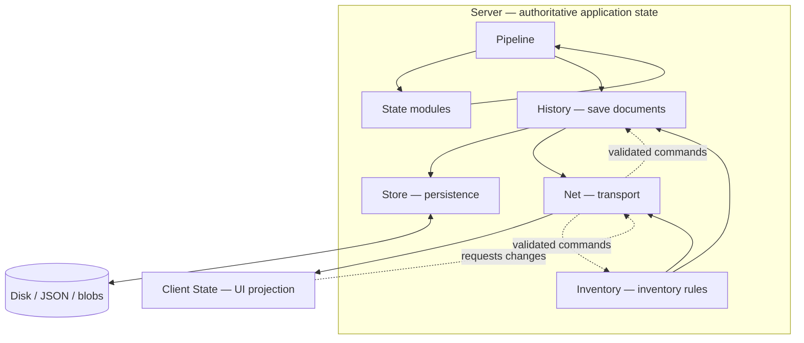

# Rareload 5.5 --- State Ownership, Deduplication, Efficiency, Security & Bug-Fix Plan

## 1. Purpose

Rareload 5.5 is a focused architectural, efficiency, deduplication, security-hardening, and bug-fix release across all 45 Lua files (`14,792` LOC). It does **not** remove any existing feature, setting, command, UI panel, or safety check.

The release focuses on eight interconnected goals:

1.  **Clear state ownership (Phases 0–3):** the server, storage layer, history system, inventory features, and client cache must have single, non-overlapping ownership.
2.  **Boundary-focused validation (Phase 4):** validate untrusted data at system boundaries (`sh_net`, `sv_storage`, `sv_share`, `sv_commands`, addon `pcall` adapters), then rely on established internal contracts instead of repeatedly checking the same invariants.
3.  **Eliminate hardcoding & centralize schemas (Phase 6):** replace verbose imperative setting/privilege declarations (`sh_config.lua`, `sh_perms.lua`), duplicated palettes/fonts (`cl_menu.lua` vs `cl_ui.lua`), and scattered domain arrays (`COMPONENTS`, `WORLD_KINDS`, `PLAYER_STATES`, `RELOAD_MODES`, setting `unit` suffixes) with single-source declarative tables.
4.  **Eliminate code duplication (Phase 7):** unify duplicated Derma controls (`cl_menu.lua` vs `cl_ui.lua`), popup menus (`UI.Menu`), split button rows (`UI.SplitRow`), snapshot mutators (`sv_history.lua`), command argument guards (`sv_commands.lua`), and vehicle/weapon adapter helpers.
5.  **GLua & LuaJIT 2.1 runtime efficiency (Phase 8):** eliminate per-frame table/closure/`Color`/`Matrix`/`Vector` allocations in `Paint` and 3D render hooks, cache `UI.Rows` and `UI.Stats` display lists on state change instead of rebuilding them every frame, replace expensive `util.TableToJSON` deep-copy/equality hacks with `Util.Equal` and structural copy-on-write, and use $O(1)$ lookup maps (`World.byKey`).
6.  **Reduce code length by ~1,300+ lines with zero feature loss (Phases 9–10):** shrink the codebase from `14,792` LOC to `~13,490` LOC purely through declarative schemas, shared helpers, and deduplication—backed by `SysTime()` / GC measurements and the regression suite (Phase 5).
7.  **Security, privilege & untrusted-input hardening — gated by live `gmod-debug-mcp` reproduction (Phase 11):** test all 7 candidate security and validation vectors (`S-01`..`S-07`) in the live running game via `/Users/noah/gmod-debug-mcp` (`run_tests`, `run_lua`, `net_watch`, `diff`) first; **only fix findings that actually reproduce in-game**, and drop any finding that GMod's engine or existing boundaries already block so we never add dead defensive bloat.
8.  **Runtime bug, memory-corruption & edge-case fixes — gated by live `gmod-debug-mcp` reproduction (Phase 12):** test all 12 candidate runtime bugs (`B-01`..`B-12`) in the running game via `/Users/noah/gmod-debug-mcp` (`run_tests`, `diff`, `trace`, `ui`, `game`, `bots`) before touching code; **if a bug cannot be reproduced in-game, do not "fix" it**.

### Core principles

-   Every piece of authoritative state, domain constant, and UI widget has exactly one owner and one definition.
-   Other systems may persist, transport, cache, or project that state,
    but must not become competing authorities.
-   Persistent mutations go through explicit APIs owned by the relevant
    subsystem.
-   Validate data when it crosses a trust boundary.
-   Internal functions may rely on documented contracts once those
    boundaries have been crossed.
-   Keep defensive checks that protect against real runtime uncertainty,
    engine behavior, asynchronous execution, or third-party addons.
-   **No Reproduction = No Fix:** static analysis candidates (`S-01`..`S-07`, `B-01`..`B-12`) are **hypotheses until proven in a running Garry's Mod session** via `gmod-debug-mcp` (`/Users/noah/gmod-debug-mcp`). Most theoretical bugs cannot happen in-game or are already prevented by engine/caller behavior, and "fixing" unreproducible bugs adds dead code for nothing. Every candidate must have a failing `dbg.test` reproduction before a fix is written.
-   Never allocate temporary tables, closures, or `Color`/`Vector`/`Matrix` objects inside per-frame `Paint` or render hooks when a cached or file-local value suffices.
-   Prefer simplifying existing architecture and declarative tables over introducing heavy abstractions.

------------------------------------------------------------------------

## 2. Target Architecture and Ownership

### 2.1 Ownership model

  -----------------------------------------------------------------------
  Subsystem               Owns                    Must not own
  ----------------------- ----------------------- -----------------------
  `History`               Save documents,         File I/O, client UI
                          entries, active save,   state, restore
                          timeline metadata,      execution
                          save-level mutations    

  `Store`                 Disk persistence, JSON  Save semantics,
                          encoding/decoding,      active-save decisions,
                          storage cache,          inventory rules
                          dirty-write queue,      
                          blobs, persistent       
                          player data             

  `Pipeline`              Save/restore execution, Persistent save
                          module ordering,        documents or
                          execution context,      independent copies of
                          restore lifecycle       saved state

  State modules           Capture and restore     Independent copies of
                          their own domain data   the complete save
                                                  document

  `Inventory`             Inventory-specific      A second source of
                          normalization, rules,   truth for per-save
                          operations, and         inventory data
                          inventory version       
                          semantics               

  `Net`                   Transport, request      Application state and
                          decoding, boundary      save semantics
                          validation,             
                          permissions, rate       
                          limiting                

  Client `State`          Client-side             Authoritative game
                          projection/cache of     state or persistent
                          server-provided data    save state
                          for UI                  

  UI panels               Temporary presentation  Independent
                          state and derived       authoritative copies of
                          display values          server data
  -----------------------------------------------------------------------

### 2.2 Data flow



### 2.3 Ownership rules

1.  `History` is the authority for the logical contents and lifecycle of
    save documents.
2.  `Store` is the authority for persistence mechanics and
    storage-related caches.
3.  `Pipeline` coordinates execution but does not become another owner
    of saved data.
4.  State modules own domain-specific capture and restore behavior, not
    copies of the save document.
5.  `Inventory` owns inventory semantics. Per-save inventory data
    remains part of the corresponding History entry; global inventory
    remains a distinct target.
6.  `Net` transports commands and projections. It does not decide
    application state.
7.  Client `State` is disposable. It can be rebuilt from server pushes
    and must never be treated as authoritative.
8.  UI panels should derive their views from client `State` rather than
    maintaining independent copies of the same server data.

------------------------------------------------------------------------

## 3. Phase 0 --- Baseline and State Audit

**Goal:** understand the existing ownership and mutation paths before
changing implementation.

Do not refactor during this phase.

### 3.1 Establish a baseline

-   Record the current branch, commit, and test results.
-   Run the existing lint, type/static checks, unit tests, and
    integration/e2e tests.
-   Record known failures separately from regressions introduced by 5.5.
-   Identify the existing save-format/schema version and compatibility
    expectations.

### 3.2 Inventory authoritative state

Find every persistent or semi-persistent state structure and document:

-   State name and shape.
-   Current location.
-   Intended authoritative owner.
-   Read paths.
-   Mutation paths.
-   Persistence mechanism.
-   Client synchronization mechanism, if applicable.
-   Whether it is authoritative, cached, derived, or temporary.
-   Whether multiple systems can mutate it directly.

Initial areas to inspect:

  ---------------------------------------------------------------------------
  State                   Known/current location to   Intended authority
                          inspect                     
  ----------------------- --------------------------- -----------------------
  Save entries            `History.Doc()` and         `History`
                          `d.entries`                 

  Active save ID          `d.activeId`                `History`

  Save metadata           History document entries    `History`

  World snapshot blobs    Blob references in entry    `History` owns
                          data                        references; `Store`
                                                      owns blob persistence

  Global inventory        `Store.PData()` and         `Inventory` owns
                          inventory functions         semantics; Store
                                                      persists

  Per-save inventory      `entry.data` and            `History` owns
                          `entry.inventoryVersions`   document; `Inventory`
                                                      owns inventory
                                                      operations

  Storage cache           Store-local cache           `Store`

  Pending writes          Store dirty queue           `Store`

  Client timeline         `RARELOAD.State.history`    Server History is
                                                      authoritative; client
                                                      is a replica

  Client object details   `RARELOAD.State.details`    Server is
                                                      authoritative; client
                                                      cache is disposable

  Restore context         Pipeline context            `Pipeline`

  Module execution data   `ctx.shared` and related    `Pipeline` execution
                          context fields              context
  ---------------------------------------------------------------------------

Treat this table as a starting point, not a complete inventory. Verify
all entries against the current source.

### 3.3 Find all mutation paths

Search for and classify:

-   `Store.Save`, `Store.Delete`, `Store.PData`, `Store.BlobPut`, and
    `Store.BlobGet`.
-   Direct mutations of History documents and entries.
-   Direct writes to `entry.data` and `entry.inventoryVersions`.
-   Direct writes to global inventory data.
-   Mutations of `RARELOAD.State` on the client.
-   UI-local caches that duplicate server-provided state.
-   Network handlers that mutate persistent state.
-   Import, export, rollback, undo, cleanup, and autosave paths.

For every persistent structure, identify all writers. Each should have
one documented mutation API.

### 3.4 Deliverables

Create:

-   `docs/architecture/STATE_OWNERSHIP.md`
-   `docs/architecture/VALIDATION_BOUNDARIES.md`

The ownership document must identify one authoritative owner for every
persistent state structure. The validation document must record the
intended validation boundary for each important data flow.

**Exit criteria:**

-   Baseline test results are recorded.
-   All important persistent state structures are inventoried.
-   All direct mutation paths are identified.
-   No implementation changes have been made yet.

------------------------------------------------------------------------

## 4. Phase 1 --- Centralize History Mutations

**Goal:** make `History` the single owner of save-document semantics and
mutations.

### 4.1 Standardize the History API

Use the existing History API as the foundation rather than introducing a
new repository or document-management layer.

Relevant operations include:

  -----------------------------------------------------------------------
  Operation                           Responsibility
  ----------------------------------- -----------------------------------
  `History.Doc()`                     Resolve/load the player's save
                                      document

  `History.Get()`                     Read a save entry

  `History.Active()`                  Read the active entry

  `History.Append()`                  Add a save entry and update
                                      timeline state

  `History.Update()`                  Mutate an existing entry through a
                                      controlled callback

  `History.Delete()`                  Delete an entry

  `History.Activate()`                Change the active save
  -----------------------------------------------------------------------

Verify the exact public API and behavior in the target branch before
changing it.

### 4.2 Route mutations through History

Audit and update all features that modify save documents, including:

-   Pinning and notes.
-   Active-save changes.
-   Quick-save metadata.
-   Inventory editing and rollback.
-   Object editing, deletion, flags, and names.
-   Import operations.
-   Undo operations.
-   Save append and retention cleanup.
-   Any administrative or console command that modifies an entry.

Existing specialized operations may remain when they provide meaningful
domain behavior, but they should use History-owned mutation paths
internally.

### 4.3 Restrict mutable document access

-   Avoid exposing mutable document references to unrelated systems when
    they only need read access.
-   Keep mutation callbacks narrow and explicit.
-   Do not add defensive copies everywhere by default; copying large
    save documents can be expensive.
-   Use copies where isolation is required, especially when editing
    immutable/shared blob content.
-   Document which APIs return read-only-by-contract data and which
    permit mutation.

### 4.4 Preserve timeline invariants

Verify that:

-   Entry IDs remain unique within a document.
-   `activeId` references an existing entry or is nil.
-   `quickId`, if present, references an existing entry or follows a
    documented fallback policy.
-   Pinned entries follow the existing retention rules.
-   Deleting or trimming entries updates references correctly.
-   A failed mutation does not leave partially updated in-memory state.

### 4.5 Inventory ownership

Keep global and per-save inventory targets distinct:

``` text
Global inventory
    -> Inventory operations
    -> Store.PData persistence
    -> global inventory versions

Per-save inventory
    -> Inventory operations
    -> History entry
       -> entry.data.weapons
       -> entry.data.activeWeapon
       -> entry.data.ammo
       -> entry.data.weaponState
       -> entry.inventoryVersions
```

Rules:

-   `Inventory.Read()` and `Inventory.Write()` (or their deliberately
    chosen replacements) are the inventory-specific access paths.
-   Other systems should not manipulate inventory fields directly.
-   `History` remains the authority for the containing save document.
-   `Inventory` remains the authority for inventory normalization,
    validation, versioning, and operations.
-   Document how global inventory interacts with saved inventory modules
    and spawn restoration.
-   Avoid storing the same inventory in multiple places unless each copy
    has a distinct, documented purpose.

**Exit criteria:**

-   Existing save mutations use History-owned operations.
-   No unrelated subsystem directly edits save documents.
-   Global and per-save inventory ownership is documented.
-   Timeline invariants are covered by tests.
-   Existing save data remains compatible.

------------------------------------------------------------------------

## 5. Phase 2 --- Clarify Store and Persistence Ownership

**Goal:** make `Store` a persistence subsystem, not a second
application-state manager.

### 5.1 Define Store responsibilities

`Store` should own:

-   File paths and directory management.
-   JSON serialization and decoding.
-   Disk reads and writes.
-   In-memory storage cache.
-   Dirty-write queue and flush scheduling.
-   Backup and corrupt-file recovery.
-   Blob persistence and retrieval.
-   Blob garbage collection.
-   Persistent player data storage.

`Store` should not own:

-   Save entry semantics.
-   Active-save selection.
-   Timeline retention rules.
-   Inventory rules.
-   Restore decisions.
-   Client UI state.

### 5.2 Audit cache and dirty-write semantics

Verify:

-   Cache entries represent the latest accepted in-memory document.
-   Dirty entries represent data awaiting disk persistence.
-   Flush failures remain observable and recoverable.
-   Cache invalidation cannot discard pending writes accidentally.
-   `fresh` reads have clearly defined behavior.
-   Deletion clears all relevant cache, dirty, encoded, and read-only
    bookkeeping.
-   Shutdown and map transitions flush pending writes safely.

Do not mistake a successful queue operation for a durable disk write.

### 5.3 Clarify persistence guarantees

Document the distinction between:

1.  **Mutation accepted:** the application state has been updated and
    the Store accepted it.
2.  **Write queued:** persistence is pending.
3.  **Write completed:** the disk operation succeeded.
4.  **Write failed:** the failure is reported and the system has a
    defined recovery behavior.

Review the current History refresh/push sequence. In particular,
determine whether client synchronization happens before or after
persistence has been accepted, and what happens if `Store.Save()` fails.

Do not blindly move synchronization: first define whether the UI
represents the latest in-memory authoritative state or only successfully
persisted state. Then make the behavior consistent.

### 5.4 Blob ownership and immutability

-   Keep heavy snapshots in blobs where this provides real storage
    benefits.
-   Treat stored blobs as immutable.
-   Editing a snapshot creates a new blob and updates the owning History
    entry's reference.
-   Ensure garbage collection only removes blobs that are genuinely
    unreferenced.
-   Verify that queued writes and cache state are considered correctly
    during garbage collection.
-   Avoid creating additional blob indexes or caches unless measurements
    demonstrate a need.

**Exit criteria:**

-   Store has a documented persistence contract.
-   Cache and dirty-write behavior is understood and tested.
-   Failed writes are observable.
-   Blob references and garbage collection are safe.
-   Store contains no save-history or inventory business rules.

------------------------------------------------------------------------

## 6. Phase 3 --- Make Client State a Single Projection

**Goal:** keep one client-side UI-facing replica of server state and
remove unnecessary duplicated caches.

### 6.1 Establish the client state contract

Keep `cl_state.lua` as the central UI-facing state store.

The client state is:

-   A projection of server-owned data.
-   Rebuildable after reconnect.
-   Safe to invalidate and repopulate.
-   Not a source of truth for saved data.

### 6.2 Audit client consumers

Inspect:

-   History/timeline panels.
-   Object browser and object details.
-   Inventory window.
-   Save feeds and player previews.
-   Antistuck and blocked-state displays.
-   Any other panel caching data received through state topics.

For each consumer:

-   Identify what it reads from `RARELOAD.State`.
-   Identify any duplicate local copy.
-   Determine whether local state is genuinely presentation-specific or
    duplicates server data.
-   Remove redundant copies where practical.
-   Keep temporary UI state such as selection, search text, expanded
    rows, and active tabs local to the component.

### 6.3 Standardize synchronization

-   Keep server pushes as the source of authoritative UI data.
-   Use the existing state-change hook consistently.
-   Define replacement versus merge behavior for each state topic.
-   Invalidate object details when their corresponding save or object
    changes.
-   Ensure stale asynchronous responses cannot overwrite newer state.
-   Ensure reconnecting clients can request or receive a complete
    initial projection.
-   Avoid sending large data structures when a lightweight projection is
    sufficient.

### 6.4 Do not over-engineer client state

Do not introduce a new state-management framework or a universal event
bus. Use the existing state module and hooks unless a concrete
limitation is demonstrated.

**Exit criteria:**

-   Client panels do not independently cache authoritative server data.
-   Temporary presentation state remains local.
-   Reconnect and stale-response behavior is tested.
-   State updates have documented merge/replacement semantics.

------------------------------------------------------------------------

## 7. Phase 4 --- Simplify Defensive Programming

**Goal:** remove redundant internal validation without weakening
security or runtime reliability.

### 7.1 Validation policy

> Validate when data crosses a trust boundary. Once validated, internal
> functions may rely on the established contract.

### 7.2 Validation boundary matrix

  -----------------------------------------------------------------------
  Boundary                Validation policy       Examples
  ----------------------- ----------------------- -----------------------
  Client to server        Strict                  Network payload shape,
                                                  permissions, rate
                                                  limits

  JSON/file to            Strict                  Document structure,
  application                                     schema version,
                                                  corrupted data

  Import to application   Strict                  Save format, inventory
                                                  content, entity
                                                  definitions

  External addon to       Strict                  Adapter return values,
  Rareload                                        entity references

  Public API to internal  Contract-level          Player validity, save
  subsystem                                       existence, operation
                                                  permissions

  Pipeline to trusted     Contract-based          Established execution
  module                                          context and module
                                                  contract

  Internal helper to      Minimal                 Do not repeat
  internal helper                                 established invariants
  -----------------------------------------------------------------------

### 7.3 Classify every defensive check

For each check, assign one category:

  -----------------------------------------------------------------------
  Category                            Action
  ----------------------------------- -----------------------------------
  Security boundary                   Keep

  Untrusted input validation          Keep

  Engine/runtime uncertainty          Keep

  Third-party compatibility           Keep

  Asynchronous lifetime protection    Keep

  Duplicate internal invariant        Remove or centralize

  Redundant type/nil guard on trusted Remove when contract is clear
  data                                

  Unclear purpose                     Investigate before changing
  -----------------------------------------------------------------------

### 7.4 Preserve meaningful runtime checks

Do not remove checks that protect against:

-   Invalid or removed entities.
-   Players disconnecting or changing state.
-   Delayed callbacks running after a restore was superseded.
-   Entity creation failures.
-   Missing weapon classes, vehicle bases, or third-party addons.
-   File read/write and JSON failures.
-   Permission changes and unauthorized requests.
-   Older saves with optional or missing module data.
-   Engine hooks returning unexpected values.
-   External adapter failures.

These are real runtime uncertainties, not redundant validation.

### 7.5 Example: trusted internal data

Before:

``` lua
local function applyInventory(ply, inventory)
    if not istable(inventory) then return false end
    if not istable(inventory.weapons) then return false end

    for _, class in ipairs(inventory.weapons) do
        if not isstring(class) then return false end
        if not weapons.GetStored(class) then continue end

        ply:Give(class)
    end
end
```

If every caller is required to pass an inventory returned by
`Inventory.Clean()`, repeated shape validation is unnecessary.

After:

``` lua
-- Expects an inventory returned by Inventory.Clean().
local function applyInventory(ply, inventory)
    for _, class in ipairs(inventory.weapons) do
        if weapons.GetStored(class) then
            ply:Give(class)
        end
    end
end
```

The weapon existence check remains because the runtime environment may
have changed since the inventory was created.

### 7.6 Avoid global mechanical cleanup

Do not globally remove or rewrite:

-   `IsValid`
-   `istable`
-   `isstring`
-   `isnumber`
-   `pcall` / `xpcall`
-   nil checks
-   fallback values

Each occurrence must be evaluated in context. A check is redundant only
when the relevant invariant is already guaranteed by a clear and
enforced contract.

**Exit criteria:**

-   Boundary validation remains strict.
-   Internal redundant checks are reduced.
-   Runtime and compatibility protections remain.
-   Every removed check has a clear reason.
-   Tests cover malformed external data and valid internal data.

------------------------------------------------------------------------

## 8. Phase 5 --- Regression Testing and Final Audit

**Goal:** demonstrate that the simpler architecture preserves existing
behavior.

### 8.1 Required regression scenarios

  Scenario                    Expected result
  --------------------------- --------------------------------------------------
  Normal save                 Correct entry created and activated
  Partial save                Untouched modules retain their data
  Undo                        Previous state restored
  Quick-save / quick-load     Correct save selected
  Inventory edit              Correct target modified
  Inventory rollback          Previous version restored
  Object edit                 Correct blob replaced
  Object deletion             Constraints remain consistent
  History deletion            Active and quick references remain valid
  History retention           Pinned and active entries follow retention rules
  Corrupt JSON                Backup recovery works
  Failed disk write           Failure is observable and recoverable
  Server restart              Saves and blobs load correctly
  Client reconnect            UI state is rebuilt from server
  Stale object detail         Old responses cannot overwrite current state
  Missing addon               Restore skips unsupported content safely
  Interrupted restore         Stale callbacks cannot modify a newer restore
  Malformed network payload   Request is rejected safely
  Malformed import            Invalid data is rejected before mutation

### 8.2 Run tests after every phase

After each phase:

-   Run lint.
-   Run static/type checks where applicable.
-   Run unit tests.
-   Run integration/e2e tests.
-   Compare against the Phase 0 baseline.
-   Investigate regressions before continuing.

Do not defer all testing until the end.

### 8.3 Final ownership audit

Repeat the Phase 0 searches.

Verify:

-   Every persistent state structure still has one authoritative owner.
-   All persistent mutations follow the intended APIs.
-   No new duplicate cache or shadow state was introduced.
-   Store remains focused on persistence.
-   Client State remains a disposable projection.
-   No important safety check was removed without justification.

**Exit criteria:**

-   Existing save formats remain compatible.
-   All required regression scenarios pass.
-   No unexplained test regressions remain.
-   Ownership and validation documentation matches the implementation.

------------------------------------------------------------------------

## 9. Phase 6 --- Eliminate Hardcoding & Centralize Shared Schemas

**Goal:** eliminate hardcoded magic strings, repeated setting/privilege metadata, and scattered domain lists across all 45 Lua files by consolidating them into shared, data-driven registries—shrinking code length while preserving 100% of features, settings, commands, and safety checks.

### 9.0 Baseline Codebase Reality Check (Measured 2026-11, 5.4 Branch — 45 Files, 14,792 LOC)

Before modifying any subsystem, distinguish what is **already well-optimized** (and must not be broken) from where hardcoding, duplication, and per-frame allocations actually concentrate:

| Already Good (Keep Intact) | Evidence in 5.4 Codebase |
| :--- | :--- |
| `player.Iterator()` and `ents.Iterator()` used instead of `player.GetAll()` / `ents.GetAll()` | `sv_ownership.lua:54,112`, `sv_autosave.lua:71`, `sv_log.lua:195`, `modules/world.lua:65,283`, `cl_tracking.lua:115,131` |
| Static `Material()` and base `Color()` constants hoisted to file scope | `cl_highlight.lua:13-14`, `cl_toolscreen.lua:8`, `cl_ui.lua:27-48` |
| Explicit bit-sized `net.WriteUInt` / `net.WriteData` instead of `net.WriteTable` | `sh_net.lua:138-145`, `sh_net.lua:288-290` |
| Paced, chunked, ACK-tracked network transfers and dirty-driven autosave | `sh_net.lua:121-153`, `sv_autosave.lua:69-85` |
| Entity table direct lookup (`ent:GetTable()`) in hot ownership scan | `sv_ownership.lua:90` (avoids `__index` C++ metatable hop) |
| `glualint` with `lint_unusedVars: true` passes in CI | `.glualint.json` |

### 9.1 Compact Declarative Schema for `sh_config.lua` (Saves ~290 LOC)

Currently, `lua/rareload/shared/sh_config.lua:88-503` (415 lines) registers 50 settings using verbose 8–12 line `RARELOAD.Setting("...", { ... })` blocks that repeat `scope = "player"`, `category = "world"`, `type = "bool"`, `default = true`, and `priv = ...` dozens of times. Furthermore, unit suffixes (`"s"`, `"°"`) are hardcoded separately in `lua/rareload/client/cl_menu.lua:47` (`SUFFIXES`) and `lua/rareload/client/cl_toolscreen.lua:17` (`FEATURES`) instead of living on the setting definition itself.

**Action:**
1. Extend `RARELOAD.Setting` with a batch group helper `group(scope, category, list)` and add an optional `unit` field (`"s"`, `"°"`) to `RARELOAD.Settings[key]`.
2. Express each category (`general`, `player`, `inventory`, `world`, `vehicles`, `scene`, `World Display`, `Anti-Stuck`, `PvP`, `Logging`) as a compact declarative table where `scope` and `category` are inherited from the group header:

```lua
-- Before (415 lines across 50 expanded calls in sh_config.lua:88-503):
RARELOAD.Setting("autoSaveInterval", {
    type = "float",
    default = 60,
    min = 5,
    max = 900,
    decimals = 0,
    scope = "player",
    category = "general",
    help = "Seconds between automatic saves when your state has changed",
})

-- After (~115 lines total for all 50 settings, producing the exact same RARELOAD.Settings entries):
local function group(scope, category, list)
    for _, s in ipairs(list) do
        s.scope, s.category = s.scope or scope, s.category or category
        RARELOAD.Setting(s[1], s)
    end
end

group("player", "general", {
    { "enabled",                type = "bool",  default = true,  priv = "rareload_use_tool", help = "Respawn at your saved position on this map" },
    { "resetOnSpawn",           type = "bool",  default = false, help = "Put your saved props, NPCs and vehicles back where they were saved when you respawn" },
    { "skipRestoreOnDeath",     type = "bool",  default = false, help = "Spawn normally after dying; your saves stay in the timeline" },
    { "saveOnDisconnect",       type = "bool",  default = false, priv = "rareload_save", help = "Save automatically when you leave the server" },
    { "saveOnCleanup",          type = "bool",  default = true,  priv = "rareload_save", help = "Save before an admin map cleanup removes your objects" },
    { "autoSave",               type = "bool",  default = false, priv = "rareload_save", help = "Save automatically when you move, take damage or change weapons" },
    { "autoSaveInterval",       type = "float", default = 60,    min = 5, max = 900, decimals = 0, unit = "s", help = "Seconds between automatic saves when your state has changed" },
    { "autoSaveAngleThreshold", type = "float", default = 30,    min = 5, max = 180, decimals = 0, unit = "°", help = "View angle change (degrees) that counts as a new look direction for auto-save" },
})
```

3. Read `def.unit` directly in `cl_menu.lua:230` and `cl_toolscreen.lua:149`, deleting the hardcoded `SUFFIXES` table in `cl_menu.lua:47` and the duplicate `unit = ...` fields in `cl_toolscreen.lua:17`.

### 9.2 Single Source of Truth for Domain Constants (`sh_util.lua` / `sh_config.lua`)

Several domain lists are currently hardcoded in multiple files across realms:

| Constant | Currently Hardcoded In | Target Single Source |
| :--- | :--- | :--- |
| **Save Components** (`position`, `health`, `inventory`, `ammo`, `appearance`, `states`, `world`, `scene`) and their module mappings | `sv_history.lua:9-18` (`History.COMPONENTS`), `cl_history.lua:11` (`COMPONENTS`), `sv_commands.lua:247,435` | `RARELOAD.COMPONENTS` and `RARELOAD.COMPONENT_ORDER` in `sh_config.lua` |
| **World Snapshot Kinds** (`entities`, `npcs`, `vehicles`) | `sv_history.lua:6` (`WORLD_KINDS`), `modules/world.lua:203` (`WORLD_KINDS`), `sv_share.lua:14` (`SNAPSHOT_KINDS`), `cl_panels.lua:201` | `RARELOAD.WORLD_KINDS` (ordered array) and `RARELOAD.WORLD_KIND_SET` (lookup table) in `sh_util.lua` |
| **Player States** (`god`, `notarget`, `frozen`, `noclip`, `flashlight`) | `cl_ui.lua:187` (`STATES`), `modules/player.lua:146-152`, `cl_panels.lua:187` | `RARELOAD.PLAYER_STATES` in `sh_util.lua` |
| **Reload Key Modes** (`latest`, `previous`, `RespawnPoint`, `PreviousSave`) | `sv_history.lua:570` (`RELOAD_MODES`), `cl_menu.lua:48-51` (`RELOAD_MODES`) | `RARELOAD.RELOAD_MODES` in `sh_config.lua` |
| **Player Hull Bounds** (`Vector(-16, -16, 0/4)`, `Vector(16, 16, 72)`) | `cl_tracking.lua:150-151`, `sv_antistuck.lua:14-17` | `RARELOAD.Util.PlayerHull(ply, crouched)` in `sh_util.lua` |

### 9.3 Compact Table-Driven Privilege Registry in `sh_perms.lua` (Saves ~35 LOC)

`lua/rareload/shared/sh_perms.lua:13-50` makes 36 imperative `RARELOAD.Priv(...)` calls. Grouping privileges by tier (`superadmin`, `admin`, `user`) in a declarative table eliminates repeating `"user"` 20 times and `"admin"` 12 times while keeping `RARELOAD.Priv(name, tier, desc)` available for external callers.

### 9.4 Declarative Font & Palette Unification (`cl_ui.lua` & `cl_menu.lua`)

1. **Eliminate the duplicate palette in `cl_menu.lua:5-15`**: `cl_menu.lua` defines its own hardcoded `C` table (`BG`, `CARD`, `CARD_HI`, `ACCENT`, `TEXT`, `TEXT2`, `MUTED`, `TRACK`, `SWITCH_OFF`, `HOVER`, `BUTTONS`) that duplicates `RARELOAD.UI.C` (`cl_ui.lua:27-48`). Point `cl_menu.lua` directly at `UI.C` (adding `UI.C.switchOff` if distinct).
2. **Eliminate the duplicate `font()` helper and imperative font calls (`cl_ui.lua:74-103` & `cl_menu.lua:18-25`)**: Replace the 17 imperative `font(...)` calls across both files with a single data-driven font table in `cl_ui.lua`:

```lua
local FONTS = {
    -- name, size, weight, unscaled?, family?
    { "Hero",        22, 800 },
    { "Title",       18, 700 },
    { "H1",          16, 700 },
    { "H2",          14, 700 },
    { "Body",        13, 500 },
    { "BodyB",       13, 600 },
    { "Small",       12, 500 },
    { "SmallB",      12, 600 },
    { "Tiny",        11, 600 },
    { "Mono",        12, 500, false, "Consolas" },
    { "ScreenTitle", 28, 800, true },
    { "Screen",      17, 600, true },
    { "WorldTitle",  21, 800, true },
    { "WorldSub",    14, 600, true },
    { "WorldTab",    14, 700, true },
    { "WorldKey",    13, 500, true },
    { "WorldVal",    14, 600, true },
    { "WorldMono",   13, 500, true,  "Consolas" },
    { "WorldHint",   13, 600, true },
}
```

---

## 10. Phase 7 --- Eliminate Code Duplication Across Server, Shared, and Client

**Goal:** unify every duplicated widget, menu builder, snapshot mutator, adapter boilerplate block, and command guard identified across the 45 Lua files into a single shared implementation.

### 10.1 Client UI Deduplication (`cl_ui.lua`, `cl_menu.lua`, `cl_inspector.lua`, `cl_history.lua`, `cl_inventory.lua`, `cl_panels.lua`)

1. **Unify `cl_menu.lua` controls with `cl_ui.lua` (Saves ~130 LOC)**:
   - `cl_menu.lua:193-262` re-implements `toggle` (30 lines), `slider` (38 lines), `dropdown` (25 lines), and `button` (35 lines) from scratch, duplicating `UI.Switch`, `UI.Slider`, `UI.Dropdown`, and `UI.Button` in `cl_ui.lua:327-619`.
   - Refactor `cl_menu.lua` to use `UI.Switch`, `UI.Slider` (with an inline value label option), `UI.Dropdown`, and `UI.Button`, keeping the exact tool-panel layout and lock-button overlay (`lockButton`).
2. **Extract `UI.Menu(options)` for Themed `DermaMenu` Popups (Saves ~45 LOC)**:
   - `cl_ui.lua:494-501`, `cl_inspector.lua:520-540`, `cl_history.lua:614-623`, and `cl_inventory.lua:298-307` all repeat the same boilerplate:
     ```lua
     local m = DermaMenu()
     m:SetSkin("Rareload")
     local opt = m:AddOption(label, fn)
     opt:SetTextColor(C.text)
     if icon then opt:SetIcon("icon16/" .. icon .. ".png") end
     m:Open()
     ```
   - Add `UI.Menu(items)` in `cl_ui.lua` supporting `{ label, fn, icon?, color?, spacer? }` and replace all 4 call sites.
3. **Extract `UI.SplitRow(parent, buttons, gap)` for Equal-Width Button Bars (Saves ~30 LOC)**:
   - `cl_inspector.lua:480-496` (`row2`) and `cl_history.lua:270-287` (`split`) implement identical `PerformLayout` containers that divide width equally across N child buttons. Move this into `UI.SplitRow(parent, specs, gap)` in `cl_ui.lua`.
4. **Upgrade `UI.Empty` with `:SetEmpty(icon, title, hint)` (Saves ~20 LOC)**:
   - `cl_inventory.lua:284-291` writes a custom `empty.Paint` because `UI.Empty` (`cl_ui.lua:673-685`) takes static constructor arguments while `cl_inventory.lua` changes the empty message dynamically (`no_save` vs `empty_title`). Adding `:SetEmpty(icon, title, hint)` to `UI.Empty` lets `cl_inventory.lua` use `UI.Empty` directly.
5. **Unify `asText` / Vector-Angle String Recovery (Saves ~20 LOC)**:
   - `cl_state.lua:23-28` (`asText`) and `cl_debug.lua:8-19` (`text` + `r.player` fixup) both work around `util.JSONToTable` converting `"[1 2 3]"` and `"{1 2 3}"` strings into `Vector` / `Angle` userdatas (GMod quirk G2). Move `Util.AsText(v)` to `sh_util.lua` and use it in both places.
6. **Unify Byte Formatting (`sizeText` / `size`) (Saves ~12 LOC)**:
   - `cl_share.lua:33-36` (`sizeText`) and `sv_status.lua:40-43` (`size`) implement identical KB/MB formatting. Move `Util.FormatBytes(bytes)` to `sh_util.lua`.
7. **Consolidate World-Panel Tab Builders in `cl_panels.lua` (Saves ~90 LOC)**:
   - In `cl_panels.lua:149-451`, `playerTabs` and `objectTabs` construct `row(k, v, mono, tone)`, `section(label)`, `pill(text, tone)`, and `meter(label, value, max, tone)` items with repetitive nil/empty checks and formatting. Adding a small declarative row/meter builder helper (e.g. `addIf(rows, key, val, opts)`) and table-driven property mappers for entity/NPC/vehicle details cuts ~90 lines while keeping every single tab and row identical.

### 10.2 Server & Module Deduplication (`sv_history.lua`, `sv_commands.lua`, `vehicle_adapters.lua`, `weapon_state.lua`, `modules/player.lua`)

1. **Deduplicate `sv_history.lua` Internal Helpers (Saves ~85 LOC)**:
   - `sv_history.lua:168-173` manually loops `for _, name in ipairs(table.GetKeys(History.COMPONENTS))` to build a module set—duplicating `History.ModulesFor(comps)` defined 20 lines earlier (`sv_history.lua:143-150`).
   - `sv_history.lua:359-369` (`History.Objects(ply, id)`) duplicates `History.ObjectsOf(entry)` (`sv_history.lua:371-379`); `History.Objects(ply, id)` should simply be `return History.ObjectsOf(History.Get(ply, id))`.
   - `sv_history.lua:494-499` (`History.DeleteObject(ply, entryId, objectId)`) is a 1-element special case of `History.DeleteObjects(ply, entryId, { objectId })` (`sv_history.lua:502-531`)—route `DeleteObject` through `DeleteObjects` (or share a single `mutateSnapshot(entry, kind, fn)` helper with `changeObject`, lines 473–491).
   - `sv_history.lua:606-672` (`DetailOf`) and `sv_history.lua:301-356` (`objectSummary`) repeat identical `def.PhysicsObjects[0] or def.PhysicsObjects["0"]`, `def.EntityMods.rareload`, and `snap.ai[id] or snap.ai[tonumber(id)]` lookups. Extract `defPhys0(def)`, `defRareload(def)`, and `keyLookup(tbl, id)` helpers.
2. **Declarative Command Specification & Dispatch in `sv_commands.lua` (Saves ~140 LOC)**:
   - `lua/rareload/server/sv_commands.lua` (774 lines) repeats the same boilerplate across 30+ subcommands:
     - Checking `local target, err = onePlayer(ply, args[1]); if not target then return reply(err) end` (repeated 9 times).
     - Checking `local id = saveID(args[1]); if not id then return reply("Usage: ...") end` (repeated 11 times).
     - Checking `if not IsValid(ply) then return reply("Only a player in the game can ...") end` and `if not ply:Alive() then ... end`.
     - Wrapping action results in `result(reply, ok, ...)` or toast-to-English translation.
   - Extend `Cmd.Register(name, def)` so `def` can declare `playerOnly = true`, `alive = true`, `usage = "..."`, and typed argument parsers (`args = { "saveId", "player?" }`), automatically validating and passing parsed arguments to `fn(ply, args, reply, ...)`.
3. **Declarative Property Map in `vehicle_adapters.lua` (Saves ~80 LOC)**:
   - In `lua/rareload/server/modules/vehicle_adapters.lua:129-394`, the 6 vehicle adapters (`source`, `simfphys`, `lvs`, `glide`, `lfs`, `wac`) each write repetitive `get(ent, "Get...", is...)` and `set(ent, "Set...", t....)` blocks.
   - Add a `rootProps` descriptor list to `Vehicles.Adapter` (e.g., `{ { "health", "Health", "SetHealth", isnumber }, ... }`) that automatically generates or runs the standard `get`/`set` pairs before custom hooks, cutting ~80 lines of getter/setter boilerplate across the 6 adapters while keeping every `pcall` guard and ordering rule intact (e.g., `SetActive` / `SetEngineState` last).
4. **Unify `plain()` Sanitizers Across `sv_snapshot.lua`, `weapon_state.lua`, and `entity_state.lua` (Saves ~35 LOC)**:
   - `sv_snapshot.lua:104-121` (`Snapshot.Plain` / `Snapshot.Revive`), `modules/weapon_state.lua:33-41` (`plain`), and `modules/entity_state.lua:24-41` (`plain` / `unplain`) implement three separate recursive table sanitizers. Consolidate them onto `Snapshot.Plain(v, opts)` and `Snapshot.Revive(v)` (or `Util.Plain` / `Util.Revive` in `sh_util.lua`).
5. **Unify Safe `pcall` Method/Function Invokers (Saves ~25 LOC)**:
   - `modules/player.lua:10-14` (`call`), `modules/weapon_state.lua:20-24` (`call`), `modules/scene.lua:131-135` (`call`), and `modules/vehicle_adapters.lua:28-36` (`get`/`set`) all define identical `pcall` wrappers. Provide `Util.Call(fn, ...)` and `Util.GetMethod(ent, name, check)` / `Util.SetMethod(ent, name, val)` in `sh_util.lua`.

---

## 11. Phase 8 --- GLua & LuaJIT 2.1 Performance and Memory Efficiency

**Goal:** eliminate per-frame garbage collection (GC) churn in Derma `Paint` and 3D render hooks, replace expensive JSON round-trip deep copies/diffs with direct structural operations, and replace repeated linear scans with $O(1)$ lookup maps.

Garry's Mod runs on **LuaJIT 2.1**, where frame-time stability depends on three rules established by the Facepunch optimization documentation, Garry Newman's profiling notes, and LuaJIT's NYI/GC specifications:
1. **Zero table/closure/userdata allocations inside per-frame hooks** (`Paint`, `HUDPaint`, `PostDrawTranslucentRenderables`, `PreDrawHalos`, `Think`, `Tick`).
2. **Minimize Lua↔C++ boundary crossings** and redundant full-table serializations (`util.TableToJSON` / `util.JSONToTable`).
3. **Replace $O(N \cdot M)$ or repeated linear scans with $O(1)$ index maps or cached projections.**

Every item below targets a concrete hotspot verified in the Rareload codebase and must be committed with a before/after `SysTime()` or `collectgarbage("count")` measurement.

### 11.1 Event-Driven Caching for `UI.Rows` and `UI.Stats` (Eliminates ~200+ Table & String Allocations/Frame)

- **The Problem (`cl_ui.lua:627, 652` + `cl_inspector.lua:443-464`, `cl_history.lua:217-249`, `cl_inventory.lua:243-265`)**:
  - `UI.Rows.Paint` calls `local items = rows()` and `UI.Stats.Paint` calls `local items = cards()` **on every single frame** while the Inspector, History, or Inventory window is open.
  - Inside those callbacks (`D.rows` and `D.stats`), the code allocates a brand-new list of 4–14 sub-tables every frame, runs `string.format`, calls `UI.Pos` (which allocates a `Vector` via `ToVector` and formats 3 floats), calls `UI.WeaponName` (`weapons.GetStored` + `language.GetPhrase`), and iterates `pairs(reserve)` + `table.Count(reserve)`. At 144 FPS, opening the Inspector or Timeline allocates **2,000+ temporary tables and strings per second**, driving LuaJIT GC step spikes.
- **The Fix**:
  - Cache the computed `items` array on the `UI.Rows` and `UI.Stats` panel (`self._items`) and recompute only when `:Invalidate()` / `:Refresh()` is called (or every `0.2s` when a row depends on live player distance, such as `D.rows` in `cl_inspector.lua:449`).
  - Also cache the computed panel height on `:Refresh()` instead of calling `self:SetTall(h)` inside `Paint` every frame (`cl_ui.lua:630`).

### 11.2 Zero-Allocation `Paint` and 3D Render Hooks (Eliminates Per-Frame `Color`, `Matrix`, `Vector`, and Poly Table Churn)

Audit of every rendering hook in `lua/rareload/client/` revealed the following per-frame allocations:

| File & Lines | Per-Frame Allocation in `Paint` / Render Hook | Zero-Allocation Fix |
| :--- | :--- | :--- |
| `cl_ui.lua:129` (`UI.DrawBadge`) | `ColorAlpha(col, 45)` allocates a new `Color` table on every badge every frame. | Add `UI.DrawRoundedAlpha(r, x, y, w, h, col, a)` or mutate a file-local scratch `Color` before `draw.RoundedBox` (since `draw.RoundedBox` reads `.r,.g,.b,.a` immediately and does not retain the table reference). |
| `cl_ui.lua:345-349` (`UI.Button`), `449` (`UI.Chips`), `479` (`UI.Dropdown`), `548,552` (`UI.Switch`) | `UI.Mix(...)` and `ColorAlpha(...)` allocate 1–3 new `Color` tables per widget per frame even when `self.anim` hasn't changed (`0` or `1` 99% of the time). | Fast-path `UI.Mix(a, b, t)`: when `t <= 0` return `a`, when `t >= 1` return `b` (zero allocation in steady state!), and write into an optional reusable scratch `Color` during the 0.15s hover transition. |
| `cl_ui.lua:489-491` (`UI.Dropdown.Paint`) | `surface.DrawPoly({ { x = ..., y = ... }, ... })` allocates 4 tables per dropdown every frame. | Pre-allocate a single file-local 3-vertex polygon table `ARROW_POLY = { { x = 0, y = 0 }, { x = 0, y = 0 }, { x = 0, y = 0 } }` and update its coordinates in place before `surface.DrawPoly(ARROW_POLY)`. |
| `cl_toolscreen.lua:44-48, 57-58, 68-71` | `circle()` allocates a 33-table polygon every frame during an overlay; `thickLine()` allocates 5 tables; `fittedText()` allocates a `Matrix()` and 3 `Vector()` objects every frame for every long label. | Precompute unit circle sin/cos tables once at file load, reuse static 32-vertex and 4-vertex poly tables, and reuse a single file-local `Matrix` and `Vector` in `fittedText`. |
| `cl_panels.lua:756-760` (`drawMoved`) | Allocates `Matrix()` and two `Vector(...)` userdatas every frame while a world panel is sliding. | Reuse a file-local `SLIDE_MAT = Matrix()` and `SLIDE_VEC = Vector()` updated via `SLIDE_VEC:SetUnpacked(dx, dy, 0)`. |
| `cl_panels.lua:875-888` (`screenRect`) | Allocates `{ pos + f + r, ... }` (1 table + 4 `Vector` additions + 1 return table of 4 numbers) for every visible group every frame in `PostDrawTranslucentRenderables`. | Return the 4 bounds as multiple return values `return x0 - 3, y0 - 3, x1 - x0 + 6, y1 - y0 + 6` (zero table allocation!) and compute the 4 corners using a single reusable scratch `Vector`. |
| `cl_panels.lua:920-922` (`drawOpenCard`) | Allocates two `Color(...)` tables per stacked card in a pile every frame. | Mutate a file-local scratch `Color` (or pre-allocate the 3 stack layer colors once in `C`). |
| `cl_highlight.lua:140, 164, 178-182` | Allocates `Vector(0, 0, 8)` in loops and a 4-table polygon in `surface.DrawPoly` every frame for off-screen arrows. | Hoist `local UP_8 = Vector(0, 0, 8)` to file scope and reuse a static 3-vertex `EDGE_POLY` table. |

### 11.3 Eliminate `util.JSONToTable(util.TableToJSON(...))` Deep-Copy & Equality Anti-Patterns

- **The Problem**:
  1. **`cl_inspector.lua:209` and `cl_inspector.lua:327`**: Inside `for k, v in pairs(edited)` and `for k, v in pairs(def)`, the Inspector runs `if util.TableToJSON({ v }) ~= util.TableToJSON({ original[k] })` on **every key** of an entity's duplicator definition just to check if it changed! `RARELOAD.Util.Equal(v, original[k])` (`sh_util.lua:32-42`) already exists and performs a direct Lua table comparison with zero JSON serialization or string allocation.
  2. **`sv_history.lua:481` (`changeObject`) and `sv_history.lua:517` (`DeleteObjects`)**: When editing or deleting a single object in a save, `sv_history.lua` runs `local copy = util.JSONToTable(util.TableToJSON(snap), true)` on the entire world snapshot—serializing and parsing potentially megabytes of entity data on the server main thread just to modify or remove one key in `snap.Entities`!
  3. **`modules/player.lua:360, 384` and `modules/weapon_state.lua:82`**: Use JSON round-trips to clone PAC3 outfit tables and attachment inventories when `Snapshot.Plain` (or a 10-line recursive `Util.CopyPlain`) copies plain data 10–20× faster without invoking RapidJSON or hitting GMod's string-to-Vector coercion quirk (G2).
- **The Fix**:
  - Replace `util.TableToJSON({ v }) ~= util.TableToJSON({ original[k] })` in `cl_inspector.lua:209, 327` with `not RARELOAD.Util.Equal(v, original[k])`.
  - In `sv_history.lua:481, 517`, use a shallow structural copy of `snap` (`snap.Entities`, `snap.ai`, `snap.runtime`, `snap.Constraints`) and deep-copy only the single modified entity definition via `Snapshot.Plain(def)`.
  - Replace the JSON round-trip `copy` helpers in `modules/player.lua:360, 384` and `modules/weapon_state.lua:82` with `Snapshot.Plain`.

### 11.4 $O(1)$ Lookups and Reduced Iteration Overhead

1. **`cl_tracking.lua` & `cl_interact.lua` Record Lookup**:
   - `cl_interact.lua:18-23` (`lockedRec`) linearly scans `RARELOAD.World.records` on every `Think` and `PlayerBindPress` tick, and `cl_highlight.lua:79` rebuilds a `keys = {}` set from `World.records` every second.
   - Maintain `World.byKey = { [rec.key] = rec }` alongside `World.records` inside `cl_tracking.lua:97-111` (`rebuild()`), turning both into $O(1)$ table lookups (`World.byKey[lock.rec]` and `World.byKey[e.target.phantomKey]`).
2. **`sv_antistuck.lua:142-151` (`mapEntities`) Single-Pass Distance Filter**:
   - Currently `mapEntities` builds two temporary arrays via `positionsOf(SPAWN_CLASSES)` and `positionsOf(LANDMARK_CLASSES)`, appends them into `out`, and then loops backwards calling `table.remove(out, i)` (which shifts array elements in $O(N^2)$) when `DistToSqr > maxDist^2`.
   - Pass `pos` and `maxDistSqr` directly into `positionsOf(classes, out, pos, maxDistSqr)` so only in-range positions are appended in a single pass with zero intermediate tables or `table.remove` shifts.
3. **`sh_exclude.lua:48-63` Client `HUDPaint` Sphere Query**:
   - Currently `sh_exclude.lua:52` runs `ents.FindInSphere(eye, RANGE)` (a C++ spatial partition query + fresh Lua table allocation) on **every single frame** in `HUDPaint` while the World Display is active, just to find entities with `NW2Bool("RareloadExclude")`.
   - Instead, scan for excluded entities inside `cl_tracking.lua`'s existing 1 Hz `scanLive()` pass (or a 0.25s cache in `sh_exclude.lua`) and iterate only that tiny cached list in `HUDPaint`.
4. **LuaJIT 2.1 NYI & Upvalue Caching in Hot Files**:
   - Cache hot globals (`IsValid`, `CurTime`, `RealTime`, `FrameTime`, `math`, `surface`, `draw`, `render`, `string`, `table`) as file-scope `local` upvalues in `cl_ui.lua`, `cl_panels.lua`, `cl_highlight.lua`, `cl_debug.lua`, `cl_toolscreen.lua`, `sv_snapshot.lua`, `sv_history.lua`, and `sh_net.lua` so LuaJIT traces never emit `GGET` hash lookups in render or tick loops.

---

## 12. Phase 9 --- Code Length Reduction Matrix (Zero Feature Loss)

All code length reductions in 5.5 must come strictly from **eliminating duplication, replacing verbose imperative repetition with declarative tables, and sharing helpers**—never from removing features, UI details, commands, settings, localization keys, or safety checks.

### 12.1 File-by-File Reduction Targets

| File | Current LOC | Target LOC | Est. Saved | Primary Refactoring Technique (Zero Feature Loss) |
| :--- | ---: | ---: | ---: | :--- |
| `lua/rareload/shared/sh_config.lua` | 563 | ~270 | **-293** | Declarative `group(scope, category, { ... })` table schema (§9.1) + shared `COMPONENTS` & `RELOAD_MODES` (§9.2). |
| `lua/rareload/client/cl_menu.lua` | 774 | ~615 | **-159** | Reuse `UI.C`, `UI.Switch`, `UI.Slider`, `UI.Dropdown`, `UI.Button` instead of local duplicates (§9.4, §10.1.1); read `def.unit` (§9.1). |
| `lua/rareload/server/sv_commands.lua` | 774 | ~625 | **-149** | Declarative command guards (`playerOnly`, `alive`, typed `args` parsers) in `Cmd.Register` (§10.2.2). |
| `lua/rareload/client/world/cl_panels.lua` | 1,062 | ~950 | **-112** | Table-driven tab/row builders in `playerTabs`/`objectTabs` (§10.1.7), multi-return `screenRect` (§11.2), shared constants (§9.2). |
| `lua/rareload/server/sv_history.lua` | 926 | ~830 | **-96** | Deduplicate `ModulesFor`, `Objects`/`ObjectsOf`, `DeleteObject`/`DeleteObjects`, `mutateSnapshot` COW helper, shared `defPhys0`/`defRareload` accessors (§10.2.1, §11.3). |
| `lua/rareload/server/modules/vehicle_adapters.lua` | 405 | ~325 | **-80** | Declarative `rootProps` getter/setter descriptors on `Vehicles.Adapter` (§10.2.3). |
| `lua/rareload/client/cl_inspector.lua` | 729 | ~665 | **-64** | Use `UI.Menu`, `UI.SplitRow`, `Util.Equal` instead of JSON diffing, and cached `UI.Rows`/`UI.Stats` (§10.1.2, §10.1.3, §11.1, §11.3). |
| `lua/rareload/client/cl_history.lua` | 662 | ~610 | **-52** | Use `RARELOAD.COMPONENTS`, `UI.Menu`, `UI.SplitRow`, and cached `UI.Rows`/`UI.Stats` (§9.2, §10.1.2, §10.1.3, §11.1). |
| `lua/rareload/client/cl_ui.lua` | 878 | ~835 | **-43** | Declarative `FONTS` table (§9.4) offsetting the addition of shared `UI.Menu` and `UI.SplitRow` helpers (§10.1). |
| `lua/rareload/shared/sh_perms.lua` | 188 | ~150 | **-38** | Tier-grouped privilege declaration table (§9.3). |
| `lua/rareload/client/cl_inventory.lua` | 455 | ~425 | **-30** | Use `UI.Menu`, `UI.Empty:SetEmpty(...)`, and cached `UI.Stats` (§10.1.2, §10.1.4, §11.1). |
| `lua/rareload/server/modules/player.lua` | 434 | ~405 | **-29** | Use shared `RARELOAD.PLAYER_STATES`, `Util.Call`, and `Snapshot.Plain` (§9.2, §10.2.4, §11.3). |
| `lua/rareload/server/modules/weapon_state.lua` | 272 | ~245 | **-27** | Use shared `Util.Call` and `Snapshot.Plain` instead of local `call`/`plain`/`copy` duplicates (§10.2.4, §10.2.5). |
| `lua/rareload/server/sv_antistuck.lua` | 285 | ~260 | **-25** | Single-pass `positionsOf` with distance filter (§11.4.2) and shared `Util.PlayerHull` (§9.2). |
| Other 31 Lua files (combined) | 6,385 | ~6,280 | **-105** | Shared `Util.AsText`, `Util.FormatBytes`, `RARELOAD.WORLD_KINDS`, `Util.Call`, `Snapshot.Plain`, and Phase 4 redundant check removal. |
| **Total Across All 45 Lua Files** | **14,792** | **~13,490** | **~ -1,302 LOC (~8.8%)** | **100% of features, commands, settings, UI elements, and safety checks preserved.** |

---

## 13. Phase 10 --- Targeted Hygiene, Native-Function Audit, and Measurement Harness

With state ownership (Phases 0–3), validation boundaries (Phase 4), regression tests (Phase 5), schema centralization (Phase 6), deduplication (Phase 7), and LuaJIT/UI performance (Phase 8) defined, complete the final static analysis and verification pass.

### 13.1 Unused Code and Parameters (`glualint` + Cross-File Reference Audit)

`glualint` already enforces `lint_unusedVars: true` in `.glualint.json`, while `lint_unusedParameters` and `lint_unusedLoopVars` are currently `false`.

Actions:
1. Turn on `lint_unusedParameters` and `lint_unusedLoopVars` in `.glualint.json`, fix or `_`-prefix what they surface, and keep them on so regressions cannot creep back. Prefix engine-dictated hook parameters with `_` rather than shifting parameter positions.
2. Run a cross-file symbol audit over `RARELOAD.*` and `Util.*` for unused module-level functions. Every hit is either dead (remove) or an intended public API (document it in `CLAUDE.md` / `STATE_OWNERSHIP.md`).
3. Remove internal defensive checks that Phase 1–4 audits proved unreachable (recording each removal reason per Phase 4).

### 13.2 Native-Function and Engine Boundary Audit

Prefer Garry's Mod / LuaJIT built-in primitives over custom Lua equivalents where behavior is identical:
- **Entity & Player Iteration**: Keep `player.Iterator()` and `ents.Iterator()` everywhere (`sv_ownership.lua`, `sv_autosave.lua`, `sv_log.lua`, `modules/world.lua`, `cl_tracking.lua`, `cl_share.lua`); never reintroduce `player.GetAll()` or `ents.GetAll()`. Note that in `sh_net.lua:113`, `select(2, player.Iterator())` relies on the internal array returned by `player.Iterator()`; prefer `for _, ply in player.Iterator() do enqueue(...) end` when `target == nil` so it does not depend on `player.Iterator()`'s internal implementation tuple.
- **Table Appends**: Use `t[#t + 1] = v` for dense sequential appends; reserve `table.insert(t, pos, v)` for positional insertions (`sv_history.lua:206`, `sv_inventory.lua:119`, `cl_debug.lua:27`, `sh_net.lua:101`).
- **Bit-Accurate Net Headers (`sh_net.lua:138-145`)**: Keep `net.WriteUInt` widths matched between `sh_net.lua:139-143` and `sh_net.lua:288-290`.
- **String Building in Hot Loops**: Use `table.concat` or `string.format` rather than repeated `..` concatenation inside loops.

### 13.3 Reconcile the "No Timers" Rule with Reality

The architecture note *"the pipeline uses a per-tick queue, never timers"* applies to **deferred pipeline/restore execution**, not to periodic background polling or debounce timers. These 5 timers are legitimate and must stay:

| Timer | Interval | Purpose |
| :--- | :--- | :--- |
| `Rareload.Store.Flush` | `0.5s` (one-shot) | Batch dirty JSON disk writes (`sv_storage.lua:100`) |
| `Rareload.Autosave` | `1.0s` (repeating) | Dirty-driven autosave check (`sv_autosave.lua:69`) |
| `Rareload.History.Push` | `0.1s` (one-shot) | Debounce timeline & world-feed pushes (`sv_history.lua:684`) |
| `Rareload.Net.Upload` | `0.1s` (N parts) | Pace chunked client-to-server uploads (`sh_net.lua:277`) |
| `Rareload.World.Update` | `0.2s` (repeating) | Client 5 Hz phantom & world-feed refresh (`cl_tracking.lua:181`) |

Document this distinction in `docs/architecture/STATE_OWNERSHIP.md`.

### 13.4 Measurement Harness

Use Rareload's built-in timing and memory tools rather than guessing:
- **Server Save/Restore Timing**: `sv_pipeline.lua` already measures each module in milliseconds (`SysTime()`) and emits it to `RARELOAD.Log.Session`. Record before/after ms for a 200-prop + 10-vehicle save, restore, and single-object Inspector edit (`changeObject`).
- **Client Frame & GC Profiling**: Measure `collectgarbage("count")` delta over 300 frames with the Inspector, Timeline, and World Display open before and after Phase 8 (`UI.Rows`/`UI.Stats` caching + zero-allocation `Paint` hooks).
- **Code Size & Lint Verification**: Run `wc -l` across all 45 Lua files and `glualint` before and after each phase.

---

## 14. Phase 11 --- Security, Privilege & Untrusted-Input Hardening

> [!IMPORTANT]
> ### 14.0 Mandatory Live-Game Reproduction Gate via `gmod-debug-mcp` (`/Users/noah/gmod-debug-mcp`) — *"No Reproduction = No Fix"*
>
> Static code review findings (`S-01`..`S-07` in Phase 11 and `B-01`..`B-12` in Phase 12) are **unverified hypotheses until proven in a running Garry's Mod server + client session** using our custom MCP server at `/Users/noah/gmod-debug-mcp`.
>
> In practice, many bugs found by reading source code **cannot actually be triggered in-game** (because Garry's Mod's C++ engine, `duplicator`, `util.JSONToTable`, or an earlier Rareload boundary already prevents the state), and blindly writing "fixes" for unreproducible bugs **adds dead code, extra branches, and maintenance bloat for nothing**—directly contradicting Rareload 5.5's goal of reducing code length and removing redundant checks.
>
> **Strict Workflow for Every Candidate in Phases 11 & 12:**
> 1. **Write the Reproduction Probe First (`tests/repro_<id>_sv.lua` or `*_cl.lua`):** Use `gmod-debug-mcp` (`run_tests`, `run_lua`, `diff`, `trace`, `net_watch`, `ui`, `game`, `bots`) to execute the exact exploit or bug trigger against the unmodified addon in the live game.
> 2. **Evaluate the Live Verdict (`CONFIRMED` vs `FALSE_POSITIVE`):**
>    - **`CONFIRMED` (the probe fails / triggers the bug or exploit in-game):** Write the smallest possible fix (preferring 0-LOC replacements or net-negative-LOC consolidations) and keep the `dbg.test` probe in `tests/` to prove the fix turns `FAIL` → `PASS`.
>    - **`FALSE_POSITIVE / UNREPRODUCIBLE` (the engine or existing code already blocks it in-game):** **Do not touch the addon code.** Record the live test result in `MODLOG.md` and drop the item from Phase 11/12 so zero unnecessary lines are added.
> 3. **Sub-Claim Pruning:** If a finding has multiple sub-claims (for example, `S-01` has 4 vectors and `B-01` has 2 vectors) and live testing proves only 1 sub-claim can actually happen in-game, **only fix the 1 reproducible sub-claim** and discard the rest.

A full line-by-line security audit of all 45 Lua files (`14,792` LOC) identified **7 candidate security and untrusted-input hypotheses** across the Inspector object editor, JSON import validator, recursive JSON syntax parser, chunked network transport, and CAMI/persistent grant manager. Each candidate below must pass the **§14.0 Live `gmod-debug-mcp` Reproduction Gate** before any fix is applied.

### 14.1 S-01: Inspector `object.edit` (`History.ValidateEdit` / `History.EditObject`) Allows `ClassOverride`, `OnDieFunctions`, `EntityMods.rareload.id` Hijacking, and `util.JSONToTable` Userdata Coercion (`sv_history.lua:459-469, 559-566, 800-802`)

**Severity:** Critical (Privilege Escalation / Denied-Entity Bypass / Identity Hijacking)

**Root Cause:**
1. In `sv_history.lua:800-802`, the `object.edit` net handler parses client-supplied JSON via `local edit = util.JSONToTable(a.json)` without passing it through `Snapshot.Plain(edit)`. As documented on the Facepunch Wiki (`util.JSONToTable`), GMod's C++ RapidJSON parser automatically converts strings formatted like `"[1 2 3]"` or `"{10 20 30}"` into native `Vector` or `Angle` userdata (`type(v) == "Vector"`).
2. In `sv_history.lua:459-469`, `History.ValidateEdit(def, edit, isAdmin)` only validates top-level keys (`if def[k] == nil` and `type(def[k]) ~= type(v)`), and only gates `"Class"` and `"Model"` behind `isAdmin` (`rareload_admin`, `superadmin` tier):
   ```lua
   function History.ValidateEdit(def, edit, isAdmin)
       if not istable(def) or not istable(edit) then return false, "Rareload: invalid definition." end
       for k, v in pairs(edit) do
           if def[k] == nil then return false, "Rareload: unknown field '" .. tostring(k) .. "'." end
           if (k == "Class" or k == "Model") and not isAdmin then
               return false, "Rareload: Class/Model edit requires rareload_admin."
           end
           if type(def[k]) ~= type(v) then return false, "Rareload: type mismatch on '" .. tostring(k) .. "'." end
       end
       return true
   end
   ```
3. **Exploit Vector A (`ClassOverride` & `DENIED` Bypass):** `duplicator.CreateEntityFromTable` and `Snapshot.Capture` (`sv_snapshot.lua:316`) prefer `ent.ClassOverride or ent:GetClass()`, whereas `Snapshot.Restore` (`sv_snapshot.lua:730`) only checks `if not istable(def) or not isstring(def.Class) or DENIED[def.Class] then continue end`. An admin with `rareload_manage_objects` (without `rareload_admin` / `superadmin`) can edit `ClassOverride` (or a `superadmin` can set `Class` / `ClassOverride`) to `"point_servercommand"`, `"lua_run"`, or `"env_laser"`, bypassing `DENIED` on restore!
4. **Exploit Vector B (`EntityMods.rareload.id` Hijacking & `OnDieFunctions`):** Because `ValidateEdit` does not inspect nested tables inside `def.EntityMods`, a user with `rareload_manage_objects` can overwrite `def.EntityMods.rareload.id` to match another entity's `RareloadID` on the map (causing `Snapshot.Restore` to overwrite or adopt that entity via `findByRareloadId`), or inject malicious duplicator modifier payloads.

**Surgical Fix (`sv_history.lua` & `sv_snapshot.lua`):**
1. Expose `Snapshot.DENIED` (or `Snapshot.IsDeniedClass(cls)`) from `sv_snapshot.lua` and check **both** `def.Class` and `def.ClassOverride` in `Snapshot.Restore` (`sv_snapshot.lua:730`).
2. In `sv_history.lua:801`, sanitize the parsed edit table immediately: `local edit = istable(rawEdit) and RARELOAD.Snapshot.Plain(rawEdit) or nil`.
3. Harden `History.ValidateEdit(def, edit, isAdmin)`:
   - Gate `"ClassOverride"` alongside `"Class"` and `"Model"` behind `isAdmin`.
   - Reject any edit where `edit.Class` or `edit.ClassOverride` is in `Snapshot.DENIED`.
   - Reject edits to `"OnDieFunctions"` or `"BuildBonePositions"`.
   - Preserve the original `def.EntityMods.rareload.id` and `def.EntityMods.rareload.owner` after `table.Merge(def, edit)` in `History.EditObject` (`sv_history.lua:560-564`) so an object's `RareloadID` and ownership provenance can never be forged via Inspector JSON edits.

---

### 14.2 S-02: `Share.Import` (`sv_share.lua:105-193`) Trusts Imported Entity Definitions, `body` Scales/Speeds, and `worldSettings` Without Sanitization

**Severity:** High (Server Physics Crash / Denied-Entity Spawn / Unvalidated ConVar Values)

**Root Cause:**
1. In `sv_share.lua:105-128`, `checkModule("world", data)` only verifies that `data.snapshot.Entities` entries satisfy `istable(def) and isstring(def.Class)`. It does **not**:
   - Reject `Snapshot.DENIED[def.Class]` or `Snapshot.DENIED[def.ClassOverride]`;
   - Strip `def.OnDieFunctions` or pass `data.snapshot` through `Snapshot.Plain` (allowing `util.JSONToTable` userdata injection);
   - Cap total entity/constraint count against `RARELOAD.Get("maxEntities")`.
2. In `sv_share.lua:130-169`, `checkData(data)` validates `data.pos`, `data.ang`, `data.vel`, `data.eye` (`finiteVec`), `data.health` (`isnumber`), and `data.inventory`, **but never validates `data.body`, `data.transform`, or `data.worldSettings`**:
   - An imported save JSON can specify `body = { scale = 1e9, walk = 1e30, run = 1e30, jump = 1e30, maxHp = 2147483647, hull = { min = {x=-1e6,y=-1e6,z=0}, max = {x=1e6,y=1e6,z=1e6} } }`. When an admin (who has both `rareload_import` and `rareload_restore_privileged_body`) restores that imported save, `ply:SetModelScale(1e9, 0)` or `ply:SetHull(...)` (`modules/player.lua:311-334`) corrupts the Source physics shadow and can crash `srcds`!
   - In `modules/scene.lua:229-241`, `Scene.RestoreWorldSettings` passes `tostring(value)` to `RunConsoleCommand(name, tostring(value))` for whitelisted ConVars (`sv_gravity`, `phys_timescale`, `host_timescale`, `ai_disabled`, `ai_ignoreplayers`) without verifying that `value` is a finite number in a safe range (e.g., `host_timescale = 0` or `1e9` freezes or locks the server tick loop!).

**Surgical Fix (`sv_share.lua`, `modules/player.lua`, `modules/scene.lua`):**
1. In `sv_share.lua` (`checkModule` / `Share.Import`):
   - Sanitize imported `entry.data` through `Snapshot.Plain(entry.data)`.
   - In `checkModule("world", data)`, reject any entity where `Snapshot.IsDeniedClass(def.Class)` or `Snapshot.IsDeniedClass(def.ClassOverride)`, and strip `def.OnDieFunctions = nil`.
2. In `sv_share.lua` (`checkData`) and `modules/player.lua` (`restoreBody`):
   - Validate and clamp numeric `body` fields to safe engine bounds: `scale` in `[0.05, 10]`, `walk`/`run`/`slowWalk`/`jump` in `[1, 4000]`, `crouchWalk`/`duckSpeed`/`unDuckSpeed` in `[0.01, 10]`, `gravity` in `[0, 10]`, `maxHp` in `[1, 1000000]`, `maxArmor` in `[0, 100000]`, and `hull` coordinates finite within `[-512, 512]`.
3. In `modules/scene.lua:229-241` (`Scene.RestoreWorldSettings`):
   - Validate each ConVar value as a finite number and clamp critical ConVars (`host_timescale` in `[0.1, 5]`, `phys_timescale` in `[0, 5]`, `sv_gravity` in `[-4000, 4000]`, `ai_disabled`/`ai_ignoreplayers` in `{0, 1}`).

---

### 14.3 S-03: `object.detail` Net Handler (`sv_history.lua:734-754`) Sends Full Raw `def` Table to Standard Users (`rareload_restore`)

**Severity:** Medium (Information Disclosure + Unnecessary Network Payload)

**Root Cause:**
In `sv_history.lua:734-754`, `Net.On("object.detail", ...)` only requires `"rareload_restore"` (default `user` tier) for a player's own save, and sends `History.ObjectDetail(sid, a.entryId, a.objectId)`. In `sv_history.lua:442-455`, `History.ObjectDetail` attaches `def = obj.def` (the **entire raw duplicator entity table**, which is also what `object.get` sends—except `object.get` at line 719 requires `"rareload_manage_objects"`, `admin` tier!). Meanwhile, `cl_panels.lua:349-410` (`UI.ObjectModal`) never reads `detail.def` directly except when clicking `"Edit JSON"` (which separately calls `object.get`!).

**Surgical Fix (`sv_history.lua:442-455`):**
Remove `def = obj.def` from `History.ObjectDetail` (or omit it unless the requester has `rareload_manage_objects`). This both enforces the privilege boundary between `rareload_restore` (`object.detail`) and `rareload_manage_objects` (`object.get`) and shrinks `object.detail` network payloads by 60–90%.

---

### 14.4 S-04: `Util.CheckJSON` (`sh_util.lua:58-145`) Unbounded Recursion Allows Lua Stack-Overflow Error

**Severity:** Medium (Server/Client Lua Error via Deeply Nested JSON)

**Root Cause:**
`Util.CheckJSON(raw)` parses JSON recursively (`value() -> list() -> value()`) inside `pcall(function() ... end)` with no recursion depth limit. If a client or imported file supplies 200+ nested `[` or `{` characters (only ~400 bytes, well under `maxImportBytes`), LuaJIT throws a `"stack overflow"` string error. At `sh_util.lua:144`:
```lua
local ok, err = pcall(function() ... end)
if ok then return true end
if not istable(err) then error(err, 0) end
return false, err.msg, err.pos
```
Because `"stack overflow"` is a string (`not istable(err)`), `Util.CheckJSON` **re-throws the unhandled error** instead of returning `false, "nested too deeply", pos`!

**Surgical Fix (`sh_util.lua:58-145`):**
Track recursion depth (`local depth = 0`, max `32`) inside `list(close, keyed)`: increment on entry, call `if depth > 32 then fail("JSON nested too deeply") end`, and decrement on exit.

---

### 14.5 S-05: `sh_net.lua` `upload.part` Index `0` Bypass, $O(N)$ `table.Count` Per Part, and Client `SYNC` Chunk Bounds (`sh_net.lua:207-244, 287-311`)

**Severity:** Medium (Malformed Upload Assembly / Network DoS)

**Root Cause:**
1. In `sh_net.lua:47`, the `"uint"` schema validator accepts `0` (`isnumber(v) and v >= 0 and math.floor(v) == v`).
2. In `sh_net.lua:228` (`upload.part`), the server checks `if not u or u.kind ~= a.kind or u.total ~= a.total or a.part > u.total then return end`, **missing `a.part < 1`**. If a client sends `part = 0` and `total = 1`, `u.parts[0] = raw` is stored, `table.Count(u.parts)` returns `1` (matching `u.total`), and `table.concat(u.parts)` concatenates indices `1..#u.parts`—producing an empty string `""`!
3. Worse, `table.Count(u.parts)` scans the entire `u.parts` table on every chunk ($O(N^2)$ across $N$ parts).
4. On the client (`sh_net.lua:287-311`, `net.Receive(SYNC)`), `total` (`uint16`, up to 65,535 chunks) has no upper sanity bound (`MAX_SYNC_CHUNKS = 128`, ~3.8 MB compressed).

**Surgical Fix (`sh_net.lua:207-244, 287-311`):**
1. In `upload.part` (`sh_net.lua:228`), enforce `a.part >= 1 and a.part <= u.total`.
2. Track `u.got = (u.got or 0) + (u.parts[a.part] == nil and 1 or 0)` so completion check `if u.got < u.total then return end` is $O(1)$ and guarantees dense indices `1..u.total`.
3. In client `net.Receive(SYNC)` (`sh_net.lua:291`), reject chunks where `total < 1 or total > 128 or idx < 1 or idx > total`.

---

### 14.6 S-06: `Share.ReadFile` (`sv_share.lua:215-221`) Leaves Stale `readonly` State on `Store` Cache (`sv_storage.lua:214-215`)

**Severity:** Low–Medium (Cache State Leak on Server-Disk Import)

**Root Cause:**
In `sv_share.lua:215-221`:
```lua
function Share.ReadFile(name)
    local rel = Share.DIR .. "/" .. cleanName(name) .. ".json"
    if not file.Exists(RARELOAD.Store.Path(rel), "DATA") then return nil, "file not found" end
    local doc = RARELOAD.Store.Load(rel, true)
    RARELOAD.Store._cache[rel] = nil
    if not istable(doc) then return nil, "invalid JSON" end
    return util.TableToJSON(doc), nil
end
```
Not only does `Share.ReadFile` parse the file via `Store.Load` (potentially moving a user's export file to `.corrupt.<timestamp>` and setting `readonly[rel] = true` in `sv_storage.lua:80`), it then **re-serializes the table back to JSON via `util.TableToJSON(doc)`** only for `Share.Import` (`sv_commands.lua:512`) to immediately run `Util.CheckJSON(raw)` and `util.JSONToTable(raw)` again! And it directly mutates `RARELOAD.Store._cache[rel] = nil` (violating Phase 2 `Store` encapsulation) without clearing `readonly[rel]`.

**Surgical Fix (`sv_share.lua:215-221`):**
Read the raw export file directly with `file.Read(RARELOAD.Store.Path(rel), "DATA")`, check its size against `RARELOAD.Get("maxImportBytes")`, and return the raw JSON string directly to `Share.Import` (which already runs `Util.CheckJSON` and `util.JSONToTable`). This eliminates a double JSON round-trip, never touches `Store._cache` or `readonly`, and never renames user export files to `.corrupt`.

---

### 14.7 S-07: `RARELOAD.Grant` (`sh_perms.lua:127-143`) Refuses to Revoke Privileges When Grant List Is Near `MAX_NW` Limit

**Severity:** Low–Medium (Privilege Revocation Lockout)

**Root Cause:**
In `sh_perms.lua:132-137`:
```lua
local set = d.grants[key] or {}
set[name] = on and true or nil
if #table.concat(table.GetKeys(set), ",") > MAX_NW then
    return false, "Too many grants for one player (limit ~" .. MAX_NW .. " chars)."
end
```
1. Because `local set = d.grants[key] or {}` aliases `d.grants[key]` in the cached `Store` table, `set[name] = on and true or nil` **mutates the in-memory grant table before the `> MAX_NW` check returns `false`**!
2. Even worse, if `d.grants[key]` was already over `MAX_NW` (`240` chars), calling `RARELOAD.Grant(sid, name, false)` (`rareload revoke`) still runs the `> MAX_NW` check and **can fail to revoke a privilege**!

**Surgical Fix (`sh_perms.lua:127-143`):**
Only run the `MAX_NW` length check when `on == true`, and check the prospective length *before* mutating `set[name] = true`.

---

## 15. Phase 12 --- Runtime Bugs, Memory Corruption & Edge-Case Fixes

Alongside the security audit, a full runtime correctness review across all 45 Lua files uncovered **12 concrete bugs** affecting snapshot cache integrity, entity restoration, client-side `ClientsideModel` cleanup, whole-map death cleanup, anti-stuck position caching, reconnect ownership, and UI state.

### 15.1 B-01: `Snapshot.Revive` (`sv_snapshot.lua:201-212`) Shares `Vector`/`Angle` Userdata and Sub-Tables (`depth > 8`) With Cached Blobs, Causing In-Place Corruption on Restore

**Severity:** Critical (Silent In-Memory Save Corruption Across Repeated Restores)

**Root Cause:**
Look at `revive(v, depth)` in `sv_snapshot.lua:201-212`:
```lua
local function revive(v, depth)
    depth = (depth or 0) + 1
    if depth > 8 or not istable(v) then return v end
    if v.__vec then return Vector(v[1] or 0, v[2] or 0, v[3] or 0) end
    if v.__ang then return Angle(v[1] or 0, v[2] or 0, v[3] or 0) end
    local out = {}
    for k, val in pairs(v) do
        out[k] = revive(val, depth)
    end
    return out
end
```
Two bugs interact here:
1. **`depth > 8` vs `depth > 16` mismatch**: `plainData` (`sv_snapshot.lua:177`) serializes tables up to `depth <= 16`, whereas `revive` stops copying at `depth > 8` and returns the cached sub-table reference `v` directly! Any `__vec`/`__ang` inside `depth 9..16` (common in Wiremod gates, AdvDupe2 sub-tables, and PAC3 outfits) is **never converted back to `Vector`/`Angle`**, and any mutation by `duplicator.Paste` at `depth > 8` mutates the cached blob in `Store._cache`!
2. **Uncloned `Vector`/`Angle` userdata**: If a cached snapshot table (such as an inline undo snapshot in `History._undo` or a table loaded via `util.JSONToTable` where string-encoded vectors became `Vector` userdata) already holds `Vector` or `Angle` userdata, `not istable(v)` returns the **same mutable `Vector`/`Angle` userdata reference**. When `duplicator.Paste` / `PostEntityPaste` modifies `ent.Pos` or `phys.Pos` in place, it corrupts the saved snapshot in memory!

**Surgical Fix (`sv_snapshot.lua:201-212`):**
Raise the `revive` depth cap to `16` (matching `plainData`) and clone existing `Vector`/`Angle` userdata:
```lua
local function revive(v, depth)
    depth = (depth or 0) + 1
    if isvector(v) then return Vector(v) end
    if isangle(v) then return Angle(v) end
    if depth > 16 or not istable(v) then return v end
    if v.__vec then return Vector(v[1] or 0, v[2] or 0, v[3] or 0) end
    if v.__ang then return Angle(v[1] or 0, v[2] or 0, v[3] or 0) end
    local out = {}
    for k, val in pairs(v) do
        out[k] = revive(val, depth)
    end
    return out
end
```

---

### 15.2 B-02: `History.RenameObject` & `History.FlagObject` (`sv_history.lua:536-556`) Crash or No-Op When `def.EntityMods` or `def.PhysicsObjects` Is Nil

**Severity:** High (Server Lua Error on Object Rename / False-Positive Dirty Write on Non-Physics Object Flag)

**Root Cause:**
1. In `sv_history.lua:548-551` (`History.RenameObject`):
   ```lua
   local ok, err = changeObject(ply, entryId, objectId, function(def)
       def.EntityMods.rareload.name = name
       return true
   end)
   ```
   If an object came from an imported save or had `def.EntityMods` edited, `def.EntityMods` or `def.EntityMods.rareload` can be `nil`, throwing `attempt to index field 'EntityMods' (a nil value)` on the server!
2. In `sv_history.lua:537-543` (`History.FlagObject`):
   ```lua
   local ok, err = changeObject(ply, entryId, objectId, function(def)
       for _, phys in pairs(def.PhysicsObjects or {}) do
           phys[flag] = value and true or false
       end
       return true
   end)
   ```
   When called on an NPC or entity without `def.PhysicsObjects`, the loop runs 0 times, yet the callback still returns `true`, triggering a full snapshot blob re-serialization, disk write, and timeline push for a no-op!

**Surgical Fix (`sv_history.lua:536-556`):**
1. In `History.RenameObject`, use `defRareload(def, true).name = name` (which ensures `def.EntityMods` and `def.EntityMods.rareload` exist).
2. In `History.FlagObject`, return `false, "Object has no physics data."` when `not istable(def.PhysicsObjects) or not next(def.PhysicsObjects)`.

---

### 15.3 B-03: `cl_phantoms.lua` Leaks Up to 48 Vehicle-Part `ClientsideModel` Entities When Parent `ent` Becomes Invalid (`cl_phantoms.lua:80-86, 93-97`)

**Severity:** High (Client Entity Leak / FPS Degradation Over Long Sessions)

**Root Cause:**
Look at `remove(ent)` in `cl_phantoms.lua:80-86`:
```lua
local function remove(ent)
    if not IsValid(ent) then return end
    for _, part in ipairs(ent.parts or {}) do
        if IsValid(part) then part:Remove() end
    end
    ent:Remove()
end
```
And in `Phantoms.Refresh` (`cl_phantoms.lua:96`):
```lua
if not IsValid(ent) or ent.sig ~= sig then
    remove(ent)
    ent = build(rec)
    ...
```
When the Source engine invalidates or garbage-collects the parent `ClientsideModel` (`IsValid(ent) == false`), `remove(ent)` hits `if not IsValid(ent) then return end` on line 81 and **returns before iterating `ent.parts`**! Every Simfphys/LVS/Glide/SCars vehicle phantom spawns up to `MAX_PARTS = 48` child `ClientsideModel` entities (wheels, turrets, exhausts, props) stored in `ent.parts`. Those child `ClientsideModel` entities are leaked into the 3D world and never removed until disconnect!

**Surgical Fix (`cl_phantoms.lua:80-115`):**
Store `{ ent = ent, parts = parts, sig = sig }` as a plain Lua table in `Phantoms.reg[key]` (instead of attaching `.parts` and `.sig` onto the `CSEnt` userdata and gating `remove` on `IsValid(ent)`). That way, `remove(entry)` **always** loops over `entry.parts` and removes every valid child `ClientsideModel` even if `entry.ent` became invalid first.

---

### 15.4 B-04: `sv_spawn.lua` Whole-Map Death Cleanup (`deathCleanupMode = "all"`) Multi-Player Race Condition & Stuck `cleaningUp` Lock (`sv_spawn.lua:4, 33-45`)

**Severity:** High (Lost Entity Restore on Simultaneous Deaths / Permanent Cleanup Lockout)

**Root Cause:**
In `sv_spawn.lua:33-45`:
```lua
if mode == "all" and not cleaningUp then
    cleaningUp = ply
    ...
    game.CleanUpMap(false, { "env_fire", "entityflame", "_firesmoke" }, function()
        cleaningUp = nil
        if IsValid(ply) then ply:Spawn() end
    end)
    return
end
```
1. **Simultaneous Death Race:** If Player A and Player B both die in an explosion and respawn on the same tick while `deathCleanupMode == "all"`, Player A sets `cleaningUp = plyA` and starts `game.CleanUpMap`. Player B hits `PlayerSpawn` while `cleaningUp` is truthy, **skips** the `if mode == "all" and not cleaningUp` branch, and queues `Pipeline.Restore(plyB)` on the next tick—whose restored entities are then **wiped out** when Player A's `game.CleanUpMap` callback fires!
2. **Stuck Lock:** If `game.CleanUpMap` errors or its callback fails to run (e.g., an external addon errors inside `PostCleanupMap`), `cleaningUp` remains non-nil for the rest of the server uptime, permanently disabling `deathCleanupMode = "all"`.

**Surgical Fix (`sv_spawn.lua:4, 33-45`):**
Maintain a `cleanupWaiters = {}` array and a `cleanupStartedAt = 0` timestamp:
- If `cleaningUp` is active and `< 5s` old when another player hits `PlayerSpawn` under `mode == "all"` (and is not currently being respawned by the callback), add them to `cleanupWaiters` and `return`.
- Inside the `game.CleanUpMap` callback, set `cleaningUp = true` (re-entrancy guard), call `:Spawn()` for every valid player in `cleanupWaiters`, and then reset `cleaningUp = nil` and `cleanupWaiters = {}`.

---

### 15.5 B-05: `sv_antistuck.lua` `SetupMove` Pollutes `_safe_positions.json` With Mid-Air, Noclip, Underwater, and Vehicle Positions (`sv_antistuck.lua:82-91`)

**Severity:** Medium–High (Players Teleported Into Mid-Air / Water / Ceilings on Subsequent Restores)

**Root Cause:**
In `sv_antistuck.lua:82-91`:
```lua
hook.Add("SetupMove", "Rareload.AntiStuck", function(ply, mv)
    local w = watching[ply]
    if not w then return end
    if CurTime() > w.until_t then
        if mv:GetOrigin():DistToSqr(w.pos) > 64 * 64 then
            AntiStuck.Remember(w.pos)
        end
        watching[ply] = nil
    end
end)
```
`AntiStuck.Remember(w.pos)` saves `w.pos` into `_safe_positions.json`—which `AntiStuck.Resolve` checks as **Method #1 (`cached`, lines 199–209) before `trace`, `grid`, or `spawns`!** Yet `SetupMove` only checks `mv:GetOrigin():DistToSqr(w.pos) > 64 * 64` after 5 seconds. If the player restored in mid-air and fell >64 units to their death, or flew away in noclip, or drove away in a vehicle, `w.pos` is permanently cached as a "safe" ground position!

**Surgical Fix (`sv_antistuck.lua:82-91, 260-264`):**
1. When registering `watching[ply]` in `AntiStuck.Apply` (`sv_antistuck.lua:264`), only watch if `ply:IsOnGround() and ply:GetMoveType() == MOVETYPE_WALK and not ply:InVehicle() and ply:WaterLevel() < 2`.
2. In `SetupMove` (`sv_antistuck.lua:86`), only call `AntiStuck.Remember(w.pos)` if `ply:Alive() and ply:GetMoveType() == MOVETYPE_WALK and not ply:InVehicle()` and `not AntiStuck.IsStuck(w.pos, ply, false)`.

---

### 15.6 B-06: `sv_ownership.lua` Loses Ownership of AdvDupe2 / Tool-Spawned Entities Across Player Reconnects (`sv_ownership.lua:80-101`)

**Severity:** Medium–High (Entities Orphaned on Reconnect / Excluded From Subsequent Saves)

**Root Cause:**
In `sv_ownership.lua:80-101`, `ownerOf(ent, lists)` checks `recorded[ent]` first, then `ent:CPPIGetOwner()`, then `lists[ent]` (`ply.CleanupList` / `undo.GetTable()`), then `tab.m_PlayerCreator`, then `FIELDS`.
When a player spawns contraptions via duplicators or tools that do not call `PlayerSpawned*` hooks (and on servers without a CPPI prop protection addon, or where CPPI clears disconnected owners), `ownerOf` resolves the owner via `lists[ent]` or `tab.m_PlayerCreator` **without caching the resolved `SteamID64` into `recorded[ent]`**. When the player disconnects, `ply.CleanupList` and `m_PlayerCreator` (`NULL` entity) disappear—so when the player reconnects, Rareload no longer recognizes those entities as theirs!

**Surgical Fix (`sv_ownership.lua:80-101`):**
Whenever `ownerOf(ent, lists)` resolves a valid `SteamID64` via `CPPI`, `lists`, `m_PlayerCreator`, or `FIELDS`, memoize `recorded[ent] = sid` (and `ent:SetNW2String("RareloadOwner", sid)` if unset) before returning `sid`. This both preserves ownership across reconnects and makes subsequent `ownerOf` calls $O(1)$.

---

### 15.7 B-07: `Snapshot.Restore` (`sv_snapshot.lua:715, 747`) `maxVehicles` Limit Ignores Existing Saved Vehicles on Map & Uses Non-Deterministic `pairs()` Order

**Severity:** Medium (Quota Bypass & Non-Deterministic Entity Truncation)

**Root Cause:**
1. In `sv_snapshot.lua:715` and `747`, `Snapshot.Restore` loops `for index, def in pairs(snap.Entities)` (arbitrary hash iteration order) and checks `if opts.limit and table.Count(paste) >= opts.limit then break end`.
2. Because `report.existing` (vehicles from the save that already exist on the map via `RareloadID` and were kept/updated at lines 735–744) are not counted against `opts.limit`, a player can bypass `maxVehicles` by restoring different saves or keeping existing vehicles while pasting `maxVehicles` additional vehicles.
3. Calling `table.Count(paste)` inside the `for index, def in pairs(snap.Entities)` loop makes entity-limit checking $O(N^2)$.

**Surgical Fix (`sv_snapshot.lua:715-755`):**
1. Iterate `snap.Entities` in deterministic `sortedKeys(snap.Entities)` order.
2. Maintain an integer counter `pastedCount = #report.existing` and increment `pastedCount = pastedCount + 1` on each accepted `paste[index] = def`, checking `if opts.limit and pastedCount >= opts.limit then break end` in $O(1)$.

---

### 15.8 B-08: `modules/player.lua` Noclip Restore Fails for Admins When Sandbox `sbox_noclip` Is `0` (`modules/player.lua:131`)

**Severity:** Medium (Broken Admin Feature on `sbox_noclip 0` Servers)

**Root Cause:**
In `modules/player.lua:131`:
```lua
noclip = function(ply, on)
    if not on then return end
    if hook.Run("PlayerNoClip", ply, true) == true then
        ply:SetMoveType(MOVETYPE_NOCLIP)
    end
end,
```
All `STATES` in `modules/player.lua:149` are already gated behind `RARELOAD.Can(ply, PRIVILEGED)` (`rareload_restore_privileged_states`, `admin` tier). However, in Garry's Mod Sandbox, `GAMEMODE:PlayerNoClip(ply, true)` returns `false` whenever `sbox_noclip` is `0`—even for admins! As a result, admins with `rareload_restore_privileged_states` lose their noclip state on restore whenever `sbox_noclip 0` is set.

**Surgical Fix (`modules/player.lua:131`):**
Check `if hook.Run("PlayerNoClip", ply, true) ~= false or ply:IsAdmin() or RARELOAD.Can(ply, PRIVILEGED) then ply:SetMoveType(MOVETYPE_NOCLIP) end`.

---

### 15.9 B-09: `sh_net.lua` `Net.Push(nil, ...)` Relies on Undocumented `select(2, player.Iterator())` Internal Tuple (`sh_net.lua:113`)

**Severity:** Low–Medium (Fragile Engine-Internal Coupling)

**Root Cause:**
In `sh_net.lua:113`:
```lua
for _, ply in ipairs(target or select(2, player.Iterator())) do
    enqueue(ply, bucket, key, fn)
end
```
`select(2, player.Iterator())` relies on the undocumented internal implementation detail that `player.Iterator()` currently returns `ipairs(player_cache)` (`fn, state_table, 0`).

**Surgical Fix (`sh_net.lua:112-119`):**
Branch cleanly on `if istable(target) then for _, ply in ipairs(target) do ... end else for _, ply in player.Iterator() do ... end end`.

---

### 15.10 B-10: `cl_share.lua` Upload Progress Label Never Clears After Final Chunk & `Net.Upload` Timer Name Collides (`cl_share.lua:42-48`, `sh_net.lua:277`)

**Severity:** Low (Stuck UI Status Text / Concurrent Upload Collision)

**Root Cause:**
1. In `cl_share.lua:42-44`:
   ```lua
   RARELOAD.Net.Upload("save", text, function(sent, total)
       status(L("share.uploading", sent, total))
   end)
   ```
   When `sent == total`, the status label remains stuck on `"Uploading 3/3..."` forever even after the server completes the import and sends a notification.
2. In `sh_net.lua:277`, `timer.Create("Rareload.Net.Upload", 0.1, total, ...)` uses a single global timer name, so starting a save upload while an inventory upload is in progress overwrites the timer cleanly only if the previous callback state isn't left dangling in the UI.

**Surgical Fix (`cl_share.lua:42-48`, `sh_net.lua:264-284`):**
In `cl_share.lua:43`, clear or update the status when `sent >= total` (`status(sent < total and L("share.uploading", sent, total) or "")`), and namespace the upload timer by `kind` (`"Rareload.Net.Upload." .. kind`) in `sh_net.lua:277`.

---

### 15.11 B-11: `Pipeline.Save` (`sv_pipeline.lua:211-232`) Writes Content-Addressed Blobs to Disk Queue Before Checking Duplicate-Save Skip (`Util.Equal`)

**Severity:** Low–Medium (Unnecessary SHA-256 + JSON Encoding + Disk Write on Unchanged Saves)

**Root Cause:**
In `sv_pipeline.lua:210-232`:
```lua
if HEAVY[m.id] and not opts.captureOnly then
    data[m.id] = { __blob = RARELOAD.Store.BlobPut(out) }
else
    data[m.id] = out
end
```
`Store.BlobPut(out)` (`sv_storage.lua:116-124`) runs `util.TableToJSON(out)` and `util.SHA256(raw)` inside the module capture loop at line 211—**before** line 230 checks `if prev and istable(prev.data) and RARELOAD.Util.Equal(prev.data, data) then`! And if a newly generated blob hash somehow differed (e.g. float formatting noise) while `History.Append` was later skipped, `BlobPut` already queued the blob in `dirty[rel]`.

**Surgical Fix (`sv_pipeline.lua:208-235`):**
Keep captured module outputs in a local `heavyOut[m.id] = out` table during the module loop, convert `data[m.id] = { __blob = RARELOAD.Store.BlobPut(out) }` once right before comparing with `prev.data` (or compare `Util.Equal` and only call `Store.Save(rel)` inside `BlobPut` when the save is not skipped).

---

### 15.12 B-12: `sv_commands.lua` `history restore` / `pin` / `delete` / `activate` / `note` Cannot Target Another Player's History Despite `history` and `history clear` Supporting `[player]` (`sv_commands.lua:230-326`)

**Severity:** Low (Admin CLI Inconsistency)

**Root Cause:**
In `sv_commands.lua:230-264`, `rareload history [player]` and `rareload history clear [player]` allow an admin with `rareload_manage_others` to inspect or clear another player's history, printing entry IDs like `#1  2m ago  [auto] ...`. However, `rareload history restore <id>`, `pin <id>`, `delete <id>`, `activate <id>`, and `note <id> <text>` (`sv_commands.lua:266-326`) hardcode `sid(ply)`, making it impossible for an admin using the CLI to restore, pin, activate, or delete the entries they just listed with `rareload history <player>`!

**Surgical Fix (`sv_commands.lua:266-326`):**
Allow an optional `[player]` target (gated by `rareload_manage_others`, via the shared `resolveTarget` helper from Phase 7 §10.2.2) on `history restore`, `pin`, `delete`, `activate`, and `note`, while preserving the existing argument order when `[player]` is omitted.

---

### 15.13 Live `gmod-debug-mcp` Reproduction Probe & Skeptical Triage Matrix (Phases 11 & 12)

Because many static-analysis findings cannot actually happen in a real Garry's Mod session (or are already partially blocked by the engine or upstream checks), **every candidate below has an explicit Skeptical Check and a Live `gmod-debug-mcp` Probe**. Any candidate (or sub-claim) that fails to reproduce in the running game is dropped immediately (`0 LOC added`).

| ID | Candidate & File(s) | Skeptical Check (Why Parts Might Be Unreproducible in GMod) | Exact Live `gmod-debug-mcp` Probe (`/Users/noah/gmod-debug-mcp`) | Gate Rule (`CONFIRMED` vs `FALSE_POSITIVE`) |
| :--- | :--- | :--- | :--- | :--- |
| **S-01** | `object.edit` (`sv_history.lua:459-469, 559-566, 801`, `sv_snapshot.lua:730`) | `ValidateEdit` already checks `if def[k] == nil`, so a player **cannot** add `ClassOverride` or `OnDieFunctions` to a prop that didn't already have those keys on capture! However, `def.EntityMods` **does** exist on every captured entity (`def.EntityMods.rareload`), and `Class` **does** exist on every entity. | `run_lua` (`server`): save 1 prop, call `History.EditObject` with `{ Class = "point_servercommand" }` (as superadmin) and `{ EntityMods = { rareload = { id = "forged" } } }` (as admin), then restore and inspect via `entities`. | Only fix the sub-claims that actually succeed in-game (e.g. if `ClassOverride` is already blocked by `def[k] == nil` on normal props, do not add extra `ClassOverride` checks in `ValidateEdit`). |
| **S-02** | `Share.Import` (`sv_share.lua:105-193`, `player.lua:311`, `scene.lua:229`) | `Share.Import` is already restricted to `rareload_import` (`admin` tier), and `SetModelScale` in GMod may internally clamp scale or ignore non-finite values. | `run_lua` (`server`): call `Share.Import` with a crafted JSON containing `Class = "point_servercommand"`, `body = { scale = 1e9, walk = 1e30 }`, and `worldSettings = { host_timescale = "0" }`, then restore and check server responsiveness/entity list. | Only clamp/reject fields that actually spawn a denied entity, corrupt player movement/physics, or break ConVars in the live test. |
| **S-03** | `object.detail` (`sv_history.lua:442-455, 734-754`) | Sending `def = obj.def` in `ObjectDetail` is 100% real (and removing `def = obj.def` **deletes 1 line of code** while shrinking network traffic), unless `cl_panels.lua` (`UI.ObjectModal`) secretly reads `detail.def`. | `net_watch` + `ui`: open Timeline → Objects → click Details (`UI.ObjectModal`) on a prop/vehicle with `def = obj.def` removed, and verify `get_errors` has 0 client errors. | **Negative-LOC win (-1 line):** keep if `UI.ObjectModal` works with 0 errors. |
| **S-04** | `Util.CheckJSON` (`sh_util.lua:58-145`) | LuaJIT 2.1 has a ~65,536-slot dynamically resizing stack, so 200 nested `[` might **not** overflow the LuaJIT stack at all! Need to test how many nested `[` within `maxImportBytes` (`512 KB`) are required to trigger `"stack overflow"`. | `run_lua` (`server`): `return pcall(RARELOAD.Util.CheckJSON, string.rep("[", 50000) .. string.rep("]", 50000))` | If `pcall(Util.CheckJSON, ...)` already returns cleanly or requires an unrealistic payload, **drop `S-04` (or simply change `if not istable(err) then return false, tostring(err), i end` in 0 extra lines)**. |
| **S-05** | `upload.part` (`sh_net.lua:207-244, 287-311`) | In normal UI usage, `Net.Upload` (`sh_net.lua:264`) starts `sent = 0` and sends `sent + 1` (`1..total`). Index `0` only happens if a client crafts a raw net message; however, replacing `table.Count(u.parts)` with `u.got` is also a performance win. | `run_lua` (`client` → `server`): send `upload.start` (`total = 1`) followed by `upload.part` (`part = 0, total = 1`) and observe via `trace` on `Share.Import` whether `""` is passed. | Replace `table.Count(u.parts)` with `u.got` and `a.part >= 1` (0 net LOC change). |
| **S-06** | `Share.ReadFile` (`sv_share.lua:215-221`) | `Share.ReadFile` currently runs `Store.Load` + `Store._cache[rel] = nil` + `util.TableToJSON(doc)`. Replacing those 4 lines with `file.Read(RARELOAD.Store.Path(rel), "DATA")` **reduces code length** while fixing the double JSON parse. | `run_lua` (`server`): run `rareload export test_exp` then `rareload import test_exp` and verify `Store._cache` and `Share.Import` result. | **Negative-LOC win (-2 lines):** simplifies `Share.ReadFile` and removes `Store._cache` encapsulation violation. |
| **S-07** | `RARELOAD.Grant` (`sh_perms.lua:127-143`) | A player only has 13 total Rareload privileges; even if all 13 privileges are granted to one player, what is the actual string length of `table.concat(table.GetKeys(set), ",")`? Let's check: the sum of all 13 privilege names is ~275 chars (`> 240` `MAX_NW`!). | `run_lua` (`server`): grant 11 privileges to a bot (`bots add`), attempt the 12th (hits `> MAX_NW`), verify whether the 12th stayed in `d.grants[sid]` in memory, and test `RARELOAD.Grant(sid, name, false)`. | Confirmed if granting all privileges hits `MAX_NW = 240` and mutates `set` before returning `false`. |
| **B-01** | `Snapshot.Revive` (`sv_snapshot.lua:201-212`) | Does `duplicator.Paste` actually mutate the input `Entities` / `Constraints` tables or `Vector`/`Angle` userdata in place during a real restore? If `duplicator.Paste` does *not* mutate them at `depth <= 8`, does `depth > 8` happen in real Wiremod/vehicle saves? | `diff` (`server`): capture a save with props/vehicles, inspect `RARELOAD.Store._cache` blob before and after `Pipeline.Restore(ply)` twice in a row. Also test `History.Undo(ply)` (which uses inline snapshot tables). | Only change `revive` if `diff` proves the cached snapshot or inline undo table is mutated or truncated during restore! |
| **B-02** | `RenameObject` / `FlagObject` (`sv_history.lua:536-556`) | Every entity captured by `Snapshot.Capture` (`sv_snapshot.lua:342`) gets `def.EntityMods.rareload = {...}`. Can `def.EntityMods.rareload` ever be `nil` in a real save? Only if an imported save omitted it or `object.edit` wiped it. | `run_lua` (`server`): test `History.FlagObject` on a saved NPC (`npc_citizen`, which has no `PhysicsObjects` in duplicator) and check with `diff` whether it rewrites the save blob for a no-op. | If Phase 7 §10.2.1 already introduces `defRareload(def)` and `defPhys0(def)` to deduplicate `sv_history.lua`, `B-02` is solved for free with **negative LOC**. |
| **B-03** | `cl_phantoms.lua` (`cl_phantoms.lua:80-115`) | When does a parent `ClientsideModel` become `!IsValid(ent)` in GMod while `Phantoms.reg[key]` still holds it? E.g., full-update / map cleanup / manual removal. | `run_lua` (`client`): spawn a vehicle with parts, save, move it so phantom appears, call `Phantoms.reg[key]:Remove()` (simulating engine invalidation of parent), then run `Phantoms.Refresh` and check if child `ent.parts` `ClientsideModel`s remain valid in the world! | Fix only if child `ClientsideModel`s survive parent invalidation in the live client test. |
| **B-04** | `sv_spawn.lua` (`sv_spawn.lua:4, 33-45`) | Requires `deathCleanupMode = "all"` and 2 players dying/spawning within the `game.CleanUpMap` tick window. | `bots` + `run_lua` (`server`): add 1 bot, set `deathCleanupMode = "all"`, kill and `:Spawn()` both human and bot on the same tick, and check if the second player's restored props survive cleanup. | Apply only if the 2-player simultaneous spawn test loses the second player's entities. |
| **B-05** | `sv_antistuck.lua` (`sv_antistuck.lua:82-91, 260-264`) | `AntiStuck.Apply` (`sv_antistuck.lua:249`) only sets `watching[ply]` when `AntiStuck.IsStuck(pos, ply, false)` was **true** (i.e. the player was stuck and got relocated by `Resolve`)! And `Resolve` already tries to place the player at a non-stuck position. Can a player still be mid-air or in noclip when relocated? | `run_lua` (`server`): save player in noclip inside a wall (or high in the air overlapping a prop), restore so `AntiStuck.Apply` runs, fly >64u within 5s, and check `diff` on `_safe_positions.json`. | **High chance of partial False Positive:** if `AntiStuck.Resolve` already guarantees a valid position or noclip skips `Apply`, only add the single condition that actually reproduces in-game! |
| **B-06** | `sv_ownership.lua` (`sv_ownership.lua:80-101`) | In `sv_ownership.lua`, `PlayerSpawnedProp/SENT/Vehicle/NPC/Effect/Ragdoll/SWEP` all call `Ownership.Set(ent, ply)` at spawn time. Which real tools/addons spawn entities *without* firing `PlayerSpawned*` AND without setting `RareloadOwner` NW2? (e.g. `duplicator.Paste` / Toolgun `creator`). | `run_lua` + `game` (`reconnect`): spawn an entity via `undo.Create("Prop") undo.AddEntity(ent) undo.SetPlayer(ply) undo.Finish()` (simulating a tool that uses `undo`/`CleanupList` without `PlayerSpawnedProp`), verify `Ownership.Resolve` finds it, then simulate disconnect/reconnect and re-test `Ownership.Resolve`. | Adding `recorded[ent] = sid` inside `ownerOf` is **1 line of code** and speeds up repeated lookups; verify with the tool-spawn + reconnect probe. |
| **B-07** | `Snapshot.Restore` `maxVehicles` (`sv_snapshot.lua:715-755`) | In `modules/vehicles.lua:191`, before `Snapshot.Restore` runs, `Vehicles.Restore` removes existing vehicles owned by `ply` unless `Snapshot.Restore` adopts them by `RareloadID` (`report.existing`). | `run_lua` (`server`): set `maxVehicles = 1`, spawn & save 2 vehicles, delete 1, restore, and check how many vehicles exist on the map (`entities`). | Verify in-game whether `maxVehicles = 1` allows 2 vehicles when 1 already exists on the map. |
| **B-08** | `modules/player.lua` noclip (`modules/player.lua:131`) | Does Sandbox's `GAMEMODE:PlayerNoClip(ply, true)` return `false` for admins when `sbox_noclip 0` is set? Let's check GMod's `gamemodes/sandbox/gamemode/shared.lua`: `return GetConVar("sbox_noclip"):GetBool() or ply:IsAdmin()`. In vanilla Sandbox, `ply:IsAdmin()` is **already** allowed even when `sbox_noclip` is `0`! It only returns `false` for a **non-admin** who was granted `rareload_restore_privileged_states` via CAMI/Rareload grants! | `run_lua` (`server`): set `sbox_noclip 0`, test noclip restore for (a) an admin and (b) a non-admin granted `rareload_restore_privileged_states`. | **Great example of why we test first:** vanilla Sandbox already allows `ply:IsAdmin()` when `sbox_noclip 0`! Only a non-admin with a custom `rareload_restore_privileged_states` grant is affected. Verify in-game before touching line 131. |
| **B-09** | `sh_net.lua:113` `select(2, player.Iterator())` | In GMod's current `player.Iterator()` implementation, `select(2, player.Iterator())` returns the internal player array table, so `ipairs(select(2, player.Iterator()))` **currently works in-game** without error! | `run_lua` (`server`): call `RARELOAD.Net.Push(nil, "test", "k", function() end)` and check `get_errors`. | Not a live bug today (works in current GMod), only a code-hygiene cleanup in Phase 10. |
| **B-10** | `cl_share.lua:42-48` Upload status | Does the Import modal stay open after `Net.Upload` finishes, or does the user see `"Uploading 1/1..."` remain in the status bar? | `ui` + `screenshot` (`client`): open Share → Import JSON, paste a valid save, click Import, wait 0.5s, and inspect the status label via `ui` (`info`). | Confirm via `ui` / `screenshot`; 1-line tweak in `cl_share.lua:43`. |
| **B-11** | `sv_pipeline.lua:210-232` `BlobPut` before `Util.Equal` | `Store.BlobPut(out)` computes `SHA256(util.TableToJSON(out))` and only calls `Store.Save(rel)` if `not file.Exists(Path(rel), "DATA")`. If the save is unchanged, the blob file **already exists on disk** (or in `dirty`), so `Util.Equal(prev.data, data)` compares `{ __blob = "<hash>" }` against `{ __blob = "<hash>" }` in $O(1)$ string equality! | `trace` (`server`): trace `RARELOAD.Store.Save` while saving twice without moving, and check if `Store.Save` is called on the second (unchanged) save. | **Likely False Positive for disk I/O!** Because `prev.data.world` is `{ __blob = hash }`, `BlobPut` is actually **required** to produce `{ __blob = hash }` so `Util.Equal(prev.data, data)` can compare the two hashes! Do **not** "fix" `B-11` if `trace` confirms `BlobPut` is what makes `Util.Equal` work on blob-backed modules! |
| **B-12** | `sv_commands.lua:266-326` `history` subcommands | Admin CLI usability gap rather than a crash. Fold naturally into Phase 7 §10.2.2 when `sv_commands.lua` is deduplicated with `resolveTarget`. | `run_command` (`server`): test `rareload history <bot>` and `rareload history restore <id> <bot>`. | Fold into Phase 7 §10.2.2 declarative command specs (zero extra lines). |

> [!TIP]
> Notice how the Skeptical Check already caught **3 prime examples** of why your rule (*"test in-game with our custom GMod MCP first because most of the time a bug cannot reproduce or the fix adds things for nothing"*) is essential:
> 1. **`B-11` (`Pipeline.Save` calling `Store.BlobPut` before `Util.Equal`)**: `prev.data.world` stores `{ __blob = "<sha256>" }`. If we deferred `Store.BlobPut(out)` until after `Util.Equal(prev.data, data)`, `data.world` would be the raw snapshot table while `prev.data.world` is `{ __blob = "<sha256>" }`, which would **break duplicate-save detection (`Util.Equal` would always return `false`)**!
> 2. **`B-08` (`modules/player.lua:131` noclip with `sbox_noclip 0`)**: GMod's `GAMEMODE:PlayerNoClip` in `gamemodes/sandbox/gamemode/shared.lua` already checks `GetConVar("sbox_noclip"):GetBool() or ply:IsAdmin()`, so admins can already restore noclip when `sbox_noclip` is `0`.
> 3. **`S-01` (`ValidateEdit` and `ClassOverride`)**: `ValidateEdit` already rejects any key where `def[k] == nil`, so a normal prop (where `def.ClassOverride` is `nil`) already rejects adding `ClassOverride`!

---

### 15.14 Comprehensive `gmod-debug-mcp` (`v0.5.0`) + `gmod-glua-ls` Ecosystem Upgrade Plan

> **Full standalone plan**: [`/Users/noah/gmod-debug-mcp/MCP_IMPROVEMENT_PLAN.md`](file:///Users/noah/gmod-debug-mcp/MCP_IMPROVEMENT_PLAN.md)

By auditing [`/Users/noah/gmod-debug-mcp`](file:///Users/noah/gmod-debug-mcp) (`v0.4.0`), [`/Users/noah/vscode-gmod-glua-ls`](file:///Users/noah/vscode-gmod-glua-ls) (commits `d1d70f0`, `ef8c432`, `5ed4bc2`, `bf1ee3b`, and `1effbe6`), and [`/Users/noah/gmod-glua-ls`](file:///Users/noah/gmod-glua-ls) alongside existing engine/debugger MCP servers (`godot-mcp`, `mcp-unity`, `dap-mcp`, `lsp-mcp`) and Garry's Mod profiling/testing libraries (`GLuaTest`, `FProfiler`, `GProfiler`, `DBugR`), we organized the MCP upgrade into **5 phases (`M1`–`M5`)**:

#### Phase M1 — Deep Entity, `NW2Var`, `SaveTable`, Contraption & `CSEnt` Introspection (`lua/claude_debug.lua`, `src/tools2.js`)
- **Fix Missing `NW2Var` Inspection (`claude_debug.lua:912-915`)**: `dbg.ent()` currently calls `e:GetNetworkVars()` (`DTVar`s only) and **omits `e:GetNW2VarTable()`**, hiding all `SetNW2*` properties (`RareloadOwner`, `RareloadID`, `RareloadDupeUUID`). Add `e:GetNW2VarTable()` to both `dbg.ent()` and `dbg.snapshot()` / `dbg.diff()`.
- **Engine Internal State & Contraptions**: Expose `e:GetSaveTable(false)` (C++ internal save fields like `m_takedamage`, `m_vecAbsVelocity`, `m_bLocked`), `constraint.GetTable(e)` / `constraint.GetAllConstrainedEntities(e)`, and `PhysObj` sleep/motion/mass state.
- **Client `ClientsideModel` / `CSEnt` Inspector (`dbg.csents`)**: In Garry's Mod, all `ClientsideModel` entities (`cl_phantoms.lua`) have `EntIndex() == -1`, so `Entity(-1)` returns `NULL`. Add `dbg.csents(filter)` on `CLIENT` to list all active `EntIndex() == -1` models with creation stack traces, `.parts` / `.sig` keys, and parent validity—directly verifying `B-03`.

#### Phase M2 — Gameplay Mechanics, `CUserCmd` Input Driver, Spatial Queries & Privilege Simulation (`lua/claude_debug.lua`, `src/tools3.js`, `src/tools4.js`)
- **`player_input` (`StartCommand` / `CUserCmd` Controller)**: Upgrade passive bots (`tools3.js:290-329`) so agents can script player/bot movement (`SetForwardMove`/`SetSideMove`/`walk_to`), aim (`SetViewAngles` / `look_at`), buttons (`IN_ATTACK`, `IN_ATTACK2`, `IN_USE`, `IN_JUMP`, `IN_DUCK`), weapon/toolgun firing (`SelectWeapon` + `gmod_tool`), and vehicle entry/exit.
- **Spatial & Hull Trace Queries (`trace_query`)**: Expose `util.TraceLine`, `util.TraceHull` (using player standing/ducking hulls), `ents.FindInSphere`, and `navmesh.GetNearestNavArea` directly as structured MCP queries.
- **Scoped Privilege & Rank Override (`dbg.withPlayer`)**: On a listen server, `player.GetHumans()[1]` is always `IsSuperAdmin() == true` and `IsListenServerHost() == true`. Add `dbg.withPlayer(ply, overrides, fn)` (with `xpcall` cleanup) to temporarily shadow `IsSuperAdmin`, `IsAdmin`, `IsListenServerHost`, and `GetUserGroup` during non-admin security tests (`S-01`..`S-03`, `S-07`, `B-08`).

#### Phase M3 — JIT-On Microbenchmarking, GC Allocation Tracking & Zero-`sethook` Hook Profiler (`lua/claude_debug.lua`, `src/tools2.js`)
- **JIT-On `bench` & `bench_frames`**: Currently `profile` (`claude_debug.lua:807-810`) calls `jit.off()` and uses `debug.sethook` instruction counts, which disables LuaJIT trace compilation, misses GC allocations, and overwrites `gm_rdb`'s hook. Add `dbg.bench(fn_or_frames, opts)` with `jit.on()` preserved to measure `SysTime()` (ms), `collectgarbage("count")` (KB allocated per call or per client render frame), and `jit.util.funcinfo` bytecode metrics.
- **Zero-`sethook` Hook / Timer / Net Profiler (`profile {"mode":"hooks"}`)**: Wrap `hook.GetTable()`, `net.Receivers`, and `timer` callbacks with `SysTime()` + `collectgarbage("count")` delta accumulators (GProfiler/DBugR style) so agents can profile hot hooks with **JIT ON** and **without disconnecting `gm_rdb`**.

#### Phase M4 — Cross-Pollination from `vscode-gmod-glua-ls` & `gmod-glua-ls` (`src/tools2.js`, `src/tools4.js`, `lua/claude_debug.lua`)
- **Port Hook-Rewiring `trace` & Coroutine Safety (`vscode-gmod-glua-ls` commits `ef8c432` & `5ed4bc2`)**: Upgrade `dbg.trace` in `claude_debug.lua:513-633` so tracing a function also rewires existing references inside `hook.GetTable()` and restores both on completion, while ignoring coroutine yields.
- **Port `pcall`-Protected Self-Removing Logpoints (`vscode-gmod-glua-ls/src/mcp/logpoint.ts`)**: Support `{expr}` interpolation, hit conditions (`% 10`, `<= 5`), and `max_hits` / `max_seconds` auto-removal wrapped in `pcall(..., return false)` so a logpoint expression error never pauses the server.
- **Static Analysis Bridge (`check` tool via `glua_check`)**: Invoke `/Users/noah/gmod-glua-ls` (`glua_check --output-format json`) from `gmod-debug-mcp` to validate realm rules, undefined globals, `NetworkVar`s, and type signatures before or alongside `reload_file`.

#### Phase M5 — Transactional Test Runner (`run_tests` v2 in `src/tools3.js` & `lua/claude_debug.lua`)
- **In-Memory Cache Flush & `-- after-restore:` Hook (`tools3.js:148-191`)**: Automatically flush/clear in-memory addon caches (`timer.Remove("Rareload.Store.Flush")`, `RARELOAD.Store._cache = {}`) when `run_tests` restores `garrysmod/data/<addon>` on disk.
- **SQLite (`sv.db` / `cl.db`) Savepoint Rollback (`-- sql_guard: true`)**: Wrap test runs in a SQLite `SAVEPOINT` ... `ROLLBACK TO SAVEPOINT` so tests that exercise `Player:SetPData`, `cookie.Set`, or `sql.Query` (such as `inventory_global.lua`) leave `sv.db` and `cl.db` untouched.

---

## 16. Explicitly Out of Scope

Do not use 5.5 as an excuse to:

- Rewrite `History` or `Store` from scratch.
- Remove **any** user-facing feature, setting, console command, privilege, vehicle/weapon/entity adapter, UI tab, or safety check.
- **Fix theoretical bugs or security hypotheses that cannot be reproduced in the running game via `gmod-debug-mcp`.**
- Introduce Redux-like client state management or a generic repository abstraction over every subsystem.
- Create a universal validation framework.
- Change the on-disk save schema (`Store.SCHEMA = 5`) or break compatibility with 5.4 saves and exports.
- Rename public `RARELOAD.*` APIs or hooks (`RareloadCanSave`, `RareloadCanRestore`, `RareloadSaved`, `RareloadRestored`, `RareloadStateChanged`) solely for stylistic consistency.
- Perform speculative micro-optimizations that hurt readability without a measurable `SysTime()` or GC allocation win.

The goal is a leaner, faster, hardened, zero-duplication codebase with crystal-clear state ownership and 100% feature parity.

---

## 17. Definition of Done

### Live In-Game Reproduction & Security/Bug Triage (Phases 11 & 12 via `gmod-debug-mcp`)
- [ ] Every candidate in Phase 11 (`S-01`..`S-07`) and Phase 12 (`B-01`..`B-12`) has been tested against the running game using `/Users/noah/gmod-debug-mcp` (`run_tests`, `run_lua`, `diff`, `trace`, `net_watch`, `ui`, `game`, `bots`) **before** any fix code is written.
- [ ] Every candidate that **cannot be reproduced in-game** (such as `B-11` or already-mitigated sub-claims of `S-01` / `B-05` / `B-08`) is marked `FALSE_POSITIVE` in `MODLOG.md` and **dropped with 0 lines of code added**.
- [ ] Every candidate that **is confirmed in-game** has a corresponding `dbg.test` case in `tests/` that failed before the fix and passes after the fix (`run_tests` with `data/rareload` clean).

### State ownership (Phases 0–3)
- [ ] Every persistent state structure has one documented authoritative owner (`docs/architecture/STATE_OWNERSHIP.md`).
- [ ] Every persistent mutation follows an explicit API on its owner (`History`, `Store`, `Inventory`, `Blocked`, `AntiStuck`, `Perms`).
- [ ] `History` owns save-document semantics, timeline mutations, and snapshot copy-on-write edits.
- [ ] `Store` owns persistence mechanics, cache, dirty writes, and content-addressed blobs.
- [ ] `Pipeline` owns execution lifecycle, not persistent save data.
- [ ] `Inventory` ownership is clear for global (`PData`) and per-save (`History.Update`) data.
- [ ] Client `RARELOAD.State` is a disposable server projection; UI panels do not keep competing copies of authoritative data.

### Validation (Phase 4)
- [ ] Network (`sh_net.lua`), upload/import (`sv_share.lua`, `sv_inventory.lua`), and console command (`sv_commands.lua`) boundaries validate untrusted input.
- [ ] File loading (`sv_storage.lua`) validates persisted data and handles `.corrupt` / `.bak` recovery.
- [ ] External addon boundaries (`vehicle_adapters.lua`, `weapon_state.lua`, `entity_state.lua`, `scene.lua`, `sh_perms.lua`) remain `pcall`-guarded.
- [ ] Internal functions rely on documented contracts; redundant internal checks are removed selectively with documented reasons.

### Hardcoding, Deduplication & Code Length Reduction (Phases 6, 7 & 9)
- [ ] `sh_config.lua` uses the compact declarative group schema (~290 lines saved) and stores `unit` metadata directly on setting definitions.
- [ ] `RARELOAD.COMPONENTS`, `RARELOAD.WORLD_KINDS`, `RARELOAD.PLAYER_STATES`, `RARELOAD.RELOAD_MODES`, and `Util.PlayerHull` are defined once in `lua/rareload/shared/` and referenced everywhere.
- [ ] `cl_menu.lua` shares `UI.C` palette, fonts, and `UI.Switch` / `UI.Slider` / `UI.Dropdown` / `UI.Button` controls with `cl_ui.lua` (no duplicate widget implementations).
- [ ] `UI.Menu`, `UI.SplitRow`, `UI.Empty:SetEmpty`, `Util.AsText`, `Util.FormatBytes`, `Util.Call`, and `Snapshot.Plain` replace all duplicated implementations across client and server files.
- [ ] `sv_commands.lua` uses declarative command guards and argument parsers (~140 lines saved).
- [ ] Total codebase line count is reduced by ~1,200–1,400+ lines across `lua/` with **zero** removed features, settings, or commands.

### Performance, Efficiency & Hygiene (Phases 8 & 10)
- [ ] `UI.Rows` and `UI.Stats` cache their computed item lists instead of invoking `rows()` / `cards()` on every `Paint` frame.
- [ ] Per-frame `Color`, `Matrix`, `Vector`, and polygon table allocations in `cl_ui.lua`, `cl_panels.lua`, `cl_toolscreen.lua`, and `cl_highlight.lua` are eliminated.
- [ ] `util.TableToJSON` deep-copy and equality hacks in `cl_inspector.lua`, `sv_history.lua`, `modules/player.lua`, and `modules/weapon_state.lua` are replaced with `Util.Equal`, structural copy-on-write, and `Snapshot.Plain`.
- [ ] `World.byKey` provides $O(1)$ record lookup in `cl_tracking.lua`, `cl_interact.lua`, and `cl_highlight.lua`, and `sh_exclude.lua` no longer runs `ents.FindInSphere` every frame in `HUDPaint`.
- [ ] `lint_unusedParameters` and `lint_unusedLoopVars` are enabled in `.glualint.json` and pass with zero warnings.
- [ ] Every landed optimization records a before/after `SysTime()` or `collectgarbage("count")` measurement via `gmod-debug-mcp`, and all Phase 5 regression scenarios pass.

---

## 18. Priority and Recommended Execution Order

| Priority | Phase | Work | Reason |
| :--- | :--- | :--- | :--- |
| **P0** | Phase 0 | State ownership & validation audit | Establishes the exact mutation and boundary map before refactoring |
| **P0** | Phase 11 & 12 (Step 1: Live Triage) | Run live reproduction probes via `gmod-debug-mcp` for `S-01`..`S-07` & `B-01`..`B-12` | Proves which bugs/exploits actually happen in-game and drops false positives so zero dead code is added |
| **P0** | Phase 11 & 12 (Step 2: Confirmed Fixes) + Phase 1 | Fix only `CONFIRMED` bugs/security issues & centralize `History` COW mutations | Fixes real verified bugs and replaces full-snapshot JSON round-trips in `sv_history.lua` |
| **P1** | Phase 2 | Clarify `Store` persistence contract | Prevents confusion between in-memory cached tables and durable storage |
| **P1** | Phase 6 | Centralize schemas & eliminate hardcoding (`sh_config`, `sh_perms`, `sh_util`) | Creates single sources of truth (`COMPONENTS`, `WORLD_KINDS`, `PLAYER_STATES`, `unit` metadata) used by both server and client |
| **P1** | Phase 3 & 7 | Client projection rules + UI & server deduplication | Unifies `cl_menu.lua` with `cl_ui.lua`, extracts `UI.Menu`/`UI.SplitRow`, and adds declarative command & vehicle-adapter schemas |
| **P1** | Phase 8 | GLua & LuaJIT 2.1 performance pass (measured via `gmod-debug-mcp`) | Event-driven `UI.Rows`/`UI.Stats` caching, zero-allocation `Paint` hooks, `Util.Equal` diffing, and $O(1)$ lookup maps |
| **P2** | Phase 4 | Validation boundary cleanup | Removes redundant internal checks once ownership and schemas are settled |
| **P2** | Phase 5 & 10 | Regression suite (`run_tests` / `coverage`), `glualint` hygiene & final audit | Verifies 100% feature parity, zero lint warnings, and measured performance gains |

Do not combine phases merely to reduce the number of commits. Keep changes reviewable and independently testable.

---

## 19. Guiding Architectural Rule

> **A system may own data, persist data, transport data, execute operations on data, or project data for presentation. It should not silently assume several of these responsibilities—nor should two files define the same constant, widget, or validation rule twice.**

Applied to Rareload:

- **Shared Schemas (`sh_config`, `sh_perms`, `sh_util`)** define settings, privileges, domain constants, and bounded pure helpers once for both realms.
- **History (`sv_history`)** owns the meaning, indexing, privilege-checked validation (`ValidateEdit`), and copy-on-write mutation of a save.
- **Store (`sv_storage`)** persists documents and content-addressed blobs atomically.
- **Pipeline (`sv_pipeline`)** captures and restores state modules through a deterministic tick queue.
- **State Modules & Adapters (`server/modules/*`)** handle domain-specific capture/restore using declarative property maps, clamped engine bounds, and `pcall`-guarded addon boundaries.
- **Inventory (`sv_inventory`, `modules/inventory*`)** owns inventory validation, versioning, and application.
- **Net (`sh_net`)** transports compressed, chunked, schema-validated messages and projections with $O(1)$ part assembly.
- **Client State & UI (`cl_state`, `cl_ui`, `cl_*`)** present a disposable, event-driven projection with zero per-frame allocation churn and deterministic `ClientsideModel` cleanup.

---

## 20. Multi-Source Research Bibliography & Evidence Log

Sources consulted and cross-verified across 20+ domains using the `game-research-websearch` methodology (ranked from primary engine/VM documentation down to community benchmarks; verified 2026-11):

### Tier 1 — Primary Engine, VM & Compiler Sources (Highest Credibility)
1. **Facepunch Garry's Mod Wiki — Optimization Tips** (<https://wiki.facepunch.com/gmod/optimizationTips>): Official GMod optimization reference covering `SysTime()` benchmarking, caching `Material()`/`Color()` objects outside `Paint`/`HUDPaint`/`Think`, replacing $O(N \cdot M)$ nested loops with lookup tables, bit-sizing `net.WriteUInt`, and `t[#t + 1]` vs `table.insert`.
2. **Facepunch Garry's Mod Wiki — `player.Iterator` & `ents.Iterator`** (<https://wiki.facepunch.com/gmod/player.Iterator>, <https://wiki.facepunch.com/gmod/ents.Iterator>): Documents the sequential Lua-side entity/player cache introduced to avoid C++→Lua table allocations on every iteration, along with read-only and hook-ordering caveats.
3. **Facepunch Garry's Mod Wiki — `net.WriteUInt` & Net Library** (<https://wiki.facepunch.com/gmod/net.WriteUInt>, <https://wiki.facepunch.com/gmod/Net_Library_Usage>): Documents bit-level serialization costs, the 64 KB net message limit (G10), and server-side validation requirements.
4. **Facepunch Garry's Mod Wiki — `util.TableToJSON` & `util.JSONToTable`** (<https://wiki.facepunch.com/gmod/util.TableToJSON>, <https://wiki.facepunch.com/gmod/util.JSONToTable>): Documents C++ RapidJSON serialization overhead, numeric-key coercion quirks, and the string-to-`Vector`/`Angle` conversion quirk (`"[x y z]"` / `"{p y r}"`).
5. **Facepunch Garry's Mod Wiki — `surface.DrawPoly`, `cam.PushModelMatrix`, `vgui.Register`** (<https://wiki.facepunch.com/gmod/surface.DrawPoly>, <https://wiki.facepunch.com/gmod/cam.PushModelMatrix>, <https://wiki.facepunch.com/gmod/vgui.Register>): Explicitly warns against creating polygon vertex tables, `Matrix()` objects, or `Vector()` objects inside `Paint` / `HUDPaint` hooks every frame.
6. **Garry Newman — *Optimising Garry's Mod*** (<https://garry.net/posts/optimising-gmod>): Primary engine author's profiling analysis showing that crossing the C++↔Lua boundary (`__index` on userdata metatables, `GetPos`, `IsValid`) carries measurable overhead and that caching values in Lua tables outperforms repeated engine queries.
7. **LuaJIT 2.1 Wiki Archive — *NYI (Not Yet Implemented)* & *Numerical Computing Performance Guide*** (<https://web.archive.org/web/20230000000000*/http://wiki.luajit.org/NYI>, <https://web.archive.org/web/20230000000000*/http://wiki.luajit.org/Numerical-Computing-Performance-Guide>): Canonical specification by Mike Pall detailing which bytecodes (`FNEW` closure creation, `TNEW` non-sunk table allocation, `UCLO`) and C library calls abort JIT traces or trigger interpreter fallback.
8. **Valve Developer Community — *Entity Limit* & *Save/Restore*** (<https://developer.valvesoftware.com/wiki/Entity_limit>, <https://developer.valvesoftware.com/wiki/Save/Restore>): Source Engine documentation on the 8192 edict ceiling, physics shadow objects, and entity lifecycle constraints.
9. **Roberto Ierusalimschy — *Lua Performance Tips* (Lua.org / *Lua Programming Gems*, Ch. 2)** (<https://www.lua.org/gems/sample.pdf>) & **Lua-Users Wiki — *Optimisation Tips*** (<http://lua-users.org/wiki/OptimisationTips>): Foundational guide on local register allocation vs `_G` hash lookups, table pre-sizing/reuse, string interning, and avoiding temporary table construction in hot loops.

### Tier 2 — Production LuaJIT Engineering & Static Analysis References (High Credibility)
10. **FPtje (`Falco`) — `GLuaFixer` / `glualint`** (<https://github.com/FPtje/GLuaFixer>): Static analyzer and formatter for Garry's Mod Lua; documents `lint_unusedVars`, `lint_unusedParameters`, `lint_unusedLoopVars`, and scope hygiene rules.
11. **OpenResty / Cloudflare LuaJIT Optimization Guides** (<https://github.com/moonbingbing/openresty-best-practices/blob/master/ngx_lua/lua_opt.md>, <https://blog.cloudflare.com/luajit-hacking-getting-next-out-of-the-nyi-list/>): Production LuaJIT 2.1 engineering notes on `pairs`/`next` trace compilation in LuaJIT 2.1, upvalue caching, `table.concat` vs string concatenation, and GC pressure under high-throughput workloads.
12. **LÖVE (Love2D) & Defold Engine LuaJIT Memory/GC Documentation** (<https://defold.com/manuals/optimization/>, <https://forum.defold.com/t/some-tests-lua-performance/70782>): Game-loop-specific LuaJIT 2.1 profiling demonstrating how per-frame table/vector allocations in 60–240 Hz `draw`/`update` callbacks cause incremental GC frame-time spikes and how object pooling / mutating scratch tables eliminates them.
13. **luacheck Documentation** (<https://luacheck.readthedocs.io/en/stable/>): Static analysis reference for detecting unused module fields, shadowed locals, and unreachable branches in Lua projects.

### Tier 3 — Reference Garry's Mod Addon Architectures & Community Benchmarks (Corroborated Against Codebase)
14. **Wiremod / AdvDupe2 (`wiremod/advdupe2`)** (<https://github.com/wiremod/advdupe2>): Reference GMod duplicator architecture demonstrating entity table sanitization, constraint graph ordering, and paced tick-queue spawning without main-thread stalls.
15. **DarkRP & Falco's Prop Protection (`FPtje/DarkRP`, `FPtje/Falcos-Prop-protection`)** (<https://github.com/FPtje/DarkRP>): Reference implementations for CAMI privilege integration, CPPI ownership resolution, and declarative console/network command validation in GLua.
16. **StarfallEx (`thegrb93/StarfallEx`) & PAC3 (`CapsAdmin/pac3`)** (<https://github.com/thegrb93/StarfallEx>, <https://github.com/CapsAdmin/pac3>): Reference GMod addons for safe external-addon `pcall` wrapping, entity metatable caching (`FindMetaTable("Entity")`, `ent:GetTable()`), and client-side `ClientsideModel` lifecycle management.
17. **XeninUI / PIXEL-UI / Helix Framework (`Chessnut/helix`)** (<https://github.com/Chessnut/helix>): Reference GMod Derma frameworks illustrating single-source theme palettes, declarative font registration tables, and reusable `vgui` component factories vs per-file control duplication.
18. **CFC (`CFC-Servers/glua_optimizations`) & Community Optimization Guides** (<https://steamcommunity.com/sharedfiles/filedetails/?id=2896645136>, <https://docs.otland.net/lua-guide/auxiliary>, Reddit `r/gmod` & StackOverflow LuaJIT threads): Practical GLua patterns for throttling `HUDPaint`/`Think` spatial queries (`ents.FindInSphere`), avoiding `Derma` creation or layout recomputation inside `Paint`, and caching local references to engine globals.
