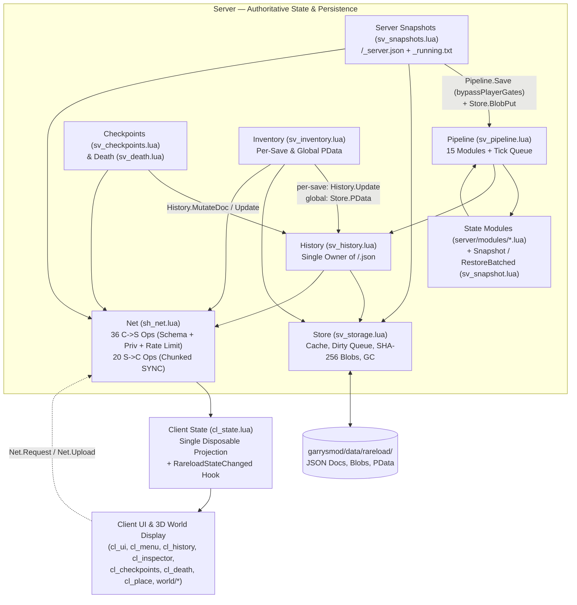

# Rareload 5.5 --- State Ownership, Deduplication, Efficiency, Security & Bug-Fix Plan

## 1. Purpose

Rareload 5.5 is a focused architectural, efficiency, deduplication, security-hardening, and bug-fix release across all **54 Lua files (`16,616` LOC)** of published Rareload 5.4 (`tag: 5.4`, commit `a47c1c3` / `main` `64797e3`). It preserves **100% of Rareload 5.4's features**: all 53 settings, 39 privileges, 15 state modules, 6 vehicle adapters, console commands, Derma windows, 3D2D world panels, checkpoints, death recovery, per-entity exclusions, server snapshots/crash recovery, and on-disk schema (`Store.SCHEMA = 5`).

The release focuses on eight interconnected goals:

1.  **Clear state ownership (Phases 0–3):** the server (`History`, `Checkpoints`, `Death`, `Snapshots`, `Store`, `Pipeline`, `Inventory`, `Blocked`, `Exclude`, `AntiStuck`, `PvP`, `Share`, `Ownership`) and client (`State` vs UI panels and world renderers) must have single, non-overlapping ownership of every persistent document and in-memory table.
2.  **Boundary-focused validation (Phase 4):** validate untrusted data strictly at system boundaries (`sh_net.lua` 36 client→server ops, `sv_storage.lua` JSON/blob loader, `sv_share.lua` import validator, `sv_commands.lua` CLI parser, and `pcall`-wrapped third-party addon adapters), then rely on established internal contracts instead of repeating redundant checks.
3.  **Eliminate hardcoding & centralize schemas (Phase 6):** replace verbose imperative setting/privilege declarations (`sh_config.lua` 53 settings, `sh_perms.lua` 39 privileges), duplicated palettes/fonts (`cl_menu.lua` vs `cl_ui.lua`), hardcoded English fallback strings (`sv_checkpoints.lua`, `sv_commands.lua`), and scattered domain arrays (`COMPONENTS`, `WORLD_KINDS`, `PLAYER_STATES`, `RELOAD_MODES`, setting `unit` suffixes) with single-source declarative tables.
4.  **Eliminate code duplication (Phase 7):** unify duplicated Derma controls (`cl_menu.lua` vs `cl_ui.lua`), 3D beam + 2D HUD world markers (`cl_checkpoints.lua` vs `cl_death.lua`), popup menus (`UI.Menu`), split button rows (`UI.SplitRow`), snapshot mutators (`sv_history.lua`), command argument/target guards (`sv_commands.lua`), and vehicle/weapon adapter helpers.
5.  **GLua & LuaJIT 2.1 runtime efficiency (Phase 8):** eliminate per-frame table/closure/`Color`/`Matrix`/`Vector` allocations in `Paint`, `HUDPaint`, and `PostDrawTranslucentRenderables` hooks (including the new 5.4 `sh_exclude.lua` per-frame `ents.FindInSphere`, `cl_checkpoints.lua`, and `cl_death.lua` hooks), cache `UI.Rows` and `UI.Stats` display lists on state change, cache player grant sets in `sh_perms.lua`, replace expensive `util.TableToJSON` deep-copy/equality hacks with `Util.Equal` and structural copy-on-write, and use $O(1)$ lookup maps (`World.byKey`).
6.  **Reduce code length by ~1,560+ lines with zero feature loss (Phases 9–10):** shrink the 5.4 codebase from `16,616` LOC across 54 files to `~15,050` LOC purely through declarative schemas, shared helpers, and deduplication—backed by `gmod-debug-mcp` `v0.5.0` `profile` (`bench` / `bench_frames` / `hooks`) measurements and the regression suite (Phase 5).
7.  **Security, privilege & untrusted-input hardening — gated by live `gmod-debug-mcp` `v0.5.0` reproduction (Phase 11):** test all candidate security and validation vectors (`S-01`..`S-07`) in the live running game via `/Users/noah/gmod-debug-mcp` (`run_tests`, `run_lua`, `net_watch`, `diff`, `entity`) first; **only fix findings that actually reproduce in-game**, and drop any finding that GMod's engine or existing boundaries already block so we never add dead defensive bloat.
8.  **Runtime bug, memory-corruption & edge-case fixes — gated by live `gmod-debug-mcp` `v0.5.0` reproduction (Phase 12):** test all 16 candidate runtime bugs (`B-01`..`B-16`, including 4 new candidates in 5.4-part-2's server snapshots, batched restore, death saves, and respawn placement) in the running game via `/Users/noah/gmod-debug-mcp` (`run_tests`, `diff`, `trace`, `entity`, `entities` with `include_csents`, `player_input`, `trace_query`, `ui`, `game`, `bots`) before touching code; **if a bug cannot be reproduced in-game, do not "fix" it**.

### Core principles

-   Every piece of authoritative state, domain constant, and UI widget has exactly one owner and one definition.
-   Other systems may persist, transport, cache, or project that state, but must not become competing authorities.
-   Persistent mutations go through explicit APIs owned by the relevant subsystem (`History`, `Store`, `Inventory`, `Snapshots`, `Blocked`).
-   Validate data when it crosses a trust boundary; internal functions rely on documented contracts once validated.
-   Keep defensive checks that protect against real runtime uncertainty, engine behavior, asynchronous execution, or third-party addons.
-   **No Reproduction = No Fix:** static analysis candidates (`S-01`..`S-07`, `B-01`..`B-16`) are **hypotheses until proven in a running Garry's Mod session** via `gmod-debug-mcp` `v0.5.0` (`/Users/noah/gmod-debug-mcp`). Most theoretical bugs cannot happen in-game or are already prevented by engine/caller behavior, and "fixing" unreproducible bugs adds dead code for nothing. Every candidate must have a failing `dbg.test` reproduction before a fix is written.
-   Never allocate temporary tables, closures, or `Color`/`Vector`/`Matrix` objects inside per-frame `Paint` or render hooks when a cached or file-local value suffices.
-   Prefer simplifying existing architecture and declarative tables over introducing heavy abstractions.

------------------------------------------------------------------------

## 2. Target Architecture and Ownership (Full 54-File Rareload 5.4 Map)

### 2.1 Complete Subsystem Ownership Model

| Subsystem & File(s) | Authoritative Owner Of | Must NOT Own or Directly Mutate |
| :--- | :--- | :--- |
| **`History`** (`sv_history.lua`) | Per-player save documents (`<map>/<sid64>.json`, `schema = 5`), `entries`, `activeId`, `quickId`, `deathId`, `checkpoints`, `_undo[sid]`, `_viewing[admin]`, timeline projections, and copy-on-write snapshot edits | Raw disk I/O (`file.*`), global server snapshots (`_server.json`), client UI widget state, or direct restore execution |
| **`Checkpoints`** (`sv_checkpoints.lua`) | Checkpoint domain logic (cursor cycling, distance removal within `150u`, max `32` cap, net handlers `checkpoint.*`) routed through `History` mutation APIs | Direct `Store.Save(rel, d)` calls or bypassing `History` when mutating `d.checkpoints` |
| **`Death`** (`sv_death.lua`, `sv_spawn.lua`) | Pre-death capture trigger (`DoPlayerDeath` with `beforeHit` HP/armor), death spot marker (`PostPlayerDeath`), respawn choice flow (`death.choice`), and a single module-owned weak `playerState[ply]` table | Calling `Store.Save(rel, d)` directly on `History.Doc(ply)` to set `d.deathId`, or scattering 7 `ply.rareload*` fields directly on the engine `Player` entity table |
| **`Snapshots`** (`sv_snapshots.lua`) | Whole-server world snapshots (`<map>/_server.json`), manual/periodic capture (`snapshotInterval`), multi-player rollback (`Snapshots.Rollback`), and crash-recovery prompt (`_running.txt`) | Reaching directly into `Pipeline._defs` or `Pipeline._queue` (must use `Pipeline.Def(id)` / `Pipeline.Defer(fn)` and a dedicated `bypassPlayerGates` option on `Pipeline.Save`) |
| **`Store`** (`sv_storage.lua`) | Disk persistence (`data/rareload/`), JSON encode/decode, `.bak`/`.corrupt` recovery, `_cache`, `dirty` write queue (`0.5s` flush), content-addressed SHA-256 blobs (`blobs/<sha>.json`), `Store.Flag`/`SetFlag`, blob GC (`GCAll`), and `Player:GetPData`/`SetPData` | Save-entry retention rules (`Store.Prune` / `Store.Overview` inspecting `e.pinned` and `d.activeId` directly instead of asking `History`), active-save decisions, or inventory rules |
| **`Pipeline`** (`sv_pipeline.lua`) | Ordered module registration (`15` modules), save/restore execution context (`ctx`, `ctx.shared`, `activeRestore`), `Pipeline.Defer(fn)` tick queue, and module timing | Persistent save documents, independent copies of saved state, or gating server-wide `captureOnly` snapshots on a dead/spectating player's personal flags |
| **`Snapshot`** (`sv_snapshot.lua`) | World entity/NPC/vehicle duplicator capture & restore, `RestoreBatched` multi-tick spawning, `KeepDeleted`, `RemoveMissing`, constraint graph restoration, and `Plain`/`Revive` | Ignoring `ctx:isCurrent()` during `RestoreBatched` or mutating cached snapshot tables in place |
| **State Modules** (`server/modules/*.lua`, 10 files) | Domain-specific capture & restore for the 15 registered modules (`transform`, `health`, `states`, `appearance`, `body`, `weapons`, `activeWeapon`, `ammo`, `weaponState`, `globalInventory`, `tool`, `entities`, `npcs`, `vehicles`, `entityState`, `mapState`, `timeState`, `worldSettings`) | Independent copies of the save document or unvalidated ConVar/hull/scale application |
| **`Inventory`** (`sv_inventory.lua`, `modules/inventory*.lua`) | Inventory normalization (`Clean`), diffing (`Diff`), version history (`MAX_VERSIONS = 30`), and unified read/write routing for `"global"` (`PData`) vs per-save (`History.Update`) targets | A competing cache of per-save weapons/ammo outside `History` or `PData` |
| **`Ownership` / `Exclude` / `Blocked`** (`sv_ownership.lua`, `sh_exclude.lua`, `sv_exclude.lua`) | Entity owner resolution (`recorded[ent]` weak map + `RareloadOwner` NW2), per-entity `RareloadExclude` NW2Bool (`rareload_exclude` property), and `data/rareload/blocked.json` class blocklist | Per-frame `ents.FindInSphere` queries in `HUDPaint` |
| **`AntiStuck` & `PvP`** (`sv_antistuck.lua`, `sv_pvp.lua`) | 6-method stuck resolution + `<map>/_safe_positions.json` (`AntiStuck`), and combat/cooldown/spawn-zone hooks (`RareloadCanSave`/`RareloadCanRestore` in `sv_pvp.lua`) | Caching mid-air/noclip positions as safe ground spots |
| **`Net`** (`sh_net.lua`) | Opcode registration (`36` client→server, `20` server→client), schema validation, privilege & rate-limit enforcement, chunked `SYNC` queue, and chunked `Upload` assembly | Application state or save semantics |
| **Client `State`** (`cl_state.lua`) | Single client-side projection of server-pushed data (`history`, `players`, `snapshots`, `usage`, `objects`, `entryData`, `inventory`, `saves`, `savesRev`, `details`, `antistuck`, `blocked`, ` checkpoints`, `deathSpot`, `lastAutosave`) | Authoritative game state or persistent save state |
| **Client UI & World Display** (`cl_*.lua`, `world/cl_*.lua`, 19 files) | Presentation, local widget state (search text, active tab, scroll offset, `PlaceUI` ghost), 3D2D world cards (`cl_panels.lua`), and `Phantoms` (`cl_phantoms.lua`) | Maintaining parallel network caches outside `RARELOAD.State` or leaking child `ClientsideModel` entities |

### 2.2 Architecture & Data Flow Diagram (5.4 → 5.5 Target)



### 2.3 Ownership Rules

1.  **`History` is the sole authority for `<map>/<sid64>.json` documents:** Every mutation to `d.entries`, `d.activeId`, `d.quickId`, `d.deathId` (`sv_death.lua`), or `d.checkpoints` (`sv_checkpoints.lua`) must go through `History` (via `History.Doc` + a single `History.SaveDoc(ply)` / `History.SetDeathEntry(ply, id)` / `History.UpdateCheckpoints(ply, fn)` API), never by external modules calling `RARELOAD.Store.Save(rel, d)` directly.
2.  **`Store` is strictly a persistence engine:** `Store` manages file paths, JSON serialization, `.bak`/`.corrupt` recovery, the `0.5s` dirty write queue, SHA-256 blobs, and blob GC. Save-entry retention predicates (such as which entries in `<map>/<sid64>.json` are pinned or active during `rareload data prune` or `rareload data usage` in `sv_storage.lua:249-302`) belong to a callback/helper provided by `History` (`History.PruneEntries(doc, cutoff)` / `History.CountEntries(doc, cutoff)`), not hardcoded inside `sv_storage.lua`.
3.  **`Pipeline` encapsulates its module registry and tick queue:** External callers (`sv_snapshots.lua`, `sv_snapshot.lua`, `sv_commands.lua`) must use `Pipeline.Def(id)`, `Pipeline.Defs()`, and `Pipeline.Defer(fn)` instead of indexing `Pipeline._defs` or `table.insert(Pipeline._queue, ...)` directly.
4.  **`Pipeline.Save` separates system captures from player-initiated saves:** When `Snapshots.Take` (`sv_snapshots.lua:35`) or `History.RestoreEntry` (`sv_history.lua:190` undo capture) invokes `Pipeline.Save(ply, { only = ..., captureOnly = true, system = true })`, `Pipeline.Save` must **not** abort just because `ply` is currently dead, in spectator mode, has personal `enabled = false`, or lacks `rareload_save`.
5.  **Per-player transient server state lives in module-owned weak tables, not on `Player` entities:** Consolidate the 7 `ply.rareload*` fields (`rareloadDeathPending`, `rareloadDeathTold`, `rareloadDeathSpot`, `rareloadBackAt`, `rareloadSpawnChoice`, `rareloadDied`, `rareloadCleaned`) scattered across `sv_death.lua`, `sv_spawn.lua`, and `sv_pipeline.lua` into a single `Death.State(ply)` weak-keyed table (`setmetatable({}, { __mode = "k" })`), matching `sv_pvp.lua` and `sv_history.lua`.
6.  **Client `RARELOAD.State` (`cl_state.lua`) owns all server-pushed projections:** Move `checkpoints` (`cl_checkpoints.lua:11-26`) and `deathSpot` (`cl_death.lua:15-17`) net receivers into `cl_state.lua` so every server push updates `RARELOAD.State` and fires `RareloadStateChanged(what, key)`.

------------------------------------------------------------------------

## 3. Phase 0 --- Complete 54-File Baseline and State Audit

**Goal:** establish the exact baseline across all 54 Lua files (`16,616` LOC) of Rareload 5.4 (`main` at `64797e3`) and document every state store, read path, and mutation path before changing code.

Do not refactor during this phase.

### 3.1 Baseline Inventory (Measured on `main` `64797e3`, Tag `5.4`)

-   **Repository & Tag:** `Rareload` `main` (`64797e3`, following `a47c1c3` tag `5.4` merging PR `#9` `noahbds/v5.4-part-2`).
-   **Codebase Size:** **54 Lua files, `16,616` total lines of code**:
    -   Loader & Toolgun: 2 files (`205` LOC: [`rareload.lua`](file:///Users/noah/Library/Application%20Support/Steam/steamapps/common/GarrysMod/garrysmod/addons/Rareload/lua/autorun/rareload.lua), [`rareload_tool.lua`](file:///Users/noah/Library/Application%20Support/Steam/steamapps/common/GarrysMod/garrysmod/addons/Rareload/lua/weapons/gmod_tool/stools/rareload_tool.lua)).
    -   Shared (`lua/rareload/shared/`): 5 files (`1,459` LOC: [`sh_config.lua`](file:///Users/noah/Library/Application%20Support/Steam/steamapps/common/GarrysMod/garrysmod/addons/Rareload/lua/rareload/shared/sh_config.lua) `662`, [`sh_net.lua`](file:///Users/noah/Library/Application%20Support/Steam/steamapps/common/GarrysMod/garrysmod/addons/Rareload/lua/rareload/shared/sh_net.lua) `316`, [`sh_perms.lua`](file:///Users/noah/Library/Application%20Support/Steam/steamapps/common/GarrysMod/garrysmod/addons/Rareload/lua/rareload/shared/sh_perms.lua) `272`, [`sh_util.lua`](file:///Users/noah/Library/Application%20Support/Steam/steamapps/common/GarrysMod/garrysmod/addons/Rareload/lua/rareload/shared/sh_util.lua) `146`, [`sh_exclude.lua`](file:///Users/noah/Library/Application%20Support/Steam/steamapps/common/GarrysMod/garrysmod/addons/Rareload/lua/rareload/shared/sh_exclude.lua) `63`).
    -   Server Core (`lua/rareload/server/`): 17 files (`5,857` LOC: [`sv_history.lua`](file:///Users/noah/Library/Application%20Support/Steam/steamapps/common/GarrysMod/garrysmod/addons/Rareload/lua/rareload/server/sv_history.lua) `1,043`, [`sv_snapshot.lua`](file:///Users/noah/Library/Application%20Support/Steam/steamapps/common/GarrysMod/garrysmod/addons/Rareload/lua/rareload/server/sv_snapshot.lua) `1,065`, [`sv_commands.lua`](file:///Users/noah/Library/Application%20Support/Steam/steamapps/common/GarrysMod/garrysmod/addons/Rareload/lua/rareload/server/sv_commands.lua) `949`, [`sv_pipeline.lua`](file:///Users/noah/Library/Application%20Support/Steam/steamapps/common/GarrysMod/garrysmod/addons/Rareload/lua/rareload/server/sv_pipeline.lua) `482`, [`sv_storage.lua`](file:///Users/noah/Library/Application%20Support/Steam/steamapps/common/GarrysMod/garrysmod/addons/Rareload/lua/rareload/server/sv_storage.lua) `390`, [`sv_share.lua`](file:///Users/noah/Library/Application%20Support/Steam/steamapps/common/GarrysMod/garrysmod/addons/Rareload/lua/rareload/server/sv_share.lua) `310`, [`sv_antistuck.lua`](file:///Users/noah/Library/Application%20Support/Steam/steamapps/common/GarrysMod/garrysmod/addons/Rareload/lua/rareload/server/sv_antistuck.lua) `285`, [`sv_inventory.lua`](file:///Users/noah/Library/Application%20Support/Steam/steamapps/common/GarrysMod/garrysmod/addons/Rareload/lua/rareload/server/sv_inventory.lua) `260`, [`sv_snapshots.lua`](file:///Users/noah/Library/Application%20Support/Steam/steamapps/common/GarrysMod/garrysmod/addons/Rareload/lua/rareload/server/sv_snapshots.lua) `246`, [`sv_log.lua`](file:///Users/noah/Library/Application%20Support/Steam/steamapps/common/GarrysMod/garrysmod/addons/Rareload/lua/rareload/server/sv_log.lua) `223`, [`sv_checkpoints.lua`](file:///Users/noah/Library/Application%20Support/Steam/steamapps/common/GarrysMod/garrysmod/addons/Rareload/lua/rareload/server/sv_checkpoints.lua) `175`, [`sv_spawn.lua`](file:///Users/noah/Library/Application%20Support/Steam/steamapps/common/GarrysMod/garrysmod/addons/Rareload/lua/rareload/server/sv_spawn.lua) `137`, [`sv_death.lua`](file:///Users/noah/Library/Application%20Support/Steam/steamapps/common/GarrysMod/garrysmod/addons/Rareload/lua/rareload/server/sv_death.lua) `127`, [`sv_ownership.lua`](file:///Users/noah/Library/Application%20Support/Steam/steamapps/common/GarrysMod/garrysmod/addons/Rareload/lua/rareload/server/sv_ownership.lua) `121`, [`sv_exclude.lua`](file:///Users/noah/Library/Application%20Support/Steam/steamapps/common/GarrysMod/garrysmod/addons/Rareload/lua/rareload/server/sv_exclude.lua) `119`, [`sv_autosave.lua`](file:///Users/noah/Library/Application%20Support/Steam/steamapps/common/GarrysMod/garrysmod/addons/Rareload/lua/rareload/server/sv_autosave.lua) `85`, [`sv_pvp.lua`](file:///Users/noah/Library/Application%20Support/Steam/steamapps/common/GarrysMod/garrysmod/addons/Rareload/lua/rareload/server/sv_pvp.lua) `61`).
    -   Server Modules (`lua/rareload/server/modules/`): 10 files (`2,318` LOC: [`player.lua`](file:///Users/noah/Library/Application%20Support/Steam/steamapps/common/GarrysMod/garrysmod/addons/Rareload/lua/rareload/server/modules/player.lua) `440`, [`vehicle_adapters.lua`](file:///Users/noah/Library/Application%20Support/Steam/steamapps/common/GarrysMod/garrysmod/addons/Rareload/lua/rareload/server/modules/vehicle_adapters.lua) `405`, [`world.lua`](file:///Users/noah/Library/Application%20Support/Steam/steamapps/common/GarrysMod/garrysmod/addons/Rareload/lua/rareload/server/modules/world.lua) `326`, [`weapon_state.lua`](file:///Users/noah/Library/Application%20Support/Steam/steamapps/common/GarrysMod/garrysmod/addons/Rareload/lua/rareload/server/modules/weapon_state.lua) `272`, [`vehicles.lua`](file:///Users/noah/Library/Application%20Support/Steam/steamapps/common/GarrysMod/garrysmod/addons/Rareload/lua/rareload/server/modules/vehicles.lua) `248`, [`scene.lua`](file:///Users/noah/Library/Application%20Support/Steam/steamapps/common/GarrysMod/garrysmod/addons/Rareload/lua/rareload/server/modules/scene.lua) `244`, [`inventory.lua`](file:///Users/noah/Library/Application%20Support/Steam/steamapps/common/GarrysMod/garrysmod/addons/Rareload/lua/rareload/server/modules/inventory.lua) `173`, [`inventory_global.lua`](file:///Users/noah/Library/Application%20Support/Steam/steamapps/common/GarrysMod/garrysmod/addons/Rareload/lua/rareload/server/modules/inventory_global.lua) `108`, [`entity_state.lua`](file:///Users/noah/Library/Application%20Support/Steam/steamapps/common/GarrysMod/garrysmod/addons/Rareload/lua/rareload/server/modules/entity_state.lua) `62`, [`tool.lua`](file:///Users/noah/Library/Application%20Support/Steam/steamapps/common/GarrysMod/garrysmod/addons/Rareload/lua/rareload/server/modules/tool.lua) `40`).
    -   Client (`lua/rareload/client/` + `world/`): 20 files (`6,777` LOC: [`cl_panels.lua`](file:///Users/noah/Library/Application%20Support/Steam/steamapps/common/GarrysMod/garrysmod/addons/Rareload/lua/rareload/client/world/cl_panels.lua) `1,062`, [`cl_ui.lua`](file:///Users/noah/Library/Application%20Support/Steam/steamapps/common/GarrysMod/garrysmod/addons/Rareload/lua/rareload/client/cl_ui.lua) `878`, [`cl_menu.lua`](file:///Users/noah/Library/Application%20Support/Steam/steamapps/common/GarrysMod/garrysmod/addons/Rareload/lua/rareload/client/cl_menu.lua) `815`, [`cl_inspector.lua`](file:///Users/noah/Library/Application%20Support/Steam/steamapps/common/GarrysMod/garrysmod/addons/Rareload/lua/rareload/client/cl_inspector.lua) `729`, [`cl_history.lua`](file:///Users/noah/Library/Application%20Support/Steam/steamapps/common/GarrysMod/garrysmod/addons/Rareload/lua/rareload/client/cl_history.lua) `725`, [`cl_inventory.lua`](file:///Users/noah/Library/Application%20Support/Steam/steamapps/common/GarrysMod/garrysmod/addons/Rareload/lua/rareload/client/cl_inventory.lua) `455`, [`cl_toolscreen.lua`](file:///Users/noah/Library/Application%20Support/Steam/steamapps/common/GarrysMod/garrysmod/addons/Rareload/lua/rareload/client/cl_toolscreen.lua) `242`, [`cl_debug.lua`](file:///Users/noah/Library/Application%20Support/Steam/steamapps/common/GarrysMod/garrysmod/addons/Rareload/lua/rareload/client/cl_debug.lua) `241`, [`cl_tracking.lua`](file:///Users/noah/Library/Application%20Support/Steam/steamapps/common/GarrysMod/garrysmod/addons/Rareload/lua/rareload/client/world/cl_tracking.lua) `239`, [`cl_highlight.lua`](file:///Users/noah/Library/Application%20Support/Steam/steamapps/common/GarrysMod/garrysmod/addons/Rareload/lua/rareload/client/world/cl_highlight.lua) `188`, [`cl_share.lua`](file:///Users/noah/Library/Application%20Support/Steam/steamapps/common/GarrysMod/garrysmod/addons/Rareload/lua/rareload/client/cl_share.lua) `143`, [`cl_checkpoints.lua`](file:///Users/noah/Library/Application%20Support/Steam/steamapps/common/GarrysMod/garrysmod/addons/Rareload/lua/rareload/client/cl_checkpoints.lua) `140`, [`cl_state.lua`](file:///Users/noah/Library/Application%20Support/Steam/steamapps/common/GarrysMod/garrysmod/addons/Rareload/lua/rareload/client/cl_state.lua) `135`, [`cl_phantoms.lua`](file:///Users/noah/Library/Application%20Support/Steam/steamapps/common/GarrysMod/garrysmod/addons/Rareload/lua/rareload/client/world/cl_phantoms.lua) `130`, [`cl_interact.lua`](file:///Users/noah/Library/Application%20Support/Steam/steamapps/common/GarrysMod/garrysmod/addons/Rareload/lua/rareload/client/world/cl_interact.lua) `107`, [`cl_death.lua`](file:///Users/noah/Library/Application%20Support/Steam/steamapps/common/GarrysMod/garrysmod/addons/Rareload/lua/rareload/client/cl_death.lua) `89`, [`cl_place.lua`](file:///Users/noah/Library/Application%20Support/Steam/steamapps/common/GarrysMod/garrysmod/addons/Rareload/lua/rareload/client/cl_place.lua) `85`, [`cl_wac.lua`](file:///Users/noah/Library/Application%20Support/Steam/steamapps/common/GarrysMod/garrysmod/addons/Rareload/lua/rareload/client/cl_wac.lua) `24`, [`cl_tool.lua`](file:///Users/noah/Library/Application%20Support/Steam/steamapps/common/GarrysMod/garrysmod/addons/Rareload/lua/rareload/client/cl_tool.lua) `18`, [`cl_keys.lua`](file:///Users/noah/Library/Application%20Support/Steam/steamapps/common/GarrysMod/garrysmod/addons/Rareload/lua/rareload/client/cl_keys.lua) `15`).
-   **Save Schema Version:** `Store.SCHEMA = 5` ([`sv_storage.lua:12`](file:///Users/noah/Library/Application%20Support/Steam/steamapps/common/GarrysMod/garrysmod/addons/Rareload/lua/rareload/server/sv_storage.lua#L12)).

### 3.2 Complete Audit of Authoritative & Transient State Stores in 5.4

Every persistent or in-memory state store across all 54 files has been audited below, including the **exact ownership violations discovered in 5.4** that Phases 1–3 will resolve:

| State Structure | On-Disk / In-Memory Location | Current Readers | Current Writers (`!` = Cross-Module Ownership Leak) | Target 5.5 Authority & Fix |
| :--- | :--- | :--- | :--- | :--- |
| **Player History Document** (`entries`, `activeId`, `quickId`, `deathId`, `checkpoints`, `nick`, `steamId`) | `data/rareload/<map>/<sid64>.json` (cached in `Store._cache[rel]`) | `sv_history.lua`, `sv_checkpoints.lua`, `sv_death.lua`, `sv_inventory.lua`, `sv_storage.lua:249-302` | `sv_history.lua` (`save`), **!** `sv_checkpoints.lua:20` (`Store.Save(rel, d)`), **!** `sv_death.lua:39` (`Store.Save(rel, d)`), **!** `sv_storage.lua:277` (`Store.Prune` mutating `d.entries` directly) | **`History` (`sv_history.lua`)** is the sole writer. Add `History.SetDeathId(ply, id)`, `History.UpdateCheckpoints(ply, fn)`, and `History.PruneDoc(doc, cutoff)` so `sv_checkpoints`, `sv_death`, and `sv_storage` never mutate `History.Doc` directly. |
| **World Snapshot Blobs** (`{ __blob = sha256 }`) | `data/rareload/blobs/<sha>.json` | `sv_storage.lua:127-146` (`BlobGet`, `ResolveBlobs`), `sv_history.lua`, `sv_snapshots.lua` | `sv_pipeline.lua:212`, `sv_history.lua:488,529,565,582`, `sv_snapshots.lua:45,103`, `sv_storage.lua:182-227` (`GC`, `GCAll`) | **`Store` (`sv_storage.lua`)** owns blob storage/GC; **`History`** & **`Snapshots`** own blob references. |
| **Server Snapshots & Crash Flag** (`_server.json`, `_running.txt`) | `data/rareload/<map>/_server.json`, `data/rareload/_running.txt` | `sv_snapshots.lua`, `sv_storage.lua:158-167,200,256,283` | `sv_snapshots.lua:22-24` (`save`), `sv_storage.lua:289` (`Store.Prune`) | **`Snapshots` (`sv_snapshots.lua`)** owns `_server.json` semantics and `_running.txt` lifecycle; `Store` persists and calls `Snapshots.PruneDoc(doc, cutoff)`. |
| **Undo Snapshot Cache** (`History._undo[sid]`) | In-memory table in `sv_history.lua:19` | `sv_history.lua:60,164-213` | `sv_history.lua:171,197` (`History.RestoreEntry`), `sv_history.lua:129` (`History.Clear`) | **`History` (`sv_history.lua`)**. Must capture undo via `Pipeline.Save(..., { captureOnly = true, system = true })` so admin rollbacks don't fail if the player is dead or lacks `rareload_save` (`B-13`). |
| **Admin Timeline Viewing Target** (`viewing[ply]`) | Weak-keyed table in `sv_history.lua:26` | `sv_history.lua:28-36,690-709,759-779` | `sv_history.lua:762` (`history.view`) | **`History` (`sv_history.lua`)**. |
| **Global Inventory & Versions** | `Player:GetPData("rareload_global_inv")` / `rareload_global_inv_ver` (`sv.db` `playerpdata`) | `sv_inventory.lua:116-127`, `modules/inventory_global.lua:28` | `sv_inventory.lua:142-151`, `modules/inventory_global.lua:22,94` | **`Inventory` (`sv_inventory.lua`)** owns semantics; **`Store.PData` / `SetPData`** persists. Route `inventory_global.lua:94` clear through `Inventory`. |
| **Per-Save Inventory & Versions** (`entry.data.weapons/ammo/activeWeapon/weaponState`, `entry.inventoryVersions`) | Inside `<map>/<sid64>.json` entry | `sv_inventory.lua:129-140`, `modules/inventory.lua`, `modules/weapon_state.lua` | `sv_inventory.lua:153-163` (via `History.Update`) | **`Inventory`** owns normalization/versioning; **`History.Update`** owns entry persistence. |
| **Persistent Grants & Settings Overrides** | `data/rareload/permissions.json`, `data/rareload/settings.json` + `sv_rareload_*` ConVars + NW2 | `sh_config.lua`, `sh_perms.lua` | `sh_config.lua:269-374`, `sh_perms.lua:182-255` | **`RARELOAD.Settings`** (`sh_config.lua`) and **`RARELOAD.Perms`** (`sh_perms.lua`). Add `grantCache` per player NW2 string in `sh_perms.lua:153`. |
| **Blocked Classes & Excluded Entities** | `data/rareload/blocked.json` (`sv_exclude.lua`), `RareloadExclude` NW2Bool + `EntityMods.rareload.exclude` (`sh_exclude.lua`) | `sv_ownership.lua:106-107`, `sv_snapshot.lua:634,686`, `sh_exclude.lua:10,48`, `cl_inspector.lua` | `sv_exclude.lua:34-65`, `sh_exclude.lua:27-35` | **`Blocked`** & **`Exclude`** (`sv_exclude.lua`, `sh_exclude.lua`). |
| **Anti-Stuck Safe Positions & Method Config** | `data/rareload/<map>/_safe_positions.json`, `data/rareload/antistuck.json` | `sv_antistuck.lua:51-79,199-209` | `sv_antistuck.lua:60,77,86` | **`AntiStuck` (`sv_antistuck.lua`)**. |
| **Per-Player Death & Spawn Transient Flags** (`rareloadDeathPending`, `rareloadDeathTold`, `rareloadDeathSpot`, `rareloadBackAt`, `rareloadSpawnChoice`, `rareloadDied`, `rareloadCleaned`) | **!** Currently 7 loose fields written directly onto the `Player` entity table across 3 files (`sv_death.lua`, `sv_spawn.lua`, `sv_pipeline.lua`) | `sv_death.lua`, `sv_spawn.lua`, `sv_pipeline.lua:301` | **!** `sv_death.lua:27,48,55,70,79,82,115`, `sv_spawn.lua:45,62,84`, `sv_pipeline.lua:301` | **`Death.State(ply)`** weak-keyed table in `sv_death.lua` (exposed cleanly to `sv_spawn.lua` and `sv_pipeline.lua`). |
| **PvP Cooldown Timestamps** (`lastCombat`, `lastSpawn`, `lastRestore`) | 3 weak-keyed tables in `sv_pvp.lua:9-11` | `sv_pvp.lua:41-61` | `sv_pvp.lua:13-39,59` | **`PvP` (`sv_pvp.lua`)** — already clean weak tables! |
| **Entity Ownership Map** (`recorded[ent]`) | Weak-keyed table in `sv_ownership.lua:7` + `RareloadOwner` NW2String | `sv_ownership.lua:80-118` | `sv_ownership.lua:15-50` | **`Ownership` (`sv_ownership.lua`)** — memoize resolved owners in `recorded[ent]` (`B-06`). |
| **Client UI State Projection** (`RARELOAD.State`) | `cl_state.lua:4-16` (`history`, `players`, `snapshots`, `usage`, `objects`, `entryData`, `inventory`, `saves`, `savesRev`, `details`, `antistuck`, `blocked`, `lastAutosave`) | `cl_history.lua`, `cl_inspector.lua`, `cl_inventory.lua`, `cl_menu.lua`, `cl_toolscreen.lua`, `world/*` | `cl_state.lua:42-122`, **!** `cl_checkpoints.lua:11-26` (`CheckpointsUI.list`), **!** `cl_death.lua:15-17` (`spot`) | **`RARELOAD.State` (`cl_state.lua`)**. Move `checkpoints` and `death.spot` net handlers into `cl_state.lua` so all server pushes live in `RARELOAD.State`. |

### 3.3 Audit of All Direct Persistence & Cross-Module Calls in 5.4

1.  **`Store.Save` callers (`7` files):**
    -   `sh_config.lua:270,320,334,373` (`settings.json` — legitimate owner)
    -   `sh_perms.lua:200,254` (`permissions.json` — legitimate owner)
    -   `sv_antistuck.lua:60,77` (`antistuck.json`, `<map>/_safe_positions.json` — legitimate owner)
    -   `sv_exclude.lua:34` (`blocked.json` — legitimate owner)
    -   `sv_snapshots.lua:23` (`<map>/_server.json` — legitimate owner)
    -   `sv_history.lua:55` (`<map>/<sid64>.json` — legitimate owner)
    -   **Violation #1:** [`sv_checkpoints.lua:20`](file:///Users/noah/Library/Application%20Support/Steam/steamapps/common/GarrysMod/garrysmod/addons/Rareload/lua/rareload/server/sv_checkpoints.lua#L15-L21) (`save(ply)` calls `History.Doc(ply)`, mutates `d.checkpoints`, and calls `RARELOAD.Store.Save(rel, d)` directly).
    -   **Violation #2:** [`sv_death.lua:39`](file:///Users/noah/Library/Application%20Support/Steam/steamapps/common/GarrysMod/garrysmod/addons/Rareload/lua/rareload/server/sv_death.lua#L37-L40) (`DoPlayerDeath` mutates `History.Doc(ply).deathId = entry.id` and calls `RARELOAD.Store.Save(rel, d)` directly right after `Pipeline.Save` already called `History.Append`!).
    -   **Violation #3:** [`sv_storage.lua:277,289`](file:///Users/noah/Library/Application%20Support/Steam/steamapps/common/GarrysMod/garrysmod/addons/Rareload/lua/rareload/server/sv_storage.lua#L265-L295) (`Store.Prune` loads `<map>/<sid64>.json` and `<map>/_server.json` and filters `d.entries` using hardcoded `e.pinned` and `d.activeId` rules inside `sv_storage.lua`).
2.  **Direct access to private `_` fields across files:**
    -   [`sv_snapshots.lua:39,74,88`](file:///Users/noah/Library/Application%20Support/Steam/steamapps/common/GarrysMod/garrysmod/addons/Rareload/lua/rareload/server/sv_snapshots.lua#L39) accesses `Pipeline._defs` directly; [`sv_snapshots.lua:203`](file:///Users/noah/Library/Application%20Support/Steam/steamapps/common/GarrysMod/garrysmod/addons/Rareload/lua/rareload/server/sv_snapshots.lua#L203) and [`sv_snapshot.lua:906`](file:///Users/noah/Library/Application%20Support/Steam/steamapps/common/GarrysMod/garrysmod/addons/Rareload/lua/rareload/server/sv_snapshot.lua#L906) access `Pipeline._queue` directly.
    -   [`sv_share.lua:217`](file:///Users/noah/Library/Application%20Support/Steam/steamapps/common/GarrysMod/garrysmod/addons/Rareload/lua/rareload/server/sv_share.lua#L217) mutates `RARELOAD.Store._cache[rel] = nil` directly.

### 3.4 Deliverables

Create:

-   `docs/architecture/STATE_OWNERSHIP.md`
-   `docs/architecture/VALIDATION_BOUNDARIES.md`

**Exit criteria:**

-   Baseline test results and `glua_check` / `glualint` outputs are recorded via `gmod-debug-mcp`.
-   All 14 persistent and transient state structures across the 54 files are inventoried.
-   All cross-module mutation leaks (`sv_checkpoints`, `sv_death`, `sv_storage`, `sv_snapshots`, `sv_share`, `cl_checkpoints`, `cl_death`) are identified.

------------------------------------------------------------------------

## 4. Phase 1 --- Centralize History, Checkpoint, Death & Inventory Mutations

**Goal:** make `History` (`sv_history.lua`) the single owner of `<map>/<sid64>.json` save documents, including `entries`, `activeId`, `quickId`, `deathId`, and `checkpoints`.

### 4.1 Complete the History Document API (`sv_history.lua`)

Extend the existing `History` API (`sv_history.lua`) with narrow, explicit mutators for the fields added in 5.4 so no other file ever calls `Store.Save` on a player's history document:

| Operation | Responsibility |
| :--- | :--- |
| `History.Doc(plyOrSid)` | Resolve/load the player's `<map>/<sid64>.json` document (`schema = 5`) |
| `History.Get(plyOrSid, id)` | Read a save entry by ID |
| `History.Active(plyOrSid)` | Read the active respawn entry (`d.activeId` fallback to latest) |
| `History.Quick(plyOrSid)` | Read the quick-load entry (`d.quickId` fallback to `History.Active`) |
| `History.Append(ply, data, meta)` | Add a save entry, optionally update `activeId` (`not meta.keepActive`), and optionally set `d.deathId = entry.id` (`meta.isDeath`) in a **single** `save(ply, d)` call |
| `History.Update(plyOrSid, id, fn)` | Mutate an existing entry through a controlled callback and persist |
| `History.Delete(plyOrSid, id)` | Delete an entry, updating `activeId`, `quickId`, and `deathId` if they pointed to `id` |
| `History.Clear(plyOrSid)` | Clear `d.entries`, `d.activeId`, `d.quickId`, `d.deathId`, and `_undo[sid]` while preserving `d.checkpoints` |
| `History.Checkpoints(plyOrSid)` | Return `d.checkpoints` (read-only list) |
| `History.UpdateCheckpoints(ply, fn)` | Run `fn(d.checkpoints)` and call `save(ply, d)` inside `sv_history.lua` |
| `History.PruneDoc(d, cutoff)` | Prune unpinned, non-active, non-death entries older than `cutoff` (called by `Store.Prune` / `Store.Overview`) |

### 4.2 Route All Save-Document Mutations Through `History`

1.  **`sv_death.lua:30-41` (`DoPlayerDeath`):**
    -   Pass `isDeath = true` in `Pipeline.Save(ply, { reason = "death", silent = true, keepActive = true, isDeath = true, deathHealth = ... })` (or call `History.SetDeathId(ply, entry.id)` when `result == "unchanged"`).
    -   Inside `History.Append` (`sv_history.lua:68-100`), if `meta.isDeath` is true, set `d.deathId = entry.id` **before** calling `save(ply, d)`—eliminating the duplicate `RARELOAD.Store.Save(rel, d)` in `sv_death.lua:39`!
2.  **`sv_checkpoints.lua:15-21` (`list` & `save`):**
    -   Replace `RARELOAD.Store.Save(rel, d)` in `sv_checkpoints.lua:20` with `History.UpdateCheckpoints(ply, fn)` (or `History.SaveDoc(ply)`), keeping all checkpoint persistence inside `sv_history.lua`.
3.  **`sv_death.lua`, `sv_spawn.lua`, `sv_pipeline.lua` (Transient Player State):**
    -   Replace the 7 loose `ply.rareload*` fields (`ply.rareloadDeathPending`, `ply.rareloadDeathTold`, `ply.rareloadDeathSpot`, `ply.rareloadBackAt`, `ply.rareloadSpawnChoice`, `ply.rareloadDied`, `ply.rareloadCleaned`) with `local st = Death.State(ply)` backed by a weak-keyed table `local state = setmetatable({}, { __mode = "k" })` in `sv_death.lua`.
4.  **`sv_history.lua:102-135` (`History.Delete` & `History.Clear`):**
    -   Ensure `History.Delete` also clears `if d.quickId == id then d.quickId = nil end` and `if d.deathId == id then d.deathId = nil end`, and `History.Clear` clears `d.quickId, d.deathId = nil, nil` alongside `d.activeId = nil`.

### 4.3 Preserve Timeline & Inventory Invariants

-   Global inventory (`Store.PData` / `SetPData`) and per-save inventory (`History.Update`) remain strictly routed through `Inventory.Read(ply, save)` and `Inventory.Write(ply, save, inv, label, actor)` (`sv_inventory.lua:114-184`).
-   In `modules/inventory_global.lua:93-95`, route the empty-inventory clear through `RARELOAD.Inventory.Write(ply, nil, { weapons = {}, ammo = {} }, "clear", ply)` (or `Store.SetPData`) so global inventory persistence has a single owner.

**Exit criteria:**

-   Zero calls to `Store.Save` for `<map>/<sid64>.json` exist outside `sv_history.lua`.
-   `d.activeId`, `d.quickId`, `d.deathId`, and `d.checkpoints` invariants hold across append, delete, clear, and prune.
-   All 7 `ply.rareload*` fields are consolidated into `Death.State(ply)`.

------------------------------------------------------------------------

## 5. Phase 2 --- Clarify Store, Pipeline & Server Snapshot Ownership

**Goal:** keep `Store` (`sv_storage.lua`) strictly focused on persistence, encapsulate `Pipeline` (`sv_pipeline.lua`) internals, and ensure `Snapshots` (`sv_snapshots.lua`) captures all players' world entities reliably.

### 5.1 Decouple `Store.Overview` and `Store.Prune` from `History` Business Rules (`sv_storage.lua:237-302`)

Currently, `sv_storage.lua:249` and `sv_storage.lua:269-277` inspect `d.entries`, `e.pinned`, and `d.activeId` directly inside `Store.Overview` and `Store.Prune`.
-   **Action:** Delegate entry-level pruning eligibility to `RARELOAD.History.IsPrunable(doc, entry, cutoff)` (which checks `not entry.pinned and entry.id ~= doc.activeId and entry.id ~= doc.deathId and entry.id ~= doc.quickId and (tonumber(entry.time) or 0) < cutoff`). Notice that 5.4's `Store.Prune` forgot to protect `d.deathId` and `d.quickId`! Moving the predicate to `History.IsPrunable` fixes both ownership and `deathId`/`quickId` preservation.

### 5.2 Public `Pipeline.Def` and `Pipeline.Defer` API (`sv_pipeline.lua`, `sv_snapshots.lua`, `sv_snapshot.lua`)

1.  Add `Pipeline.Def(id)` (returning `Pipeline._defs[id]`) and `Pipeline.Defer(fn)` (enqueueing a step on `Pipeline._queue` without requiring a restore `ctx`) in [`sv_pipeline.lua`](file:///Users/noah/Library/Application%20Support/Steam/steamapps/common/GarrysMod/garrysmod/addons/Rareload/lua/rareload/server/sv_pipeline.lua).
2.  Update [`sv_snapshots.lua:11,39,74,88,203`](file:///Users/noah/Library/Application%20Support/Steam/steamapps/common/GarrysMod/garrysmod/addons/Rareload/lua/rareload/server/sv_snapshots.lua#L11) and [`sv_snapshot.lua:906`](file:///Users/noah/Library/Application%20Support/Steam/steamapps/common/GarrysMod/garrysmod/addons/Rareload/lua/rareload/server/sv_snapshot.lua#L906) (`RestoreBatched`) to use `Pipeline.Def(id)` and `Pipeline.Defer(fn)` instead of touching `Pipeline._defs` and `Pipeline._queue` directly.
3.  Remove `Store._cache[rel] = nil` from [`sv_share.lua:217`](file:///Users/noah/Library/Application%20Support/Steam/steamapps/common/GarrysMod/garrysmod/addons/Rareload/lua/rareload/server/sv_share.lua#L217) (`Share.ReadFile`, see `S-06`).

### 5.3 Audit Cache, Dirty-Write & Blob GC Semantics (`sv_storage.lua`)

-   Verify that `Store.GC()` and `Store.GCAll()` (`sv_storage.lua:182-227`) scan both player history docs and `<map>/_server.json` (`snapshotBlobs`), flushing any pending `dirty` writes first (`Store.Flush()`).
-   Keep stored blobs immutable: copy-on-write edits in `sv_history.lua` always produce a new SHA-256 blob via `Store.BlobPut`.

**Exit criteria:**

-   `Store` contains zero hardcoded save-entry business rules (`History.IsPrunable` owns entry retention).
-   `Pipeline._defs` and `Pipeline._queue` are never accessed outside `sv_pipeline.lua`.
-   `Store._cache` is never mutated outside `sv_storage.lua`.

------------------------------------------------------------------------

## 6. Phase 3 --- Make Client State a Single Projection Across All 20 Client Files

**Goal:** keep [`cl_state.lua`](file:///Users/noah/Library/Application%20Support/Steam/steamapps/common/GarrysMod/garrysmod/addons/Rareload/lua/rareload/client/cl_state.lua) as the single client-side projection of server state across all 20 client files (including the new 5.4 `cl_checkpoints.lua`, `cl_death.lua`, and `cl_place.lua`).

### 6.1 Unify `checkpoints` and `death.spot` Into `cl_state.lua`

In 5.4, most new features (`history.players`, `snapshots`, `data.usage`, `blocked`) were properly added to `cl_state.lua:50-67, 114-117`. However, two new 5.4 files registered their own `RARELOAD.Net.On` handlers outside `cl_state.lua`:
1.  [`cl_checkpoints.lua:11-26`](file:///Users/noah/Library/Application%20Support/Steam/steamapps/common/GarrysMod/garrysmod/addons/Rareload/lua/rareload/client/cl_checkpoints.lua#L11-L26) listens to `RARELOAD.Net.On("checkpoints", ...)` and stores `CheckpointsUI.list`.
2.  [`cl_death.lua:15-17`](file:///Users/noah/Library/Application%20Support/Steam/steamapps/common/GarrysMod/garrysmod/addons/Rareload/lua/rareload/client/cl_death.lua#L15-L17) listens to `RARELOAD.Net.On("death.spot", ...)` and stores a file-local `spot`.

**Action:**
-   Move the `"checkpoints"` and `"death.spot"` net receivers into [`cl_state.lua`](file:///Users/noah/Library/Application%20Support/Steam/steamapps/common/GarrysMod/garrysmod/addons/Rareload/lua/rareload/client/cl_state.lua), populating `State.checkpoints` (converting `c.pos = Util.ToVector(c.pos)` and `c.ang = Util.ToAngle(c.ang)`) and `State.deathSpot` (`Util.ToVector(p.pos)`), and firing `changed("checkpoints")` and `changed("deathSpot")`.
-   Have `cl_checkpoints.lua` read `RARELOAD.State.checkpoints` and listen to `RareloadStateChanged` (`what == "checkpoints"`), and have `cl_death.lua` read `RARELOAD.State.deathSpot`. (`death.choice` in `cl_death.lua:55` is an imperative modal trigger like `share.offer` in `cl_share.lua:120` and stays in `cl_death.lua`.)

### 6.2 Audit of All 20 Client Files Against `RARELOAD.State`

| Client File | Reads From `RARELOAD.State` | Local UI / Presentation State (Keep Local) |
| :--- | :--- | :--- |
| `cl_state.lua` | Owns `State.*` (`history`, `players`, `snapshots`, `usage`, `objects`, `entryData`, `inventory`, `saves`, `savesRev`, `details`, `antistuck`, `blocked`, `checkpoints`, `deathSpot`, `lastAutosave`) | — |
| `cl_history.lua` | `State.history`, `State.players`, `State.objects`, `State.entryData`, `State.Row`, `State.ActiveRow` | `Timeline.selected`, `Timeline.target` (admin viewing SteamID64), search/filter/sort state |
| `cl_inspector.lua` | `State.objects`, `State.entryData`, `State.Row`, `State.ActiveRow` | `edited` JSON diff table, selected object ID, search/kind filter |
| `cl_inventory.lua` | `State.inventory`, `State.history.rows` | Selected target (`"global"` or save ID), search text, category filter |
| `cl_menu.lua` | `State.antistuck`, `State.blocked`, `State.snapshots`, `State.usage` | Collapsible section states, `wrapCache` |
| `cl_checkpoints.lua` | `State.checkpoints` (moved from `CheckpointsUI.list`) | Open frame reference |
| `cl_death.lua` | `State.deathSpot` (moved from local `spot`) | Open choice modal reference |
| `cl_place.lua` | — | `PlaceUI.ghost` (`ClientsideModel`), `PlaceUI.id`, `PlaceUI.sid`, `PlaceUI.yaw` |
| `world/cl_tracking.lua` | `State.saves`, `State.savesRev` | `World.records`, `World.byKey` ($O(1)$ map), `World.live`, `World.preview` |
| `world/cl_panels.lua` | `State.details`, `World.records` | `Panels.view` (tab/scroll), `Panels.piles`, `Panels.focus`, `Panels.lock` |

**Exit criteria:**

-   100% of server-pushed state topics terminate in `cl_state.lua` and emit `RareloadStateChanged`.
-   UI windows derive their data from `RARELOAD.State` and keep only transient presentation state locally.

------------------------------------------------------------------------

## 7. Phase 4 --- Eliminate Excessive Defensive Programming & Enforce Boundary-Once Normalization

**Goal:** cure one of Rareload's biggest sources of code bloat and visual noise—**paranoid, repetitive defensive programming**—by normalizing data shapes **once** at external trust boundaries and removing the hundreds of redundant `istable(...)`, `or {}`, `tonumber(...) or 0`, `tostring(...)`, dual-key probes (`t[id] or t[tonumber(id)]`), and redundant `IsValid` / `pcall` checks scattered across internal functions.

---

### 7.1 Quantitative Audit: Why Rareload 5.4 Feels Over-Defensive (984 Guards Across 54 Files)

A static scan across all **54 Lua files (`16,616` LOC)** of published Rareload 5.4 counts **984 defensive type, fallback, coercion, and wrapper expressions** (~1 every 16 lines of code):

| Defensive Pattern | Count in 5.4 | Where It Is Legitimate (Keep) | Where It Is Pure Bloat (Remove in Phase 4) |
| :--- | :---: | :--- | :--- |
| **`or {}` fallback tables** | **304** | Defaulting optional `opts = opts or {}` or initializing empty state once | Inside loops, `Paint` hooks, and internal readers (`d and d.entries or {}`, `snap and snap.Entities or {}`, `row.info or {}`, `State.players or {}`) where the table is already guaranteed non-nil |
| **`istable(...)` guards** | **259** | External JSON imports (`sv_share.lua`), Inspector edits (`ValidateEdit`), third-party addon tables (`ARC9`, `StormFox2`, `LVS`) | Re-checking internal subtables (`istable(def.EntityMods)`, `istable(v.data)`, `istable(p.list)`, `istable(detail.constraints)`) that Rareload itself created or normalized |
| **`IsValid(...)` guards** | **197** | Delayed timers/hooks, live entities on the map, Derma frame references, `net.Receive` player check | Re-checking `IsValid(ply)` or `IsValid(ent)` inside synchronous internal helpers immediately after the caller already checked it in the same tick |
| **`isstring` / `isnumber` / `isbool` / `isfunction`** | **128** | `Net.Validate` (`sh_net.lua`), `Inventory.Clean` (`sv_inventory.lua`), third-party method checks | Re-checking validated `Net.Handle` args, `Net.On` server payloads, or vanilla GMod `Player` metatable methods (`isfunction(ply.SetWalkSpeed)`) |
| **`tonumber(...) or` & `tostring(...)` coercions** | **61** | Parsing raw console command string `args` in `sv_commands.lua` | Dual-key probing (`snap.runtime[id] or snap.runtime[tonumber(id)]`, `ammo.reserve[name] or ammo.reserve[tonumber(name)]`) and `tostring(id)` on already-typed IDs |
| **`pcall` / `ProtectedCall`** | **34** | `Util.CheckJSON`, `Net` dispatch, `Pipeline` module boundaries, third-party vehicle/weapon adapters, `CPPI` | Wrapping internal Rareload functions (`sv_status.lua`, `sv_commands.lua`) that already return `ok, err` |

**Top 12 Most Over-Defensive Files in Rareload 5.4:**
1. [`sv_snapshot.lua`](file:///Users/noah/Library/Application%20Support/Steam/steamapps/common/GarrysMod/garrysmod/addons/Rareload/lua/rareload/server/sv_snapshot.lua) — **122 guards** (`40 istable`, `39 IsValid`, `21 or {}`, `10 tonumber(...) or`, `7 isstring`)
2. [`modules/weapon_state.lua`](file:///Users/noah/Library/Application%20Support/Steam/steamapps/common/GarrysMod/garrysmod/addons/Rareload/lua/rareload/server/modules/weapon_state.lua) — **80 guards** (`34 istable`, `19 or {}`, `7 isstring`, `6 isnumber`, `5 isfunction`)
3. [`sv_history.lua`](file:///Users/noah/Library/Application%20Support/Steam/steamapps/common/GarrysMod/garrysmod/addons/Rareload/lua/rareload/server/sv_history.lua) — **67 guards** (`23 or {}`, `21 istable`, `12 isstring`, `7 IsValid`)
4. [`world/cl_panels.lua`](file:///Users/noah/Library/Application%20Support/Steam/steamapps/common/GarrysMod/garrysmod/addons/Rareload/lua/rareload/client/world/cl_panels.lua) — **44 guards** (`19 istable`, `18 or {}`, `4 IsValid`)
5. [`sv_commands.lua`](file:///Users/noah/Library/Application%20Support/Steam/steamapps/common/GarrysMod/garrysmod/addons/Rareload/lua/rareload/server/sv_commands.lua) — **44 guards** (`20 IsValid`, `7 or {}`, `6 pcall`, `4 isstring`, `3 istable`)
6. [`modules/player.lua`](file:///Users/noah/Library/Application%20Support/Steam/steamapps/common/GarrysMod/garrysmod/addons/Rareload/lua/rareload/server/modules/player.lua) — **38 guards** (`16 istable`, `7 isnumber`, `5 isfunction`, `5 or {}`)
7. [`modules/scene.lua`](file:///Users/noah/Library/Application%20Support/Steam/steamapps/common/GarrysMod/garrysmod/addons/Rareload/lua/rareload/server/modules/scene.lua) — **35 guards** (`14 istable`, `6 isnumber`, `6 IsValid`, `3 isfunction`, `3 pcall`)
8. [`sv_inventory.lua`](file:///Users/noah/Library/Application%20Support/Steam/steamapps/common/GarrysMod/garrysmod/addons/Rareload/lua/rareload/server/sv_inventory.lua) — **33 guards** (`16 istable`, `11 or {}`, `2 isstring`, `2 IsValid`)
9. [`sv_share.lua`](file:///Users/noah/Library/Application%20Support/Steam/steamapps/common/GarrysMod/garrysmod/addons/Rareload/lua/rareload/server/sv_share.lua) — **32 guards** (`19 istable`, `5 isstring`, `4 or {}`, `3 IsValid`)
10. [`modules/vehicle_adapters.lua`](file:///Users/noah/Library/Application%20Support/Steam/steamapps/common/GarrysMod/garrysmod/addons/Rareload/lua/rareload/server/modules/vehicle_adapters.lua) — **32 guards** (`9 isfunction`, `8 or {}`, `6 IsValid`, `5 pcall`)
11. [`sv_storage.lua`](file:///Users/noah/Library/Application%20Support/Steam/steamapps/common/GarrysMod/garrysmod/addons/Rareload/lua/rareload/server/sv_storage.lua) — **26 guards** (`19 or {}`, `5 istable`, `2 tonumber(...) or`)
12. [`cl_state.lua`](file:///Users/noah/Library/Application%20Support/Steam/steamapps/common/GarrysMod/garrysmod/addons/Rareload/lua/rareload/client/cl_state.lua), [`cl_history.lua`](file:///Users/noah/Library/Application%20Support/Steam/steamapps/common/GarrysMod/garrysmod/addons/Rareload/lua/rareload/client/cl_history.lua), [`cl_inventory.lua`](file:///Users/noah/Library/Application%20Support/Steam/steamapps/common/GarrysMod/garrysmod/addons/Rareload/lua/rareload/client/cl_inventory.lua), [`cl_inspector.lua`](file:///Users/noah/Library/Application%20Support/Steam/steamapps/common/GarrysMod/garrysmod/addons/Rareload/lua/rareload/client/cl_inspector.lua) — **75 guards combined** (`46 or {}` across the 4 client state/window files).

---

### 7.2 Architectural Principle: "Parse & Normalize Once at the Boundary — Trust Internal Contracts"

Instead of checking `if istable(x)` and `x or {}` at every internal call site, Rareload 5.5 enforces validation and structural normalization **strictly at the 5 external trust boundaries**, and guarantees canonical shapes everywhere inside the addon:

| Trust Boundary | Entry Point(s) | What Must Be Validated & Normalized Here (Once) | What Internal Callers Can Assume Afterwards (Zero Re-Checks) |
| :--- | :--- | :--- | :--- |
| **1. Client → Server Net (`36` ops)** | [`sh_net.lua:32-55, 155-178`](file:///Users/noah/Library/Application%20Support/Steam/steamapps/common/GarrysMod/garrysmod/addons/Rareload/lua/rareload/shared/sh_net.lua#L32-L55) (`Net.Validate`) | `IsValid(ply)`, `RARELOAD.Can(ply, h.priv)`, rate limit, and exact field types/lengths (`bool`, `number`, `uint`, `string:N`) | `ply` is valid and authorized; every non-optional field in `a` exists with the exact Lua type declared in `args` |
| **2. Untrusted JSON Payloads (`import`, `inventory.upload`, `object.edit`)** | [`sv_share.lua:105-193`](file:///Users/noah/Library/Application%20Support/Steam/steamapps/common/GarrysMod/garrysmod/addons/Rareload/lua/rareload/server/sv_share.lua#L105-L193), [`sv_inventory.lua:37-94`](file:///Users/noah/Library/Application%20Support/Steam/steamapps/common/GarrysMod/garrysmod/addons/Rareload/lua/rareload/server/sv_inventory.lua#L37-L94), [`sv_history.lua:491-499`](file:///Users/noah/Library/Application%20Support/Steam/steamapps/common/GarrysMod/garrysmod/addons/Rareload/lua/rareload/server/sv_history.lua#L491-L499) | `Util.CheckJSON` (depth `<= 32`), `Snapshot.Plain`, `Inventory.Clean`, `History.ValidateEdit`, `Snapshot.IsDeniedClass` | Cleaned inventories always have `{ weapons = {...}, ammo = { reserve = {...}, clips = {...} } }`; validated edits are plain tables |
| **3. Disk JSON & Blob Loader** | [`sv_storage.lua:60-90, 127-146`](file:///Users/noah/Library/Application%20Support/Steam/steamapps/common/GarrysMod/garrysmod/addons/Rareload/lua/rareload/server/sv_storage.lua#L60-L90), [`sv_history.lua:23-29`](file:///Users/noah/Library/Application%20Support/Steam/steamapps/common/GarrysMod/garrysmod/addons/Rareload/lua/rareload/server/sv_history.lua#L23-L29) | `.bak` recovery, `.corrupt` quarantine, and **one-time structural + key normalization** (`normalizeDoc`, `normalizeBlob`) | `d.entries` and `d.checkpoints` are always tables; `snap.Entities`, `snap.Constraints`, `snap.runtime`, `snap.ai`, `def.EntityMods.rareload`, and `def.PhysicsObjects` are always tables with normalized key types |
| **4. Console Commands (`rareload ...`)** | [`sv_commands.lua:1-949`](file:///Users/noah/Library/Application%20Support/Steam/steamapps/common/GarrysMod/garrysmod/addons/Rareload/lua/rareload/server/sv_commands.lua#L1-L949) | Privilege check (`can`), target resolution (`targetOf` / `withTarget`), and typed CLI argument parsing | Downstream `History.*`, `Checkpoints.*`, `Snapshots.*`, `Inventory.*` functions receive valid players/SIDs and typed arguments |
| **5. Engine & Third-Party Addons** | `vehicle_adapters.lua`, `weapon_state.lua`, `entity_state.lua`, `scene.lua`, `player.lua`, `sh_perms.lua`, `sv_ownership.lua` | `IsValid(ent)` on live map entities and `pcall` around third-party addon APIs (`LVS`, `Simfphys`, `Glide`, `WAC`, `ARC9`, `ArcCW`, `TFA`, `MW`, `WireLib`, `StormFox2`, `pace`, `CPPI`) | Captured module output tables are plain, well-typed Lua tables that internal `summary` and `Info` functions can read directly |

---

### 7.3 Rule 1: Normalize Document & Snapshot Shapes Once on Load (`sv_history.lua`, `sv_storage.lua`, `sv_snapshot.lua`) — Removes ~130 `istable` / `or {}` Guards

#### Why Defensive Checks Multiplied Here
Currently, `History.Doc(ply)` (`sv_history.lua:23-29`) and `Store.BlobGet(hash)` (`sv_storage.lua:127-140`) return raw `util.JSONToTable` tables without normalizing optional subtables. Because `d.checkpoints`, `entry.data`, `snap.Entities`, `snap.Constraints`, `snap.runtime`, `snap.ai`, `def.EntityMods`, `def.EntityMods.rareload`, and `def.PhysicsObjects` might be `nil`, **every internal function** defensively re-checks them:
- `sv_history.lua:40, 672` & `sv_storage.lua:168, 237, 276`: `for _, entry in ipairs(d and d.entries or {})`
- `sv_history.lua:655` & `sv_storage.lua:169, 205`: `for _, value in pairs(entry and entry.data or {})`
- `sv_history.lua:381, 509, 540, 612` & `sv_snapshot.lua:342, 434`: `for _, def in pairs(snap and snap.Entities or {})`
- `sv_history.lua:346-351`:
  ```lua
  -- BEFORE (sv_history.lua:346-351 — 6 defensive checks in 6 lines!):
  local mods = istable(def.EntityMods) and def.EntityMods or {}
  local phys = istable(def.PhysicsObjects) and (def.PhysicsObjects[0] or def.PhysicsObjects["0"]) or {}
  local rl = istable(mods.rareload) and mods.rareload or {}
  local id = RARELOAD.Snapshot.DefID(def)
  local runtime = id and istable(snap.runtime) and (snap.runtime[id] or snap.runtime[tonumber(id)]) or nil
  local ai = id and istable(snap.ai) and (snap.ai[id] or snap.ai[tonumber(id)]) or nil
  ```
- `sv_snapshot.lua:150, 511, 593, 604, 613, 681`: repeats `local mods = istable(def.EntityMods) and def.EntityMods or {}` and `local rl = istable(mods.rareload) and mods.rareload or {}` **6 separate times** in the same file!

#### Concrete Refactor
1. **Normalize `History.Doc(ply)` once on load (`sv_history.lua:23-35`)**:
   - Ensure `d.entries = d.entries or {}` and `d.checkpoints = d.checkpoints or {}`.
   - When loading from disk (`Store.Load`), normalize each `entry` in `d.entries` once: `entry.data = entry.data or {}` and `entry.note = noteText(entry.note)` (removing the per-push `e.note = noteText(e.note)` mutation inside `History.Rows(ply)` at `sv_history.lua:673`!).
2. **Normalize Snapshot Blobs once in `Snapshot.Normalize(snap)` (called by `Store.BlobGet` on cache miss and `Snapshot.Capture`)**:
   - Ensure `snap.Entities = snap.Entities or {}`, `snap.Constraints = snap.Constraints or {}`, `snap.runtime = snap.runtime or {}`, `snap.ai = snap.ai or {}`.
   - For each `def` in `snap.Entities`, ensure `def.EntityMods = def.EntityMods or {}`, `def.EntityMods.rareload = def.EntityMods.rareload or {}`, and `def.PhysicsObjects = def.PhysicsObjects or {}`.
3. **Result (`objectInfo` in `sv_history.lua:345-352` after normalization)**:
   ```lua
   -- AFTER (zero defensive istable / or {} / dual-key probes):
   local function objectInfo(def, kind, snap)
       local mods, phys = def.EntityMods, def.PhysicsObjects[0]
       local rl = mods.rareload
       local id = rl.id
       local runtime, ai = snap.runtime[id], snap.ai[id]
   ```

---

### 7.4 Rule 2: Eliminate Dual-Key String/Number Probing (`t[id] or t[tonumber(id)]`) at the Root — Removes ~35 Coercions

#### Why Defensive Dual-Key Probing Exists Today
As noted in the comment at [`sv_snapshot.lua:147-148`](file:///Users/noah/Library/Application%20Support/Steam/steamapps/common/GarrysMod/garrysmod/addons/Rareload/lua/rareload/server/sv_snapshot.lua#L147-L148):
> `-- IDs are 12 hex characters; about one in 300 is all digits, which JSON reads back as a number, so an ID is always handled as a string.`

Because `util.JSONToTable` converts all-digit string keys (`"0"`, `"357"`, or an all-digit hex `RareloadID`) into Lua numbers when loading a JSON file, the codebase currently probes **both** string and number keys everywhere:
- [`sv_history.lua:347`](file:///Users/noah/Library/Application%20Support/Steam/steamapps/common/GarrysMod/garrysmod/addons/Rareload/lua/rareload/server/sv_history.lua#L347): `def.PhysicsObjects[0] or def.PhysicsObjects["0"]`
- [`sv_history.lua:350, 478`](file:///Users/noah/Library/Application%20Support/Steam/steamapps/common/GarrysMod/garrysmod/addons/Rareload/lua/rareload/server/sv_history.lua#L350): `snap.runtime[id] or snap.runtime[tonumber(id)]`
- [`sv_history.lua:351, 477`](file:///Users/noah/Library/Application%20Support/Steam/steamapps/common/GarrysMod/garrysmod/addons/Rareload/lua/rareload/server/sv_history.lua#L351): `snap.ai[id] or snap.ai[tonumber(id)]`
- [`sv_history.lua:458`](file:///Users/noah/Library/Application%20Support/Steam/steamapps/common/GarrysMod/garrysmod/addons/Rareload/lua/rareload/server/sv_history.lua#L458): `snap.Entities[e.Index] or snap.Entities[tostring(e.Index)]`
- [`sv_snapshot.lua:396`](file:///Users/noah/Library/Application%20Support/Steam/steamapps/common/GarrysMod/garrysmod/addons/Rareload/lua/rareload/server/sv_snapshot.lua#L396): `old[field][id] or old[field][tonumber(id)]`
- [`sv_snapshot.lua:516`](file:///Users/noah/Library/Application%20Support/Steam/steamapps/common/GarrysMod/garrysmod/addons/Rareload/lua/rareload/server/sv_snapshot.lua#L516): `bones[i] or bones[tostring(i)]`
- [`sv_history.lua:584`](file:///Users/noah/Library/Application%20Support/Steam/steamapps/common/GarrysMod/garrysmod/addons/Rareload/lua/rareload/server/sv_history.lua#L584), [`modules/player.lua:429`](file:///Users/noah/Library/Application%20Support/Steam/steamapps/common/GarrysMod/garrysmod/addons/Rareload/lua/rareload/server/modules/player.lua#L429), [`sv_snapshot.lua:152, 157, 370, 390, 436, 440`](file:///Users/noah/Library/Application%20Support/Steam/steamapps/common/GarrysMod/garrysmod/addons/Rareload/lua/rareload/server/sv_snapshot.lua#L152): `tostring(ent.RareloadID) == tostring(objectId)`
- [`world/cl_panels.lua:165, 168`](file:///Users/noah/Library/Application%20Support/Steam/steamapps/common/GarrysMod/garrysmod/addons/Rareload/lua/rareload/client/world/cl_panels.lua#L165-L168) & [`cl_inventory.lua:110, 115`](file:///Users/noah/Library/Application%20Support/Steam/steamapps/common/GarrysMod/garrysmod/addons/Rareload/lua/rareload/client/cl_inventory.lua#L110-L115): `ammo.reserve[name] or ammo.reserve[tonumber(name)]` (`-- "357" comes back as a number`).

#### Concrete Refactor
1. **Prefix `Snapshot.ID(ent)` with `"r"` ([`sv_snapshot.lua:113`](file:///Users/noah/Library/Application%20Support/Steam/steamapps/common/GarrysMod/garrysmod/addons/Rareload/lua/rareload/server/sv_snapshot.lua#L113))**:
   - Change `util.SHA256(...):sub(1, 12)` to `"r" .. util.SHA256(...):sub(1, 11)` (just like `Snapshot.Num` already prefixes `"k_"` at line 139!). A newly generated `RareloadID` can **never** be all digits.
2. **One-time key normalization in `Snapshot.Normalize(snap)` (for existing saves on disk)**:
   - Convert `snap.Entities` keys and `def.PhysicsObjects` keys to `tonumber(k)`.
   - Convert `snap.runtime` and `snap.ai` keys and `def.EntityMods.rareload.id` to `tostring(k)`.
3. **One-time key normalization for `ammo.reserve` (`sv_inventory.lua` / `cl_state.lua`)**:
   - Convert `ammo.reserve` keys to `tostring(k)` once when loading from disk or receiving over net.
4. **Delete all 35 dual-key lookups and `tostring(id)` coercions** across `sv_snapshot.lua`, `sv_history.lua`, `modules/player.lua`, `cl_inventory.lua`, and `world/cl_panels.lua`.

---

### 7.5 Rule 3: Trust `sh_net.lua` Schema Validation & Server-Built Payloads — Removes ~45 Net Handler Guards

#### Why Defensive Checks Multiplied Here
In [`sh_net.lua:32-55, 155-178`](file:///Users/noah/Library/Application%20Support/Steam/steamapps/common/GarrysMod/garrysmod/addons/Rareload/lua/rareload/shared/sh_net.lua#L32-L55), `Net.Validate(h.args, ...)` already validates every request argument's type and string length and drops unknown keys before calling `h.fn(ply, args)`. On the client, the server is the sole sender of `SYNC` topics. Yet handlers re-validate guaranteed types:
1. **Client `Net.On` handlers re-checking server-built tables (`cl_state.lua`, `cl_checkpoints.lua`, `cl_share.lua`, `cl_death.lua`)**:
   - [`cl_state.lua:51, 60, 65, 115`](file:///Users/noah/Library/Application%20Support/Steam/steamapps/common/GarrysMod/garrysmod/addons/Rareload/lua/rareload/client/cl_state.lua#L51-L115): writes `istable(p.list) and p.list or {}`, `istable(p.lines) and p.lines or {}`, `istable(p.classes) and p.classes or {}` even though `sv_history.lua:825`, `sv_snapshots.lua:191`, `sv_storage.lua:326`, and `sv_exclude.lua:51` **always** push non-nil tables (`{ list = list }`, `{ lines = lines }`, `{ classes = list }`). Simply write `State.players = p.list`, `State.snapshots = p.list`, `State.usage = p.lines`, `State.blocked = p.classes`.
   - [`cl_checkpoints.lua:13`](file:///Users/noah/Library/Application%20Support/Steam/steamapps/common/GarrysMod/garrysmod/addons/Rareload/lua/rareload/client/cl_checkpoints.lua#L13): writes `istable(p.list) and p.list or {}` when `sv_checkpoints.lua:25` always pushes `{ list = list(ply) }`.
   - [`cl_share.lua:22-23, 120-127`](file:///Users/noah/Library/Application%20Support/Steam/steamapps/common/GarrysMod/garrysmod/addons/Rareload/lua/rareload/client/cl_share.lua#L22-L127): writes `if not isstring(p.name) or not istable(p.doc) then return end`, `if not isstring(p.token) then return end`, `if (tonumber(p.objects) or 0) > 0`, `tostring(p.nick)`, `tonumber(p.id) or 0` on payloads constructed exclusively by `sv_share.lua:206, 250-262` where `name`/`token`/`nick` are always strings and `objects`/`weapons`/`id` are always numbers.
2. **Server `Net.Handle` callbacks & `logged(...)` wrappers re-coercing validated `uint`/`string` args (`sv_history.lua:861, 1010-1042`)**:
   - In [`sv_history.lua:1010-1042`](file:///Users/noah/Library/Application%20Support/Steam/steamapps/common/GarrysMod/garrysmod/addons/Rareload/lua/rareload/server/sv_history.lua#L1010-L1042), 10 `logged(...)` formatters call `tostring(id)`, `tostring(entryId)`, `tostring(objectId)`, `tostring(flag)`, `tostring(name)` **17 times** on parameters that are already validated numbers or strings. Lua's `..` and `string.format("%s", ...)` / `"%d"` format numbers and strings natively without `tostring(...)`.

---

### 7.6 Rule 4: Stop Re-Guarding `RARELOAD.State` and `History.Info` Across Client UI Files — Removes ~85 Client `or {}` / `istable` Guards

#### 1. `cl_history.lua` (`15` `or {}` guards — [`cl_history.lua:26-547`](file:///Users/noah/Library/Application%20Support/Steam/steamapps/common/GarrysMod/garrysmod/addons/Rareload/lua/rareload/client/cl_history.lua#L26-L547))
- `History.Rows(ply)` (`sv_history.lua:685`) **always** sets `row.info = History.Info(e.data)`, which **always** returns a table (`sv_history.lua:623`).
- Yet [`cl_history.lua`](file:///Users/noah/Library/Application%20Support/Steam/steamapps/common/GarrysMod/garrysmod/addons/Rareload/lua/rareload/client/cl_history.lua) writes `local i = row.info or {}` **8 separate times** (lines `26, 40, 74, 162, 204, 225, 241, 371`), plus `for _, p in ipairs(State.players or {})` at line `547` (when `State.players` is initialized to `{}` at `cl_state.lua:10` and never nil).
- **Action:** Guarantee `row.info` is a table in `State.history.rows` and access `row.info` and `State.players` directly.

#### 2. `cl_inventory.lua` (`11` `or {}` + `3` `tonumber(...) or` guards — [`cl_inventory.lua:78-407`](file:///Users/noah/Library/Application%20Support/Steam/steamapps/common/GarrysMod/garrysmod/addons/Rareload/lua/rareload/client/cl_inventory.lua#L78-L407))
- Look at how `cl_inventory.lua` accesses `State.inventory[key]`:
  - Line 78: `local clips = inv.ammo and inv.ammo.clips or {}`
  - Line 79: `#(inv.weapons or {})`
  - Line 80: `if #(inv.weapons or {}) == 0`
  - Line 81: `table.Copy(inv.weapons or {})`
  - Line 90: `tonumber(clip[1]) or -1, tonumber(clip[2]) or -1`
  - Line 108: `local reserve = inv.ammo and inv.ammo.reserve or {}`
  - Line 246: `local reserve = inv and inv.ammo and inv.ammo.reserve or {}`
  - Line 248: `rounds = rounds + (tonumber(n) or 0)`
  - Line 250: `inv and #(inv.weapons or {})`
  - Line 253: `data and #(data.versions or {}) or 0`
  - Line 348: `for i, v in ipairs(data and data.versions or {})`
  - Line 407: `local versions = exists and #(data.versions or {}) or 0`
- **Action:** Add `State.Inventory(target)` in [`cl_state.lua`](file:///Users/noah/Library/Application%20Support/Steam/steamapps/common/GarrysMod/garrysmod/addons/Rareload/lua/rareload/client/cl_state.lua) that always returns a normalized record `{ inv = { weapons = {}, ammo = { reserve = {}, clips = {} } }, versions = {}, exists = false }`. Every single `inv and inv.ammo and inv.ammo.reserve or {}` and `data and #(data.versions or {}) or 0` in `cl_inventory.lua` collapses to direct field access (`inv.weapons`, `inv.ammo.reserve`, `inv.ammo.clips`, `#data.versions`).

#### 3. `world/cl_panels.lua` (`19` `istable` + `18` `or {}` guards — [`world/cl_panels.lua:97-327`](file:///Users/noah/Library/Application%20Support/Steam/steamapps/common/GarrysMod/garrysmod/addons/Rareload/lua/rareload/client/world/cl_panels.lua#L97-L327))
- Look at `ordered(t)` at [`world/cl_panels.lua:95-104`](file:///Users/noah/Library/Application%20Support/Steam/steamapps/common/GarrysMod/garrysmod/addons/Rareload/lua/rareload/client/world/cl_panels.lua#L95-L104):
  ```lua
  local function ordered(t)
      local keys, i = {}, 0
      for k in pairs(istable(t) and t or {}) do keys[#keys + 1] = k end
  ```
  `ordered(t)` **already handles `nil` or non-table `t` safely**! Yet every caller in `objectCats` (lines `277, 303, 307, 309, 317, 325`) still wraps the argument in `istable(...) and ... or {}`:
  ```lua
  -- BEFORE (world/cl_panels.lua:303-325 — redundant istable + temporary {} allocation at every call!):
  for k, v in ordered(istable(c.set) and c.set or {}) do ... end
  for k, v in ordered(istable(detail.runtime) and detail.runtime.root or {}) do ... end
  for k, v in ordered(istable(detail.runtime) and detail.runtime.components or {}) do ... end
  for k, v in ordered(istable(def.DT) and def.DT or {}) do ... end
  for name, data in ordered(istable(def.EntityMods) and def.EntityMods or {}) do ... end
  ```
- **Action:** Make `ordered(t)` return a no-op iterator immediately `if not istable(t) then return noop end`, and change all 6 callers to pass `c.set`, `detail.runtime and detail.runtime.root`, `detail.runtime and detail.runtime.components`, `def.DT`, `def.EntityMods`, and `o.bodygroups` directly!

---

### 7.7 Rule 5: Stop Re-Validating Internal Domain Data & Standard GMod Metatable Methods (`sv_inventory.lua`, `modules/player.lua`, `modules/scene.lua`, `modules/weapon_state.lua`)

1. **Standard GMod `Player` Metatable Methods ([`modules/player.lua:230-320`](file:///Users/noah/Library/Application%20Support/Steam/steamapps/common/GarrysMod/garrysmod/addons/Rareload/lua/rareload/server/modules/player.lua#L230-L320))**:
   - `modules/player.lua` checks `if not isfunction(ply[method]) then return nil end` (`L231`), `if isnumber(d[f[1]]) and isfunction(ply[f[3]])` (`L310`), and `if isnumber(d.suit) and isfunction(ply.SetSuitPower)` (`L316`) for standard GMod `Player` methods (`GetWalkSpeed`/`SetWalkSpeed`, `GetRunSpeed`/`SetRunSpeed`, `GetJumpPower`/`SetJumpPower`, `GetMaxHealth`/`SetMaxHealth`, `GetSuitPower`/`SetSuitPower`) that have been built into GMod's C++ `Player` metatable since GMod 13.
   - **Action:** Call `ply[getter](ply)` and `ply[setter](ply, val)` directly without `isfunction(...)` guards.
2. **Already-Cleaned Inventory Tables ([`sv_inventory.lua:97-250`](file:///Users/noah/Library/Application%20Support/Steam/steamapps/common/GarrysMod/garrysmod/addons/Rareload/lua/rareload/server/sv_inventory.lua#L97-L250) & [`modules/inventory_global.lua:20-65`](file:///Users/noah/Library/Application%20Support/Steam/steamapps/common/GarrysMod/garrysmod/addons/Rareload/lua/rareload/server/modules/inventory_global.lua#L20-L65))**:
   - In `sv_inventory.lua:150`, `v.data` was produced by `ofEntry(entry.data)` (`L135`), which always sets `weapons` to a table; `#(istable(v.data) and v.data.weapons or {})` simplifies to `#v.data.weapons`.
   - In `sv_inventory.lua:250`, `inv` was just returned by `Inventory.Clean(raw)` (`L244`); `#(inv and inv.weapons or {})` simplifies to `#inv.weapons`.
   - In `modules/inventory_global.lua`, `Inventory.GlobalGet(ply)` already returns a normalized `{ weapons = {...}, ammo = { reserve = {...}, clips = {...} } }` table; remove the 6 redundant `istable` and `or {}` checks when reading it.
3. **Internal Weapon-State & Scene Tables ([`modules/weapon_state.lua:63-268`](file:///Users/noah/Library/Application%20Support/Steam/steamapps/common/GarrysMod/garrysmod/addons/Rareload/lua/rareload/server/modules/weapon_state.lua#L63-L268) & [`modules/scene.lua:99-201`](file:///Users/noah/Library/Application%20Support/Steam/steamapps/common/GarrysMod/garrysmod/addons/Rareload/lua/rareload/server/modules/scene.lua#L99-L201))**:
   - Keep `istable` / `isfunction` / `pcall` guards when probing external SWEP tables (`wep.Attachments`, `ARC9`, `ArcCW`, `TFA`, `MW_ATTS`, `StormFox2`), **but remove** redundant `istable(t.slots) and t.slots or {}`, `istable(t.sel) and t.sel or {}`, `istable(t.atts) and t.atts or {}`, and `istable(d.entities) and d.entities or {}` when reading Rareload's own captured payload tables!

---

### 7.8 Rule 6: Remove Redundant `IsValid` and Internal `pcall` Wrappers (`sv_commands.lua`, `sv_snapshot.lua`, `sv_status.lua`)

1. **Synchronous `IsValid(ply)` / `IsValid(ent)` Call Chains**:
   - Once `sv_commands.lua` validates `IsValid(ply)` at command entry (or `Net.Receive` validates `ply`), synchronous helpers called in the same tick (`History.*`, `Checkpoints.*`, `Snapshots.*`, `Inventory.*`) do not re-check `IsValid(ply)` unless `ply` can be an offline SteamID64 string (`isstring(ply)`).
   - Once `collectEntities` in `sv_snapshot.lua:455-505` filters `IsValid(ent)` for the current tick's capture list, synchronous per-entity helpers called immediately in the same loop (`Snapshot.ID(ent)`, `Snapshot.Num(ent)`, `motionOf(ent)`, `animOf(ent)`) do not re-check `IsValid(ent)`.
2. **Restrict `pcall` / `ProtectedCall` Strictly to External Boundaries**:
   - Keep `pcall` / `ProtectedCall` at:
     - `sh_util.lua:140` (`Util.CheckJSON` parser bailout)
     - `sh_net.lua:177, 236` (`Net` request/upload dispatch isolation)
     - `sv_pipeline.lua:70, 315` (`Pipeline` module capture/restore isolation)
     - `sv_ownership.lua:34, 49` (`CPPI` calls)
     - `vehicles.lua`, `vehicle_adapters.lua`, `weapon_state.lua`, `entity_state.lua`, `scene.lua` (third-party addon hooks and `duplicator.Paste`).
   - Remove redundant `pcall` wrappers around internal Rareload functions in `sv_status.lua:60` and `sv_commands.lua`.

---

### 7.9 Summary of Phase 4 Defensive Cleanup Targets Across the Codebase

| File | Current Guards in 5.4 | Guards Removed in Phase 4 | How They Are Eliminated | Est. Lines Saved |
| :--- | :---: | :---: | :--- | :---: |
| [`sv_history.lua`](file:///Users/noah/Library/Application%20Support/Steam/steamapps/common/GarrysMod/garrysmod/addons/Rareload/lua/rareload/server/sv_history.lua) | 67 | **~42** | Canonical `History.Doc` + `Snapshot.Normalize` + `"r"`-prefixed IDs + remove `tostring` in `logged` | **~45 LOC** |
| [`sv_snapshot.lua`](file:///Users/noah/Library/Application%20Support/Steam/steamapps/common/GarrysMod/garrysmod/addons/Rareload/lua/rareload/server/sv_snapshot.lua) | 122 | **~48** | `Snapshot.Normalize` (`Entities`, `Constraints`, `EntityMods.rareload`, `PhysicsObjects`) + `"r"` ID prefix | **~50 LOC** |
| [`world/cl_panels.lua`](file:///Users/noah/Library/Application%20Support/Steam/steamapps/common/GarrysMod/garrysmod/addons/Rareload/lua/rareload/client/world/cl_panels.lua) | 44 | **~28** | Nil-safe `ordered(t)` + normalized `ammo.reserve` string keys + normalized `detail.def` | **~30 LOC** |
| [`modules/weapon_state.lua`](file:///Users/noah/Library/Application%20Support/Steam/steamapps/common/GarrysMod/garrysmod/addons/Rareload/lua/rareload/server/modules/weapon_state.lua) | 80 | **~24** | Trust Rareload's own captured `state.weapons`, `t.slots`, `t.sel`, `t.atts` tables | **~25 LOC** |
| [`cl_state.lua`](file:///Users/noah/Library/Application%20Support/Steam/steamapps/common/GarrysMod/garrysmod/addons/Rareload/lua/rareload/client/cl_state.lua) + [`cl_history.lua`](file:///Users/noah/Library/Application%20Support/Steam/steamapps/common/GarrysMod/garrysmod/addons/Rareload/lua/rareload/client/cl_history.lua) + [`cl_inventory.lua`](file:///Users/noah/Library/Application%20Support/Steam/steamapps/common/GarrysMod/garrysmod/addons/Rareload/lua/rareload/client/cl_inventory.lua) + [`cl_inspector.lua`](file:///Users/noah/Library/Application%20Support/Steam/steamapps/common/GarrysMod/garrysmod/addons/Rareload/lua/rareload/client/cl_inspector.lua) | 75 | **~52** | Canonical `State.Inventory(target)`, `State.Objects(id)`, guaranteed `row.info`, trust server `Net.On` tables | **~55 LOC** |
| [`sv_inventory.lua`](file:///Users/noah/Library/Application%20Support/Steam/steamapps/common/GarrysMod/garrysmod/addons/Rareload/lua/rareload/server/sv_inventory.lua) + [`modules/inventory_global.lua`](file:///Users/noah/Library/Application%20Support/Steam/steamapps/common/GarrysMod/garrysmod/addons/Rareload/lua/rareload/server/modules/inventory_global.lua) | 46 | **~18** | Trust `Inventory.Clean` and `ofEntry` output shapes without re-checking `istable` / `or {}` | **~20 LOC** |
| [`modules/player.lua`](file:///Users/noah/Library/Application%20Support/Steam/steamapps/common/GarrysMod/garrysmod/addons/Rareload/lua/rareload/server/modules/player.lua) + [`modules/scene.lua`](file:///Users/noah/Library/Application%20Support/Steam/steamapps/common/GarrysMod/garrysmod/addons/Rareload/lua/rareload/server/modules/scene.lua) | 73 | **~22** | Remove `isfunction(ply.SetWalkSpeed)` checks on built-in `Player` metatable methods; trust `d.entities` | **~20 LOC** |
| [`sv_storage.lua`](file:///Users/noah/Library/Application%20Support/Steam/steamapps/common/GarrysMod/garrysmod/addons/Rareload/lua/rareload/server/sv_storage.lua) + [`sv_commands.lua`](file:///Users/noah/Library/Application%20Support/Steam/steamapps/common/GarrysMod/garrysmod/addons/Rareload/lua/rareload/server/sv_commands.lua) + [`cl_share.lua`](file:///Users/noah/Library/Application%20Support/Steam/steamapps/common/GarrysMod/garrysmod/addons/Rareload/lua/rareload/client/cl_share.lua) | 82 | **~26** | Normalize docs on load; validate `ply` once in command spec; trust server `export.file` / `share.offer` payloads | **~25 LOC** |
| **Total Across Phase 4** | **984** | **~260 Guards Removed** | **Validate & Normalize at 5 Trust Boundaries Only** | **~270 LOC Saved** |

### 7.10 Preserve Meaningful Runtime Checks (Never Remove)

Never remove checks that guard against genuine runtime uncertainty:
- Disconnected players in timers/hooks (`IsValid(ply)`) and removed world entities (`IsValid(ent)`).
- Superseded multi-tick restores (`ctx:isCurrent()`).
- Missing weapon or entity classes from uninstalled Workshop addons (`weapons.GetStored`, `scripted_ents.GetStored`, `util.IsValidModel`).
- Third-party addon errors (`pcall` / `ProtectedCall` around `LVS`, `Simfphys`, `Glide`, `WAC`, `ARC9`, `ArcCW`, `TFA`, `MW`, `WireLib`, `StormFox2`, `pace`, `CPPI`).

**Exit criteria:**

-   All 5 external trust boundaries normalize data shapes and key types once on entry.
-   Zero dual-key probes (`t[id] or t[tonumber(id)]`) remain anywhere in `lua/`.
-   ~260 redundant `istable`, `or {}`, `tonumber`, `tostring`, `isfunction`, and internal `pcall` guards are removed (~270 LOC saved), verified with `0` diagnostics in `glua_check` (`check` MCP tool) and `0` runtime errors across all 26 `run_tests` regression scenarios.

------------------------------------------------------------------------

## 8. Phase 5 --- Regression Testing and Final Audit (Expanded for All 5.4 Features)

**Goal:** verify via automated `gmod-debug-mcp` `v0.5.0` `run_tests` (`dbg.test` with `sql_guard: true` and `data/rareload` diffing) that every 5.4 feature works identically after the 5.5 refactors.

### 8.1 Required Regression Scenarios (26 End-to-End Cases)

| # | Scenario | Expected Result |
| :--- | :--- | :--- |
| 1 | Normal & partial save | Correct entry created, activated (`not keepActive`), and untouched modules carried forward |
| 2 | Multi-tick batched restore (`restoreBatch`) | Entities above `restoreBatch` threshold spawn across ticks with poses, constraints, and `RareloadRestored` fired once at completion |
| 3 | Concurrent / superseded batched restore (`B-14`) | Starting a second restore while a batch is running cancels the superseded batch cleanly without spawning duplicate entities |
| 4 | Undo (`rareload undo`) | Previous player + world state restored; works even after an admin rollback when player lacks `rareload_save` (`B-13`) |
| 5 | Quick-save (`F6`) & Quick-load (`F7`) | `quickId` set and restored; `History.Delete` / `Clear` cleans up stale `quickId` |
| 6 | Reload key modes & `back` (`rareload back`) | `"latest"` restores active save; `"previous"` steps back through timeline |
| 7 | Pre-death save & Respawn choice (`sv_death.lua`, `cl_death.lua`) | `DoPlayerDeath` saves with `beforeHit` HP/armor, sets `d.deathId` in a single `Store.Save`, shows death beam/badge + choice modal (`deathChoiceAlways`), and `rareload death` restores pre-death save |
| 8 | Checkpoints (`sv_checkpoints.lua`, `cl_checkpoints.lua`) | `checkpoint add/go/remove/list`, keybind toggle ( removes within `150u`, adds otherwise), cycle keybind, 3D beam + HUD marker, preserved across `History.Clear` and `Store.Prune` |
| 9 | Respawn placement (`cl_place.lua`, `history.move`) | Ghost model follows aim, mouse wheel rotates yaw, left-click updates `entry.data.transform` (own or admin target's save) and refreshes world display |
| 10 | Per-entity exclude & Blocked classes (`sh_exclude.lua`, `sv_exclude.lua`) | Context-menu `rareload_exclude` property and Inspector toggle set `RareloadExclude` NW2Bool; `KeepDeleted` leaves excluded live entities untouched; `blocked.json` skips blocked classes |
| 11 | Server snapshots, Rollback & Crash recovery (`sv_snapshots.lua`) | `rareload snapshot` captures all players' world entities (even if a player is currently dead or has `enabled = false`, `B-13`); `rareload rollback <id>` restores all players with undo; `_running.txt` triggers `rareload recover` on unclean restart |
| 12 | Storage overview, GC & Prune (`sv_storage.lua`) | `rareload data usage`, `cleanup all` (`Store.GCAll`), and `prune [days]` preserve pinned, `activeId`, `quickId`, and `deathId` entries plus referenced blobs |
| 13 | PvP combat delay, cooldown & spawn zone (`sv_pvp.lua`) | `saveCombatDelay`, `restoreCooldown`, and `restoreNeedsSpawn` veto manual/quick saves and restores while allowing system/death captures |
| 14 | Admin cross-player CLI & Timeline (`sv_commands.lua`, `sv_history.lua`) | Admin can view, save, restore, quickload, delete, clear, and move another online/offline player's saves via CLI (`[player]`) and Timeline player picker |
| 15 | Inventory edit & rollback (global + per-save) | Correct target modified, version history (`<= 30`) recorded, `sql_guard` verified |
| 16 | Inspector object edit, rename, flag & delete | Copy-on-write blob created without full-snapshot JSON round-trip; `ValidateEdit` blocks denied classes and preserves `EntityMods.rareload.id` (`S-01`) |
| 17 | Corrupt JSON & failed disk write | `.bak` recovery and `.corrupt` quarantine work; `readonly` prevents overwriting corrupt files |
| 18 | Client reconnect & World Display (`cl_tracking`, `cl_panels`, `cl_phantoms`) | `RARELOAD.State` rebuilds on reconnect; 3D2D piles/tags/cards render with zero per-frame table allocations; child vehicle-part `ClientsideModel`s never leak (`B-03`) |

**Exit criteria:**

-   All 26 regression scenarios pass in `gmod-debug-mcp` `v0.5.0` (`run_tests` with `0` Lua errors in `get_errors`).
-   `docs/architecture/STATE_OWNERSHIP.md` and `docs/architecture/VALIDATION_BOUNDARIES.md` match the implementation.

------------------------------------------------------------------------

## 9. Phase 6 --- Eliminate Hardcoding & Centralize Shared Schemas

**Goal:** eliminate hardcoded magic strings, repeated setting/privilege metadata, hardcoded English fallback phrases, and scattered domain lists across all **54 Lua files (`16,616` LOC)** by consolidating them into shared, data-driven registries—shrinking code length while preserving 100% of features, settings, commands, and safety checks.

### 9.0 Baseline Codebase Reality Check (Measured on Published 5.4 `main` — 54 Files, 16,616 LOC)

Before modifying any subsystem, distinguish what is **already well-optimized** in 5.4 (and must not be broken) from where hardcoding, duplication, and per-frame allocations actually concentrate:

| Already Good in 5.4 (Keep Intact) | Evidence in 5.4 (`main` `64797e3`) |
| :--- | :--- |
| `player.Iterator()` and `ents.Iterator()` used instead of `player.GetAll()` / `ents.GetAll()` | [`sv_ownership.lua:54,114`](file:///Users/noah/Library/Application%20Support/Steam/steamapps/common/GarrysMod/garrysmod/addons/Rareload/lua/rareload/server/sv_ownership.lua#L54), [`sv_autosave.lua:71`](file:///Users/noah/Library/Application%20Support/Steam/steamapps/common/GarrysMod/garrysmod/addons/Rareload/lua/rareload/server/sv_autosave.lua#L71), [`sv_snapshots.lua:48`](file:///Users/noah/Library/Application%20Support/Steam/steamapps/common/GarrysMod/garrysmod/addons/Rareload/lua/rareload/server/sv_snapshots.lua#L48), [`modules/world.lua:65,283`](file:///Users/noah/Library/Application%20Support/Steam/steamapps/common/GarrysMod/garrysmod/addons/Rareload/lua/rareload/server/modules/world.lua#L65), [`cl_tracking.lua:115,131`](file:///Users/noah/Library/Application%20Support/Steam/steamapps/common/GarrysMod/garrysmod/addons/Rareload/lua/rareload/client/world/cl_tracking.lua#L115) |
| Static `Material()` and base `Color()` constants hoisted to file scope | [`cl_highlight.lua:13-14`](file:///Users/noah/Library/Application%20Support/Steam/steamapps/common/GarrysMod/garrysmod/addons/Rareload/lua/rareload/client/world/cl_highlight.lua#L13-L14), [`cl_toolscreen.lua:8`](file:///Users/noah/Library/Application%20Support/Steam/steamapps/common/GarrysMod/garrysmod/addons/Rareload/lua/rareload/client/cl_toolscreen.lua#L8), [`cl_ui.lua:27-48`](file:///Users/noah/Library/Application%20Support/Steam/steamapps/common/GarrysMod/garrysmod/addons/Rareload/lua/rareload/client/cl_ui.lua#L27-L48) |
| Explicit bit-sized `net.WriteUInt` / `net.WriteData` instead of `net.WriteTable` | [`sh_net.lua:138-145, 288-290`](file:///Users/noah/Library/Application%20Support/Steam/steamapps/common/GarrysMod/garrysmod/addons/Rareload/lua/rareload/shared/sh_net.lua#L138-L145) |
| Paced, chunked, ACK-tracked network transfers, batched multi-tick entity spawn (`RestoreBatched`), and dirty-driven autosave | [`sh_net.lua:121-153`](file:///Users/noah/Library/Application%20Support/Steam/steamapps/common/GarrysMod/garrysmod/addons/Rareload/lua/rareload/shared/sh_net.lua#L121-L153), [`sv_snapshot.lua:885-981`](file:///Users/noah/Library/Application%20Support/Steam/steamapps/common/GarrysMod/garrysmod/addons/Rareload/lua/rareload/server/sv_snapshot.lua#L885-L981), [`sv_autosave.lua:69-85`](file:///Users/noah/Library/Application%20Support/Steam/steamapps/common/GarrysMod/garrysmod/addons/Rareload/lua/rareload/server/sv_autosave.lua#L69-L85) |
| Entity table direct lookup (`ent:GetTable()`) in hot ownership scan | [`sv_ownership.lua:90`](file:///Users/noah/Library/Application%20Support/Steam/steamapps/common/GarrysMod/garrysmod/addons/Rareload/lua/rareload/server/sv_ownership.lua#L90) (avoids `__index` C++ metatable hop) |
| `lockCache` (`sh_config.lua:241`) and `tierCache` (`sh_perms.lua:142`) per-string memoization | [`sh_config.lua:241-251`](file:///Users/noah/Library/Application%20Support/Steam/steamapps/common/GarrysMod/garrysmod/addons/Rareload/lua/rareload/shared/sh_config.lua#L241-L251), [`sh_perms.lua:142-151`](file:///Users/noah/Library/Application%20Support/Steam/steamapps/common/GarrysMod/garrysmod/addons/Rareload/lua/rareload/shared/sh_perms.lua#L142-L151) |

### 9.1 Compact Declarative Schema for `sh_config.lua` (53 Settings — Saves ~310 LOC)

Currently, [`lua/rareload/shared/sh_config.lua:88-654`](file:///Users/noah/Library/Application%20Support/Steam/steamapps/common/GarrysMod/garrysmod/addons/Rareload/lua/rareload/shared/sh_config.lua#L88-L654) (662 lines total, 53 settings including the new 5.4 `deathChoiceAlways`, `saveCombatDelay`, `restoreCooldown`, `restoreNeedsSpawn`, `restoreBatch`, `snapshotInterval`, `snapshotKeep`, and `wdShowCheckpoints`) registers each setting using a verbose 8–12 line `RARELOAD.Setting("...", { ... })` block that repeats `scope = "player"`, `category = "world"`, `type = "bool"`, `default = true`, and `priv = ...` dozens of times. Furthermore, unit suffixes (`"s"`, `"°"`) are hardcoded separately in [`cl_menu.lua:47`](file:///Users/noah/Library/Application%20Support/Steam/steamapps/common/GarrysMod/garrysmod/addons/Rareload/lua/rareload/client/cl_menu.lua#L47) (`SUFFIXES`) and [`cl_toolscreen.lua:17`](file:///Users/noah/Library/Application%20Support/Steam/steamapps/common/GarrysMod/garrysmod/addons/Rareload/lua/rareload/client/cl_toolscreen.lua#L17) (`FEATURES`) instead of living on the setting definition itself.

**Action:**
1. Extend `RARELOAD.Setting` with a batch group helper `group(scope, category, list)` and add an optional `unit` field (`"s"`, `"°"`) to `RARELOAD.Settings[key]`.
2. Express all 53 settings across each `(scope, category)` pair (`player/general`, `player/player`, `player/world`, `player/timing`, `server/general`, `server/world`, `server/server`, `server/antistuck`, `client/display`) as a compact declarative table where `scope` and `category` are inherited from the group header:

```lua
-- Before (470+ lines across 53 expanded calls in sh_config.lua):
RARELOAD.Setting("autoSaveInterval", {
    type = "float",
    default = 30,
    min = 5,
    max = 600,
    scope = "player",
    category = "timing",
    priv = "rareload_auto_save",
    help = "Seconds between automatic saves.",
})

-- After (~135 lines total for all 53 settings, producing the exact same RARELOAD.Settings entries):
local function group(scope, category, list)
    for _, s in ipairs(list) do
        s.scope, s.category = s.scope or scope, s.category or category
        RARELOAD.Setting(s[1], s)
    end
end

group("player", "timing", {
    { "autoSaveInterval",       type = "float", default = 30, min = 5, max = 600, unit = "s", priv = "rareload_auto_save", help = "Seconds between automatic saves." },
    { "autoSaveAngleThreshold", type = "float", default = 15, min = 1, max = 180, unit = "°", priv = "rareload_auto_save", help = "Look change in degrees that triggers an autosave." },
    { "historySize",            type = "int",   default = 15, min = 1, max = 200, help = "Unpinned saves kept in your timeline." },
})
```

3. Read `def.unit` directly in [`cl_menu.lua:455`](file:///Users/noah/Library/Application%20Support/Steam/steamapps/common/GarrysMod/garrysmod/addons/Rareload/lua/rareload/client/cl_menu.lua#L455) and [`cl_toolscreen.lua:149`](file:///Users/noah/Library/Application%20Support/Steam/steamapps/common/GarrysMod/garrysmod/addons/Rareload/lua/rareload/client/cl_toolscreen.lua#L149), deleting the hardcoded `SUFFIXES` table in `cl_menu.lua:47` and the duplicate `unit = ...` fields in `cl_toolscreen.lua:17`.

### 9.2 Single Source of Truth for Domain Constants (`sh_util.lua` / `sh_config.lua`)

Several domain lists are currently hardcoded in multiple files across realms:

| Constant | Currently Hardcoded In (5.4 `main`) | Target Single Source |
| :--- | :--- | :--- |
| **Save Components** (`position`, `health`, `inventory`, `ammo`, `appearance`, `states`, `world`, `scene`) and their module mappings | [`sv_history.lua:9-18`](file:///Users/noah/Library/Application%20Support/Steam/steamapps/common/GarrysMod/garrysmod/addons/Rareload/lua/rareload/server/sv_history.lua#L9-L18) (`History.COMPONENTS`), [`cl_history.lua:11`](file:///Users/noah/Library/Application%20Support/Steam/steamapps/common/GarrysMod/garrysmod/addons/Rareload/lua/rareload/client/cl_history.lua#L11) (`COMPONENTS`), [`sv_commands.lua:282,491`](file:///Users/noah/Library/Application%20Support/Steam/steamapps/common/GarrysMod/garrysmod/addons/Rareload/lua/rareload/server/sv_commands.lua#L282) | `RARELOAD.COMPONENTS` and `RARELOAD.COMPONENT_ORDER` in [`sh_config.lua`](file:///Users/noah/Library/Application%20Support/Steam/steamapps/common/GarrysMod/garrysmod/addons/Rareload/lua/rareload/shared/sh_config.lua) |
| **World Snapshot Kinds** (`entities`, `npcs`, `vehicles`) | [`sv_history.lua:6`](file:///Users/noah/Library/Application%20Support/Steam/steamapps/common/GarrysMod/garrysmod/addons/Rareload/lua/rareload/server/sv_history.lua#L6) (`WORLD_KINDS`), [`sv_snapshots.lua:14`](file:///Users/noah/Library/Application%20Support/Steam/steamapps/common/GarrysMod/garrysmod/addons/Rareload/lua/rareload/server/sv_snapshots.lua#L14) (`WORLD`), [`modules/world.lua:203`](file:///Users/noah/Library/Application%20Support/Steam/steamapps/common/GarrysMod/garrysmod/addons/Rareload/lua/rareload/server/modules/world.lua#L203) (`WORLD_KINDS`), [`sv_share.lua:14`](file:///Users/noah/Library/Application%20Support/Steam/steamapps/common/GarrysMod/garrysmod/addons/Rareload/lua/rareload/server/sv_share.lua#L14) (`SNAPSHOT_KINDS`), [`cl_panels.lua:201`](file:///Users/noah/Library/Application%20Support/Steam/steamapps/common/GarrysMod/garrysmod/addons/Rareload/lua/rareload/client/world/cl_panels.lua#L201) | `RARELOAD.WORLD_KINDS` (ordered array) and `RARELOAD.WORLD_KIND_SET` (lookup table) in [`sh_util.lua`](file:///Users/noah/Library/Application%20Support/Steam/steamapps/common/GarrysMod/garrysmod/addons/Rareload/lua/rareload/shared/sh_util.lua) |
| **Player States** (`god`, `notarget`, `frozen`, `noclip`, `flashlight`) | [`cl_ui.lua:187`](file:///Users/noah/Library/Application%20Support/Steam/steamapps/common/GarrysMod/garrysmod/addons/Rareload/lua/rareload/client/cl_ui.lua#L187) (`STATES`), [`modules/player.lua:146-152`](file:///Users/noah/Library/Application%20Support/Steam/steamapps/common/GarrysMod/garrysmod/addons/Rareload/lua/rareload/server/modules/player.lua#L146-L152) | `RARELOAD.PLAYER_STATES` in [`sh_util.lua`](file:///Users/noah/Library/Application%20Support/Steam/steamapps/common/GarrysMod/garrysmod/addons/Rareload/lua/rareload/shared/sh_util.lua) |
| **Reload Key Modes** (`latest`, `previous`, `RespawnPoint`, `PreviousSave`) | [`sv_history.lua:606`](file:///Users/noah/Library/Application%20Support/Steam/steamapps/common/GarrysMod/garrysmod/addons/Rareload/lua/rareload/server/sv_history.lua#L606) (`RELOAD_MODES`), [`sh_config.lua:630-632`](file:///Users/noah/Library/Application%20Support/Steam/steamapps/common/GarrysMod/garrysmod/addons/Rareload/lua/rareload/shared/sh_config.lua#L630-L632) | `RARELOAD.RELOAD_MODES` in [`sh_config.lua`](file:///Users/noah/Library/Application%20Support/Steam/steamapps/common/GarrysMod/garrysmod/addons/Rareload/lua/rareload/shared/sh_config.lua) |
| **Player Hull Bounds** (`Vector(-16, -16, 0/4)`, `Vector(16, 16, 72)`) | [`cl_tracking.lua:150-151`](file:///Users/noah/Library/Application%20Support/Steam/steamapps/common/GarrysMod/garrysmod/addons/Rareload/lua/rareload/client/world/cl_tracking.lua#L150-L151), [`sv_antistuck.lua:14-17`](file:///Users/noah/Library/Application%20Support/Steam/steamapps/common/GarrysMod/garrysmod/addons/Rareload/lua/rareload/server/sv_antistuck.lua#L14-L17) | `RARELOAD.Util.PlayerHull(ply, crouched)` in [`sh_util.lua`](file:///Users/noah/Library/Application%20Support/Steam/steamapps/common/GarrysMod/garrysmod/addons/Rareload/lua/rareload/shared/sh_util.lua) |
| **Server CLI English Toast Messages** | [`sv_commands.lua:93-122`](file:///Users/noah/Library/Application%20Support/Steam/steamapps/common/GarrysMod/garrysmod/addons/Rareload/lua/rareload/server/sv_commands.lua#L93-L122) (`TOAST`) & [`sv_checkpoints.lua:163-175`](file:///Users/noah/Library/Application%20Support/Steam/steamapps/common/GarrysMod/garrysmod/addons/Rareload/lua/rareload/server/sv_checkpoints.lua#L163-L175) (`Checkpoints.English`) | Single `Cmd.Phrase(key, ...)` lookup table in `sv_commands.lua` (or parsed once from `resource/localization/en/rareload.properties` on server startup so English CLI strings are never duplicated in Lua!) |

> [!TIP]
> **Parsing `resource/localization/en/rareload.properties` Once on the Server (`sv_commands.lua` & `sv_checkpoints.lua`):**
> `resource/localization/en/rareload.properties` is shipped inside the addon (`file.Read("resource/localization/en/rareload.properties", "GAME")`). Reading `rareload.*` keys from `en/rareload.properties` into a cached table on the server eliminates **both** the 30-line `TOAST` table in `sv_commands.lua:93-122` and the 13-line `Checkpoints.English` table in `sv_checkpoints.lua:163-175` (~40 LOC saved) and guarantees server console messages never drift from `en/rareload.properties`!

### 9.3 Compact Table-Driven Privilege Registry in `sh_perms.lua` (39 Privileges — Saves ~40 LOC)

[`lua/rareload/shared/sh_perms.lua:13-53`](file:///Users/noah/Library/Application%20Support/Steam/steamapps/common/GarrysMod/garrysmod/addons/Rareload/lua/rareload/shared/sh_perms.lua#L13-L53) makes 39 imperative `RARELOAD.Priv(...)` calls (including the 3 new 5.4 privileges `rareload_checkpoints`, `rareload_block_classes`, and `rareload_rollback`). Grouping privileges by default tier (`user`, `admin`, `superadmin`) in a declarative table eliminates repeating `"user"` 21 times and `"admin"` 14 times while keeping `RARELOAD.Priv(name, tier, desc)` available for external callers.

### 9.4 Declarative Font & Palette Unification (`cl_ui.lua` & `cl_menu.lua`)

1. **Eliminate the duplicate palette in [`cl_menu.lua:5-15`](file:///Users/noah/Library/Application%20Support/Steam/steamapps/common/GarrysMod/garrysmod/addons/Rareload/lua/rareload/client/cl_menu.lua#L5-L15)**: `cl_menu.lua` defines its own hardcoded `BG`, `CARD`, `CARD_HI`, `ACCENT`, `TEXT`, `TEXT2`, `MUTED`, `TRACK`, `SWITCH_OFF`, `HOVER`, and `BUTTONS` colors that duplicate `RARELOAD.UI.C` ([`cl_ui.lua:27-48`](file:///Users/noah/Library/Application%20Support/Steam/steamapps/common/GarrysMod/garrysmod/addons/Rareload/lua/rareload/client/cl_ui.lua#L27-L48)). Point `cl_menu.lua` directly at `UI.C`.
2. **Eliminate the duplicate `font()` helper and imperative font calls ([`cl_ui.lua:74-103`](file:///Users/noah/Library/Application%20Support/Steam/steamapps/common/GarrysMod/garrysmod/addons/Rareload/lua/rareload/client/cl_ui.lua#L74-L103) & [`cl_menu.lua:18-25`](file:///Users/noah/Library/Application%20Support/Steam/steamapps/common/GarrysMod/garrysmod/addons/Rareload/lua/rareload/client/cl_menu.lua#L18-L25))**: Replace the 22 imperative `font(...)` / `surface.CreateFont(...)` calls across both files with a single data-driven `FONTS` table in `cl_ui.lua` (supporting scaled vs fixed-size fonts).

---

## 10. Phase 7 --- Eliminate Code Duplication Across All 54 Files

**Goal:** unify every duplicated widget, 3D world marker, menu builder, snapshot mutator, adapter boilerplate block, and command guard identified across the 54 Lua files into a single shared implementation.

### 10.1 Client UI & World Display Deduplication

1. **Unify 3D Beam + 2D HUD Floating Markers in [`cl_checkpoints.lua:105-140`](file:///Users/noah/Library/Application%20Support/Steam/steamapps/common/GarrysMod/garrysmod/addons/Rareload/lua/rareload/client/cl_checkpoints.lua#L105-L140) and [`cl_death.lua:19-47`](file:///Users/noah/Library/Application%20Support/Steam/steamapps/common/GarrysMod/garrysmod/addons/Rareload/lua/rareload/client/cl_death.lua#L19-L47) (NEW in 5.4 — Saves ~45 LOC)**:
   - Look at `cl_checkpoints.lua:105-140` and `cl_death.lua:19-47`: both files define `local BEAM = Material("trails/laser")` and `local RANGE = 3000`, draw a vertical `render.DrawBeam` in `PostDrawTranslucentRenderables`, and then in `HUDPaint` project `(pos + Vector(0, 0, height)):ToScreen()`, compute distance-based `alpha`, draw a `draw.RoundedBox(sc(6), x, y, w, h, ColorAlpha(C.bgDark, 220 * alpha))`, call `UI.DrawIcon(icon, ...)`, draw the title in `"Rareload.Small"`, and draw `L("inspector.units", math.Round(d))` in `"Rareload.Tiny"`!
   - Extract `UI.DrawWorldBeam(pos, height, width, col)` and `UI.DrawWorldBadge(pos, height, icon, title, titleCol, maxRange)` into [`cl_ui.lua`](file:///Users/noah/Library/Application%20Support/Steam/steamapps/common/GarrysMod/garrysmod/addons/Rareload/lua/rareload/client/cl_ui.lua), reusing pre-allocated scratch `Vector` and `Color` objects so both `cl_checkpoints.lua` and `cl_death.lua` become 5-line callers with **zero per-frame allocations**.
2. **Unify `cl_menu.lua` Controls with `cl_ui.lua` (Saves ~130 LOC)**:
   - [`cl_menu.lua:193-323`](file:///Users/noah/Library/Application%20Support/Steam/steamapps/common/GarrysMod/garrysmod/addons/Rareload/lua/rareload/client/cl_menu.lua#L193-L323) re-implements `toggle`, `slider`, `dropdown`, and `button` from scratch, duplicating `UI.Switch`, `UI.Slider`, `UI.Dropdown`, and `UI.Button` in [`cl_ui.lua:327-619`](file:///Users/noah/Library/Application%20Support/Steam/steamapps/common/GarrysMod/garrysmod/addons/Rareload/lua/rareload/client/cl_ui.lua#L327-L619).
   - Share the underlying control painters/behaviors between `cl_ui.lua` and `cl_menu.lua` while keeping `newRow`'s left gutter lock/reset icon column intact.
3. **Extract `UI.Menu(options)` for Themed `DermaMenu` Popups (Saves ~45 LOC)**:
   - [`cl_ui.lua:494-501`](file:///Users/noah/Library/Application%20Support/Steam/steamapps/common/GarrysMod/garrysmod/addons/Rareload/lua/rareload/client/cl_ui.lua#L494-L501), [`cl_inspector.lua:520-540`](file:///Users/noah/Library/Application%20Support/Steam/steamapps/common/GarrysMod/garrysmod/addons/Rareload/lua/rareload/client/cl_inspector.lua#L520-L540), [`cl_history.lua:650-685`](file:///Users/noah/Library/Application%20Support/Steam/steamapps/common/GarrysMod/garrysmod/addons/Rareload/lua/rareload/client/cl_history.lua#L650-L685), [`cl_inventory.lua:298-307`](file:///Users/noah/Library/Application%20Support/Steam/steamapps/common/GarrysMod/garrysmod/addons/Rareload/lua/rareload/client/cl_inventory.lua#L298-L307), and [`cl_menu.lua:182-189, 646-653`](file:///Users/noah/Library/Application%20Support/Steam/steamapps/common/GarrysMod/garrysmod/addons/Rareload/lua/rareload/client/cl_menu.lua#L182-L189) all repeat the same `DermaMenu` + `SetSkin("Rareload")` + `SetIcon("icon16/...")` boilerplate. Add `UI.Menu(items)` in `cl_ui.lua`.
4. **Extract `UI.SplitRow(parent, buttons, gap)` for Equal-Width Button Bars (Saves ~30 LOC)**:
   - [`cl_inspector.lua:480-496`](file:///Users/noah/Library/Application%20Support/Steam/steamapps/common/GarrysMod/garrysmod/addons/Rareload/lua/rareload/client/cl_inspector.lua#L480-L496) (`row2`) and [`cl_history.lua:300-318`](file:///Users/noah/Library/Application%20Support/Steam/steamapps/common/GarrysMod/garrysmod/addons/Rareload/lua/rareload/client/cl_history.lua#L300-L318) (`split`) implement identical `PerformLayout` containers that divide width equally across N child buttons. Move this into `UI.SplitRow(parent, specs, gap)` in `cl_ui.lua`.
5. **Upgrade `UI.Empty` with `:SetEmpty(icon, title, hint)` (Saves ~20 LOC)**:
   - [`cl_inventory.lua:284-291`](file:///Users/noah/Library/Application%20Support/Steam/steamapps/common/GarrysMod/garrysmod/addons/Rareload/lua/rareload/client/cl_inventory.lua#L284-L291) writes a custom `empty.Paint` because `UI.Empty` (`cl_ui.lua:673-685`) takes static constructor arguments while `cl_inventory.lua` changes the empty message dynamically (`no_save` vs `empty_title`). Adding `:SetEmpty(icon, title, hint)` to `UI.Empty` lets `cl_inventory.lua` use `UI.Empty` directly.
6. **Unify `asText` / Vector-Angle String Recovery & `FormatBytes` in `sh_util.lua` (Saves ~32 LOC)**:
   - Move `asText` ([`cl_state.lua:23-28`](file:///Users/noah/Library/Application%20Support/Steam/steamapps/common/GarrysMod/garrysmod/addons/Rareload/lua/rareload/client/cl_state.lua#L23-L28) & [`cl_debug.lua:8-19`](file:///Users/noah/Library/Application%20Support/Steam/steamapps/common/GarrysMod/garrysmod/addons/Rareload/lua/rareload/client/cl_debug.lua#L8-L19)) to `Util.AsText(v)` in `sh_util.lua`.
   - Move `sizeText` / `fmtSize` ([`cl_share.lua:33-36`](file:///Users/noah/Library/Application%20Support/Steam/steamapps/common/GarrysMod/garrysmod/addons/Rareload/lua/rareload/client/cl_share.lua#L33-L36), [`sv_storage.lua:232-235`](file:///Users/noah/Library/Application%20Support/Steam/steamapps/common/GarrysMod/garrysmod/addons/Rareload/lua/rareload/server/sv_storage.lua#L232-L235), and [`sv_commands.lua:62-65`](file:///Users/noah/Library/Application%20Support/Steam/steamapps/common/GarrysMod/garrysmod/addons/Rareload/lua/rareload/server/sv_commands.lua#L62-L65) — currently duplicated **3 times** in 5.4!) to `Util.FormatBytes(bytes)` in `sh_util.lua`.
7. **Consolidate World-Panel Tab Builders in [`cl_panels.lua:128-332`](file:///Users/noah/Library/Application%20Support/Steam/steamapps/common/GarrysMod/garrysmod/addons/Rareload/lua/rareload/client/world/cl_panels.lua#L128-L332) (Saves ~90 LOC)**:
   - Use table-driven property mappers for `playerCats` and `objectCats` in `cl_panels.lua` while keeping every tab and row identical.

### 10.2 Server & Module Deduplication (`sv_history.lua`, `sv_commands.lua`, `vehicle_adapters.lua`, `weapon_state.lua`, `modules/player.lua`)

1. **Deduplicate `sv_history.lua` Internal Helpers (Saves ~95 LOC)**:
   - [`sv_history.lua:251-255`](file:///Users/noah/Library/Application%20Support/Steam/steamapps/common/GarrysMod/garrysmod/addons/Rareload/lua/rareload/server/sv_history.lua#L251-L255) manually loops `for _, name in ipairs(table.GetKeys(History.COMPONENTS))` to build a module set—duplicating `History.ModulesFor(comps)` defined right above it (`sv_history.lua:225-232`).
   - [`sv_history.lua:432-442`](file:///Users/noah/Library/Application%20Support/Steam/steamapps/common/GarrysMod/garrysmod/addons/Rareload/lua/rareload/server/sv_history.lua#L432-L442) (`History.Objects(ply, id)`) duplicates `History.ObjectsOf(entry)` (`sv_history.lua:444-452`); `History.Objects(ply, id)` should simply be `return History.ObjectsOf(History.Get(ply, id))`.
   - [`sv_history.lua:567-572`](file:///Users/noah/Library/Application%20Support/Steam/steamapps/common/GarrysMod/garrysmod/addons/Rareload/lua/rareload/server/sv_history.lua#L567-L572) (`History.DeleteObject(ply, entryId, objectId)`) is a 1-element special case of `History.DeleteObjects(ply, entryId, { objectId })` (`sv_history.lua:575-604`)—route `DeleteObject` through `DeleteObjects` and share a single copy-on-write `mutateSnapshot(entry, kind, fn)` helper with `changeObject` (`sv_history.lua:546-564`).
   - [`sv_history.lua:642-708`](file:///Users/noah/Library/Application%20Support/Steam/steamapps/common/GarrysMod/garrysmod/addons/Rareload/lua/rareload/server/sv_history.lua#L642-L708) (`DetailOf`) and [`sv_history.lua:374-429`](file:///Users/noah/Library/Application%20Support/Steam/steamapps/common/GarrysMod/garrysmod/addons/Rareload/lua/rareload/server/sv_history.lua#L374-L429) (`objectSummary`) repeat identical `def.PhysicsObjects[0] or def.PhysicsObjects["0"]`, `def.EntityMods.rareload`, and `snap.ai[id] or snap.ai[tonumber(id)]` lookups. Extract `defPhys0(def)`, `defRareload(def, create)`, and `keyLookup(tbl, id)` helpers.
2. **Declarative Command Specification & Dispatch in [`sv_commands.lua`](file:///Users/noah/Library/Application%20Support/Steam/steamapps/common/GarrysMod/garrysmod/addons/Rareload/lua/rareload/server/sv_commands.lua) (Now 949 LOC in 5.4 — Saves ~175 LOC)**:
   - `sv_commands.lua` grew to 949 lines in 5.4 with `restore`, `back`, `death`, `quicksave`, `quickload`, `checkpoint`, `snapshot`, `snapshots`, `rollback`, `recover`, `block`, and `data`. Across its 40+ subcommands, it repeats `if not can(ply, "...") then return end`, `if not IsValid(ply) then return reply(...) end`, `if not ply:Alive() then return reply(...) end`, `local id = saveID(args[1]); if not id then return reply("Usage: ...") end`, and `withTarget(ply, arg, needOnline, fn)`.
   - Extend `Cmd.Register(name, def)` so `def` can declare `priv = "rareload_..."`, `playerOnly = true`, `alive = true`, `target = "online" | "any"`, `usage = "..."`, and typed argument parsers (`args = { "saveId" }`), automatically validating permissions, target resolution, and arguments before calling `fn`.
3. **Declarative Property Map in [`vehicle_adapters.lua`](file:///Users/noah/Library/Application%20Support/Steam/steamapps/common/GarrysMod/garrysmod/addons/Rareload/lua/rareload/server/modules/vehicle_adapters.lua) (Saves ~80 LOC)**:
   - Add a `rootProps` descriptor list to `Vehicles.Adapter` (`{ { "health", "Health", "SetHealth", isnumber }, ... }`) across the 6 vehicle adapters (`source`, `simfphys`, `lvs`, `glide`, `lfs`, `wac`), cutting ~80 lines of repetitive getter/setter boilerplate while preserving every `pcall` guard and ordering rule.
4. **Unify `plain()` Sanitizers & Safe `pcall` Invokers Across Server Modules (Saves ~60 LOC)**:
   - Consolidate the three recursive table sanitizers in `sv_snapshot.lua:190-212`, `modules/weapon_state.lua:33-41`, and `modules/entity_state.lua:24-41` onto `Snapshot.Plain` / `Snapshot.Revive`.
   - Consolidate the four identical `local function call(fn, ...)` wrappers in `modules/player.lua:10-14`, `modules/weapon_state.lua:20-24`, `modules/scene.lua:131-135`, and `modules/vehicle_adapters.lua:28-36` onto `Util.Call(fn, ...)` in `sh_util.lua`.

---

## 11. Phase 8 --- GLua & LuaJIT 2.1 Performance and Memory Efficiency (All 54 Files)

**Goal:** eliminate per-frame garbage collection (GC) churn in Derma `Paint`, `HUDPaint`, and 3D render hooks, eliminate per-frame spatial queries (`ents.FindInSphere`), cache player privilege grants, replace expensive JSON round-trip deep copies/diffs with direct structural operations, and replace repeated linear scans with $O(1)$ lookup maps.

Every item below targets a concrete hotspot verified in the 5.4 codebase and will be measured before and after using `gmod-debug-mcp` `v0.5.0`'s `profile` tool (`mode = "bench"`, `"bench_frames"`, and `"hooks"` with `jit.on()` preserved).

### 11.1 Event-Driven Caching for `UI.Rows` and `UI.Stats` (Eliminates ~200+ Table & String Allocations/Frame)

- **The Problem ([`cl_ui.lua:627, 652`](file:///Users/noah/Library/Application%20Support/Steam/steamapps/common/GarrysMod/garrysmod/addons/Rareload/lua/rareload/client/cl_ui.lua#L627) + `cl_inspector.lua:443-464`, `cl_history.lua:238-270`, `cl_inventory.lua:243-265`)**:
  - `UI.Rows.Paint` calls `local items = rows()` and `UI.Stats.Paint` calls `local items = cards()` **on every single frame** while the Inspector, History, or Inventory window is open, allocating 4–14 sub-tables and running `UI.Pos` / `UI.WeaponName` / `table.Count` 60–240 times per second.
- **The Fix**:
  - Cache `self._items` on the `UI.Rows` and `UI.Stats` panel and recompute only when `:Refresh()` is called (or every `0.2s` when displaying live player distance), and set panel height on `:Refresh()` rather than inside `Paint`.

### 11.2 Zero-Allocation `Paint`, `HUDPaint`, and 3D Render Hooks (Including New 5.4 Hooks)

Audit of every rendering hook across all 20 client files + `sh_exclude.lua` revealed the following per-frame allocations:

| File & Lines | Per-Frame Allocation in `Paint` / Render Hook | Zero-Allocation Fix |
| :--- | :--- | :--- |
| **`sh_exclude.lua:48-63` (`HUDPaint` — NEW in 5.4)** | Calls `ents.FindInSphere(eye, 1500)` (C++ spatial partition query + fresh Lua table allocation) **every single frame** when `World.Active()` is true, plus allocates `Vector(0, 0, above)` per excluded entity! | Scan for `RareloadExclude` entities inside `cl_tracking.lua`'s existing 1 Hz `scanLive()` pass (`World.excluded` array) and reuse a single scratch `Vector` in `HUDPaint`. |
| **`cl_checkpoints.lua:105-140` & `cl_death.lua:19-47` (`PostDrawTranslucentRenderables` & `HUDPaint` — NEW in 5.4)** | Allocate `Vector(0, 0, 80/64)`, `Vector(0, 0, 88/72)`, and 4 `ColorAlpha(...)` tables per checkpoint / death spot on **every frame**! | Route both through `UI.DrawWorldBeam` and `UI.DrawWorldBadge` (`§10.1.1`) using file-local scratch `Vector` and `Color` objects. |
| **`cl_place.lua:48-49, 82` (`Think` & `HUDPaint` — NEW in 5.4)** | Allocates `Angle(0, PlaceUI.yaw, 0)`, `ColorAlpha(ok and C.accent or C.bad, 150)`, and `ColorAlpha(C.surface, 230)` every frame while placing a respawn point. | Hoist static `PLACE_OK`, `PLACE_BAD`, `PLACE_BG` colors and mutate a file-local `PLACE_ANG` in `cl_place.lua`. |
| `cl_ui.lua:129` (`UI.DrawBadge`) | `ColorAlpha(col, 45)` allocates a new `Color` table on every badge every frame. | Mutate a file-local scratch `Color` before `draw.RoundedBox`. |
| `cl_ui.lua:345-349` (`UI.Button`), `449` (`UI.Chips`), `479` (`UI.Dropdown`), `548,552` (`UI.Switch`) | `UI.Mix(...)` and `ColorAlpha(...)` allocate 1–3 new `Color` tables per widget per frame even when `self.anim` is `0` or `1`. | Fast-path `UI.Mix(a, b, t)`: when `t <= 0` return `a`, when `t >= 1` return `b` (zero allocation in steady state!). |
| `cl_ui.lua:489-491` (`UI.Dropdown.Paint`) | `surface.DrawPoly({ { x = ..., y = ... }, ... })` allocates 4 tables per dropdown every frame. | Reuse a single file-local 3-vertex polygon table `ARROW_POLY`. |
| `cl_toolscreen.lua:44-48, 57-58, 68-71` | `circle()` allocates a 33-table polygon; `thickLine()` allocates 5 tables; `fittedText()` allocates a `Matrix()` and 3 `Vector()` objects every frame. | Precompute unit circle sin/cos tables once, reuse static poly tables, and reuse a single file-local `Matrix` and `Vector` in `fittedText`. |
| `cl_panels.lua:756-760` (`drawMoved`), `875-888` (`screenRect`), `920-922` (`drawOpenCard`) | `drawMoved` allocates `Matrix()` + 2 `Vector`s; `screenRect` allocates 2 tables + 4 `Vector`s per visible group; `drawOpenCard` allocates 2 `Color`s per stacked card. | Reuse file-local `SLIDE_MAT`/`SLIDE_VEC`, return 4 numbers `x0, y0, x1, y1` from `screenRect` using a scratch `Vector`, and pre-allocate stack layer colors. |
| `cl_highlight.lua:140, 164, 178-182` | Allocates `Vector(0, 0, 8)` in loops and a 4-table polygon in `surface.DrawPoly` every frame for off-screen arrows. | Hoist `local UP_8 = Vector(0, 0, 8)` to file scope and reuse a static 3-vertex `EDGE_POLY` table. |

### 11.3 Eliminate `util.JSONToTable(util.TableToJSON(...))` Deep-Copy & Equality Anti-Patterns

- **The Problem**:
  1. **[`cl_inspector.lua:209, 327`](file:///Users/noah/Library/Application%20Support/Steam/steamapps/common/GarrysMod/garrysmod/addons/Rareload/lua/rareload/client/cl_inspector.lua#L209)**: Runs `util.TableToJSON({ v }) ~= util.TableToJSON({ original[k] })` on every key of an entity's duplicator definition just to check if it changed, instead of `not RARELOAD.Util.Equal(v, original[k])` (`sh_util.lua:32-42`).
  2. **[`sv_history.lua:554` (`changeObject`) and `sv_history.lua:590` (`DeleteObjects`)](file:///Users/noah/Library/Application%20Support/Steam/steamapps/common/GarrysMod/garrysmod/addons/Rareload/lua/rareload/server/sv_history.lua#L554)**: Serializes and parses the entire world snapshot via `util.JSONToTable(util.TableToJSON(snap), true)` on the server main thread just to edit or delete a single key in `snap.Entities`.
  3. **[`modules/player.lua:366, 390`](file:///Users/noah/Library/Application%20Support/Steam/steamapps/common/GarrysMod/garrysmod/addons/Rareload/lua/rareload/server/modules/player.lua#L366) and [`modules/weapon_state.lua:82`](file:///Users/noah/Library/Application%20Support/Steam/steamapps/common/GarrysMod/garrysmod/addons/Rareload/lua/rareload/server/modules/weapon_state.lua#L82)**: Use JSON round-trips to clone PAC3 outfit tables and attachment inventories instead of `Snapshot.Plain`.
- **The Fix**:
  - Replace JSON equality checks in `cl_inspector.lua` with `not RARELOAD.Util.Equal(v, original[k])`.
  - Use a shallow structural copy of `snap` (`snap.Entities`, `snap.ai`, `snap.runtime`, `snap.Constraints`) in `sv_history.lua` and deep-copy only the modified entity definition via `Snapshot.Plain(def)`.
  - Replace JSON round-trip `copy` helpers in `modules/player.lua` and `modules/weapon_state.lua` with `Snapshot.Plain`.

### 11.4 $O(1)$ Lookups, `grantCache`, and Reduced Iteration Overhead

1. **Memoize Player Grants in [`sh_perms.lua:153-158`](file:///Users/noah/Library/Application%20Support/Steam/steamapps/common/GarrysMod/garrysmod/addons/Rareload/lua/rareload/shared/sh_perms.lua#L153-L158) (`granted(ply, name)`):**
   - `sh_config.lua:241` caches `lockCache` by raw string and `sh_perms.lua:142` caches `tierCache` by raw string, but `granted(ply, name)` (`sh_perms.lua:153-158`) runs `string.gsub(name, "^rareload_", "")` and `"," .. grants .. ","` on every `RARELOAD.Can` call!
   - Precompute `def.short = string.gsub(name, "^rareload_", "")` once when registering each privilege in `RARELOAD.Priv`, and cache the parsed grant set per raw `grants` NW2 string so `granted(ply, name)` is a single $O(1)$ table lookup with zero string allocations.
2. **`cl_tracking.lua` & `cl_interact.lua` $O(1)$ Record Lookup (`World.byKey`):**
   - Maintain `World.byKey = { [rec.key] = rec }` alongside `World.records` inside [`cl_tracking.lua:97-111`](file:///Users/noah/Library/Application%20Support/Steam/steamapps/common/GarrysMod/garrysmod/addons/Rareload/lua/rareload/client/world/cl_tracking.lua#L97-L111) (`rebuild()`), turning `lockedRec()` in `cl_interact.lua:18-23` and highlight pruning in `cl_highlight.lua:79` into $O(1)$ lookups.
3. **[`sv_antistuck.lua:142-151`](file:///Users/noah/Library/Application%20Support/Steam/steamapps/common/GarrysMod/garrysmod/addons/Rareload/lua/rareload/server/sv_antistuck.lua#L142-L151) (`mapEntities`) Single-Pass Distance Filter:**
   - Pass `pos` and `maxDistSqr` directly into `positionsOf(classes, out, pos, maxDistSqr)` so only in-range positions are appended in a single pass without `table.remove` shifts.

---

## 12. Phase 9 --- Code Length Reduction Matrix Across All 54 Files (Zero Feature Loss)

All code length reductions in 5.5 come strictly from **eliminating duplication, replacing verbose imperative repetition with declarative tables, and sharing helpers**—never from removing features, UI details, commands, settings, localization keys, or safety checks.

### 12.1 54-File Reduction Targets (`16,616` LOC → `~15,050` LOC)

| File | 5.4 LOC (`main`) | Target 5.5 LOC | Est. Saved | Primary Refactoring Technique (Zero Feature Loss) |
| :--- | ---: | ---: | ---: | :--- |
| [`sh_config.lua`](file:///Users/noah/Library/Application%20Support/Steam/steamapps/common/GarrysMod/garrysmod/addons/Rareload/lua/rareload/shared/sh_config.lua) | 662 | ~345 | **-317** | Declarative `group(scope, category, { ... })` table schema for all 53 settings (§9.1) + shared `COMPONENTS` & `RELOAD_MODES` (§9.2). |
| [`sv_commands.lua`](file:///Users/noah/Library/Application%20Support/Steam/steamapps/common/GarrysMod/garrysmod/addons/Rareload/lua/rareload/server/sv_commands.lua) | 949 | ~765 | **-184** | Declarative command guards (`priv`, `playerOnly`, `alive`, `target`, typed `args`) in `Cmd.Register` (§10.2.2) + shared `en/rareload.properties` phrase reader (§9.2) & `Util.FormatBytes` (§10.1.6). |
| [`cl_menu.lua`](file:///Users/noah/Library/Application%20Support/Steam/steamapps/common/GarrysMod/garrysmod/addons/Rareload/lua/rareload/client/cl_menu.lua) | 815 | ~655 | **-160** | Reuse `UI.C`, shared fonts, `UI.Switch`, `UI.Slider`, `UI.Dropdown`, `UI.Button`, `UI.Menu` (§9.4, §10.1.2, §10.1.3); read `def.unit` (§9.1). |
| [`world/cl_panels.lua`](file:///Users/noah/Library/Application%20Support/Steam/steamapps/common/GarrysMod/garrysmod/addons/Rareload/lua/rareload/client/world/cl_panels.lua) | 1,062 | ~950 | **-112** | Table-driven tab/row builders in `playerCats`/`objectCats` (§10.1.7), multi-return `screenRect` (§11.2), shared constants (§9.2). |
| [`sv_history.lua`](file:///Users/noah/Library/Application%20Support/Steam/steamapps/common/GarrysMod/garrysmod/addons/Rareload/lua/rareload/server/sv_history.lua) | 1,043 | ~940 | **-103** | Deduplicate `ModulesFor`, `Objects`/`ObjectsOf`, `DeleteObject`/`DeleteObjects`, `mutateSnapshot` COW helper, shared `defPhys0`/`defRareload` accessors (§10.2.1, §11.3). |
| [`modules/vehicle_adapters.lua`](file:///Users/noah/Library/Application%20Support/Steam/steamapps/common/GarrysMod/garrysmod/addons/Rareload/lua/rareload/server/modules/vehicle_adapters.lua) | 405 | ~325 | **-80** | Declarative `rootProps` getter/setter descriptors on `Vehicles.Adapter` (§10.2.3). |
| [`cl_inspector.lua`](file:///Users/noah/Library/Application%20Support/Steam/steamapps/common/GarrysMod/garrysmod/addons/Rareload/lua/rareload/client/cl_inspector.lua) | 729 | ~665 | **-64** | Use `UI.Menu`, `UI.SplitRow`, `Util.Equal` instead of JSON diffing, and cached `UI.Rows`/`UI.Stats` (§10.1.3, §10.1.4, §11.1, §11.3). |
| [`cl_history.lua`](file:///Users/noah/Library/Application%20Support/Steam/steamapps/common/GarrysMod/garrysmod/addons/Rareload/lua/rareload/client/cl_history.lua) | 725 | ~670 | **-55** | Use `RARELOAD.COMPONENTS`, `UI.Menu`, `UI.SplitRow`, and cached `UI.Rows`/`UI.Stats` (§9.2, §10.1.3, §10.1.4, §11.1). |
| [`cl_checkpoints.lua`](file:///Users/noah/Library/Application%20Support/Steam/steamapps/common/GarrysMod/garrysmod/addons/Rareload/lua/rareload/client/cl_checkpoints.lua) & [`cl_death.lua`](file:///Users/noah/Library/Application%20Support/Steam/steamapps/common/GarrysMod/garrysmod/addons/Rareload/lua/rareload/client/cl_death.lua) | 229 | ~175 | **-54** | Unify 3D beam + 2D HUD floating badge rendering via `UI.DrawWorldBeam` / `UI.DrawWorldBadge` (§10.1.1) and move state receivers to `cl_state.lua` (§6.1). |
| [`sh_perms.lua`](file:///Users/noah/Library/Application%20Support/Steam/steamapps/common/GarrysMod/garrysmod/addons/Rareload/lua/rareload/shared/sh_perms.lua) | 272 | ~230 | **-42** | Tier-grouped privilege declaration table for all 39 privileges (§9.3) + precomputed `def.short` & `grantCache` (§11.4.1). |
| [`cl_ui.lua`](file:///Users/noah/Library/Application%20Support/Steam/steamapps/common/GarrysMod/garrysmod/addons/Rareload/lua/rareload/client/cl_ui.lua) | 878 | ~840 | **-38** | Declarative `FONTS` table (§9.4) offsetting the addition of shared `UI.Menu`, `UI.SplitRow`, and `UI.DrawWorldBeam`/`Badge` helpers (§10.1). |
| [`cl_inventory.lua`](file:///Users/noah/Library/Application%20Support/Steam/steamapps/common/GarrysMod/garrysmod/addons/Rareload/lua/rareload/client/cl_inventory.lua) | 455 | ~425 | **-30** | Use `UI.Menu`, `UI.Empty:SetEmpty(...)`, and cached `UI.Stats` (§10.1.3, §10.1.5, §11.1). |
| [`modules/player.lua`](file:///Users/noah/Library/Application%20Support/Steam/steamapps/common/GarrysMod/garrysmod/addons/Rareload/lua/rareload/server/modules/player.lua) | 440 | ~410 | **-30** | Use shared `RARELOAD.PLAYER_STATES`, `Util.Call`, and `Snapshot.Plain` (§9.2, §10.2.4, §11.3). |
| [`modules/weapon_state.lua`](file:///Users/noah/Library/Application%20Support/Steam/steamapps/common/GarrysMod/garrysmod/addons/Rareload/lua/rareload/server/modules/weapon_state.lua) | 272 | ~245 | **-27** | Use shared `Util.Call` and `Snapshot.Plain` instead of local `call`/`plain`/`copy` duplicates (§10.2.4). |
| [`sv_checkpoints.lua`](file:///Users/noah/Library/Application%20Support/Steam/steamapps/common/GarrysMod/garrysmod/addons/Rareload/lua/rareload/server/sv_checkpoints.lua) | 175 | ~150 | **-25** | Route persistence through `History.UpdateCheckpoints` (§4.2) and share `en/rareload.properties` phrases instead of `Checkpoints.English` (§9.2). |
| [`sv_antistuck.lua`](file:///Users/noah/Library/Application%20Support/Steam/steamapps/common/GarrysMod/garrysmod/addons/Rareload/lua/rareload/server/sv_antistuck.lua) | 285 | ~260 | **-25** | Single-pass `positionsOf` with distance filter (§11.4.3) and shared `Util.PlayerHull` (§9.2). |
| Other 37 Lua files (combined) | 7,220 | ~7,000 | **-220** | Shared `Util.AsText`, `Util.FormatBytes`, `RARELOAD.WORLD_KINDS`, `Util.Call`, `Snapshot.Plain`, `History.IsPrunable`, and Phase 4 redundant check removal. |
| **Total Across All 54 Lua Files** | **16,616** | **~15,050** | **~ -1,566 LOC (~9.4%)** | **100% of 5.4 features, commands, settings, UI elements, and safety checks preserved.** |

---

## 13. Phase 10 --- Targeted Hygiene, Native-Function Audit, and Measurement Harness

With state ownership (Phases 0–3), validation boundaries (Phase 4), regression tests (Phase 5), schema centralization (Phase 6), deduplication (Phase 7), and LuaJIT/UI performance (Phase 8) defined, complete the final static analysis and verification pass.

### 13.1 Unused Code and Parameters (`glualint` + `gmod-debug-mcp` `check` Tool)

1. Turn on `lint_unusedParameters` and `lint_unusedLoopVars` in [`.glualint.json`](file:///Users/noah/Library/Application%20Support/Steam/steamapps/common/GarrysMod/garrysmod/addons/Rareload/.glualint.json), fix or `_`-prefix what they surface, and verify zero warnings via both `glualint` and `gmod-debug-mcp` `v0.5.0`'s `check` tool (`glua_check --output-format json`).
2. Run a cross-file symbol audit over `RARELOAD.*` and `Util.*` for unused module-level functions. Every hit is either dead (remove) or an intended public API (document it in `CLAUDE.md` / `STATE_OWNERSHIP.md`).
3. Remove internal defensive checks that Phase 1–4 audits proved unreachable (recording each removal reason per Phase 4).

### 13.2 Native-Function and Engine Boundary Audit

Prefer Garry's Mod / LuaJIT built-in primitives over custom Lua equivalents where behavior is identical:
- **Entity & Player Iteration**: Keep `player.Iterator()` and `ents.Iterator()` everywhere; never reintroduce `player.GetAll()` or `ents.GetAll()`. In [`sh_net.lua:113`](file:///Users/noah/Library/Application%20Support/Steam/steamapps/common/GarrysMod/garrysmod/addons/Rareload/lua/rareload/shared/sh_net.lua#L113), replace `select(2, player.Iterator())` with `for _, ply in player.Iterator() do enqueue(...) end` when `target == nil` (`B-09`).
- **Table Appends**: Use `t[#t + 1] = v` for dense sequential appends; reserve `table.insert(t, pos, v)` for positional insertions.
- **Bit-Accurate Net Headers (`sh_net.lua:138-145`)**: Keep `net.WriteUInt` widths matched between `sh_net.lua:139-143` and `sh_net.lua:288-290`.
- **String Building in Hot Loops**: Use `table.concat` or `string.format` rather than repeated `..` concatenation inside loops.

### 13.3 Reconcile the "No Timers" Rule with Reality (6 Legitimate Background Timers in 5.4)

The architecture note *"the pipeline uses a per-tick queue, never timers"* applies to **deferred pipeline/restore execution** (`sv_pipeline.lua` and `Snapshot.RestoreBatched`), not to periodic background polling or debounce timers. These **6 background timers** in 5.4 are legitimate and must stay:

| Timer | Interval | File & Line | Purpose |
| :--- | :--- | :--- | :--- |
| `Rareload.Store.Flush` | `0.5s` (one-shot) | [`sv_storage.lua:100`](file:///Users/noah/Library/Application%20Support/Steam/steamapps/common/GarrysMod/garrysmod/addons/Rareload/lua/rareload/server/sv_storage.lua#L100) | Batch dirty JSON disk writes |
| `Rareload.Autosave` | `1.0s` (repeating) | [`sv_autosave.lua:69`](file:///Users/noah/Library/Application%20Support/Steam/steamapps/common/GarrysMod/garrysmod/addons/Rareload/lua/rareload/server/sv_autosave.lua#L69) | Dirty-driven player autosave check |
| `Rareload.Snapshots` | `60.0s` (repeating) | [`sv_snapshots.lua:191`](file:///Users/noah/Library/Application%20Support/Steam/steamapps/common/GarrysMod/garrysmod/addons/Rareload/lua/rareload/server/sv_snapshots.lua#L191) | Periodic whole-server snapshot check (`snapshotInterval`) |
| `Rareload.History.Push` | `0.1s` (one-shot) | [`sv_history.lua:718`](file:///Users/noah/Library/Application%20Support/Steam/steamapps/common/GarrysMod/garrysmod/addons/Rareload/lua/rareload/server/sv_history.lua#L718) | Debounce timeline & world-feed pushes |
| `Rareload.Net.Upload` | `0.1s` (N parts) | [`sh_net.lua:277`](file:///Users/noah/Library/Application%20Support/Steam/steamapps/common/GarrysMod/garrysmod/addons/Rareload/lua/rareload/shared/sh_net.lua#L277) | Pace chunked client-to-server uploads |
| `Rareload.World.Update` | `0.2s` (repeating) | [`cl_tracking.lua:181`](file:///Users/noah/Library/Application%20Support/Steam/steamapps/common/GarrysMod/garrysmod/addons/Rareload/lua/rareload/client/world/cl_tracking.lua#L181) | Client 5 Hz phantom & world-feed refresh |

Document this distinction in `docs/architecture/STATE_OWNERSHIP.md`.

### 13.4 Measurement Harness via `gmod-debug-mcp` `v0.5.0`

Use `gmod-debug-mcp` `v0.5.0` (`profile` with `mode = "bench"`, `"bench_frames"`, `"hooks"`, and `coverage`) rather than guessing:
- **Server Save/Restore & Inspector Edit Timing**: Use `profile { mode: "bench" }` and `RARELOAD.Log.Session` to record before/after ms and KB/call for a 200-prop + 10-vehicle save, batched restore (`RestoreBatched`), and single-object Inspector edit (`changeObject`).
- **Client Frame & GC Profiling**: Use `profile { mode: "bench_frames", frames: 300 }` and `profile { mode: "hooks", duration: 5 }` with the Inspector, Timeline, Checkpoints, and World Display open before and after Phase 8 (`UI.Rows`/`UI.Stats` caching + zero-allocation `Paint` hooks + `sh_exclude.lua` sphere query removal).
- **Code Size & Static Analysis**: Run `wc -l` across all 54 Lua files, `glualint`, and `check` (`glua_check`) before and after each phase.

---

## 14. Phase 11 --- Security, Privilege & Untrusted-Input Hardening

> [!IMPORTANT]
> ### 14.0 Mandatory Live-Game Reproduction Gate via `gmod-debug-mcp` (`/Users/noah/gmod-debug-mcp`) — *"No Reproduction = No Fix"*
>
> Static code review findings (`S-01`..`S-07` in Phase 11 and `B-01`..`B-12` in Phase 12) are **unverified hypotheses until proven in a running Garry's Mod server + client session** using our custom MCP server at `/Users/noah/gmod-debug-mcp`.
>
> In practice, many bugs found by reading source code **cannot actually be triggered in-game** (because Garry's Mod's C++ engine, `duplicator`, `util.JSONToTable`, or an earlier Rareload boundary already prevents the state), and blindly writing "fixes" for unreproducible bugs **adds dead code, extra branches, and maintenance bloat for nothing**—directly contradicting Rareload 5.5's goal of reducing code length and removing redundant checks.
>
> **Strict Workflow for Every Candidate in Phases 11 & 12:**
> 1. **Write the Reproduction Probe First (`tests/repro_<id>_sv.lua` or `*_cl.lua`):** Use `gmod-debug-mcp` (`run_tests`, `run_lua`, `diff`, `trace`, `net_watch`, `ui`, `game`, `bots`) to execute the exact exploit or bug trigger against the unmodified addon in the live game.
> 2. **Evaluate the Live Verdict (`CONFIRMED` vs `FALSE_POSITIVE`):**
>    - **`CONFIRMED` (the probe fails / triggers the bug or exploit in-game):** Write the smallest possible fix (preferring 0-LOC replacements or net-negative-LOC consolidations) and keep the `dbg.test` probe in `tests/` to prove the fix turns `FAIL` → `PASS`.
>    - **`FALSE_POSITIVE / UNREPRODUCIBLE` (the engine or existing code already blocks it in-game):** **Do not touch the addon code.** Record the live test result in `MODLOG.md` and drop the item from Phase 11/12 so zero unnecessary lines are added.
> 3. **Sub-Claim Pruning:** If a finding has multiple sub-claims (for example, `S-01` has 4 vectors and `B-01` has 2 vectors) and live testing proves only 1 sub-claim can actually happen in-game, **only fix the 1 reproducible sub-claim** and discard the rest.

A full line-by-line security audit of all **54 Lua files (`16,616` LOC)** of published Rareload 5.4 (`main` at `64797e3`) identified **7 candidate security and untrusted-input hypotheses** across the Inspector object editor, JSON import validator, recursive JSON syntax parser, chunked network transport, and CAMI/persistent grant manager. Each candidate below must pass the **§14.0 Live `gmod-debug-mcp` `v0.5.0` Reproduction Gate** before any fix is applied.

### 14.1 S-01: Inspector `object.edit` (`History.ValidateEdit` / `History.EditObject`) Allows `ClassOverride`, `OnDieFunctions`, `EntityMods.rareload.id` Hijacking, and `util.JSONToTable` Userdata Coercion ([`sv_history.lua:532-542, 632-639, 906`](file:///Users/noah/Library/Application%20Support/Steam/steamapps/common/GarrysMod/garrysmod/addons/Rareload/lua/rareload/server/sv_history.lua#L532-L542))

**Severity:** Critical (Privilege Escalation / Denied-Entity Bypass / Identity Hijacking)

**Root Cause:**
1. In [`sv_history.lua:906`](file:///Users/noah/Library/Application%20Support/Steam/steamapps/common/GarrysMod/garrysmod/addons/Rareload/lua/rareload/server/sv_history.lua#L906), the `object.edit` net handler parses client-supplied JSON via `local edit = util.JSONToTable(a.json)` without passing it through `Snapshot.Plain(edit)`. As documented on the Facepunch Wiki (`util.JSONToTable`), GMod's C++ RapidJSON parser automatically converts strings formatted like `"[1 2 3]"` or `"{10 20 30}"` into native `Vector` or `Angle` userdata (`type(v) == "Vector"`).
2. In [`sv_history.lua:532-542`](file:///Users/noah/Library/Application%20Support/Steam/steamapps/common/GarrysMod/garrysmod/addons/Rareload/lua/rareload/server/sv_history.lua#L532-L542), `History.ValidateEdit(def, edit, isAdmin)` only validates top-level keys (`if def[k] == nil` and `type(def[k]) ~= type(v)`), and only gates `"Class"` and `"Model"` behind `isAdmin` (`rareload_admin`, `superadmin` tier):
   ```lua
   function History.ValidateEdit(def, edit, isAdmin)
       if not istable(def) or not istable(edit) then return false, "Rareload: invalid definition." end
       for k, v in pairs(edit) do
           if def[k] == nil then return false, "Rareload: unknown field '" .. tostring(k) .. "'." end
           if (k == "Class" or k == "Model") and not isAdmin then
               return false, "Rareload: Class/Model edit requires rareload_admin."
           end
           if type(def[k]) ~= type(v) then return false, "Rareload: type mismatch on '" .. tostring(k) .. "'." end
       end
       return true
   end
   ```
3. **Exploit Vector A (`Class` / `ClassOverride` & `DENIED` Bypass):** `duplicator.CreateEntityFromTable` and `Snapshot.Capture` ([`sv_snapshot.lua:349`](file:///Users/noah/Library/Application%20Support/Steam/steamapps/common/GarrysMod/garrysmod/addons/Rareload/lua/rareload/server/sv_snapshot.lua#L349)) prefer `ent.ClassOverride or ent:GetClass()`, whereas `Snapshot.Restore` ([`sv_snapshot.lua:801`](file:///Users/noah/Library/Application%20Support/Steam/steamapps/common/GarrysMod/garrysmod/addons/Rareload/lua/rareload/server/sv_snapshot.lua#L801)) only checks `if not istable(def) or not isstring(def.Class) or DENIED[def.Class] then continue end`. An admin with `rareload_manage_objects` on an entity that has `ClassOverride` (or a `superadmin` editing `Class` / `ClassOverride`) can set it to `"point_servercommand"`, `"lua_run"`, or `"env_laser"`, bypassing `DENIED` on restore!
4. **Exploit Vector B (`EntityMods.rareload.id` Hijacking & `OnDieFunctions`):** Because `ValidateEdit` does not inspect nested tables inside `def.EntityMods`, a user with `rareload_manage_objects` can overwrite `def.EntityMods.rareload.id` to match another entity's `RareloadID` on the map (causing `Snapshot.Restore` to overwrite or adopt that entity via `findByRareloadId`), or inject malicious duplicator modifier payloads.

**Surgical Fix (`sv_history.lua` & `sv_snapshot.lua`):**
1. Expose `Snapshot.DENIED` (or `Snapshot.IsDeniedClass(cls)`) from `sv_snapshot.lua` and check **both** `def.Class` and `def.ClassOverride` in `Snapshot.Restore` ([`sv_snapshot.lua:801`](file:///Users/noah/Library/Application%20Support/Steam/steamapps/common/GarrysMod/garrysmod/addons/Rareload/lua/rareload/server/sv_snapshot.lua#L801)) and `Snapshot.RestoreBatched` ([`sv_snapshot.lua:909`](file:///Users/noah/Library/Application%20Support/Steam/steamapps/common/GarrysMod/garrysmod/addons/Rareload/lua/rareload/server/sv_snapshot.lua#L909)).
2. In [`sv_history.lua:906`](file:///Users/noah/Library/Application%20Support/Steam/steamapps/common/GarrysMod/garrysmod/addons/Rareload/lua/rareload/server/sv_history.lua#L906), sanitize the parsed edit table immediately: `local edit = istable(rawEdit) and RARELOAD.Snapshot.Plain(rawEdit) or nil`.
3. Harden `History.ValidateEdit(def, edit, isAdmin)`:
   - Gate `"ClassOverride"` alongside `"Class"` and `"Model"` behind `isAdmin`.
   - Reject any edit where `edit.Class` or `edit.ClassOverride` is in `Snapshot.DENIED`.
   - Reject edits to `"OnDieFunctions"` or `"BuildBonePositions"`.
   - Preserve the original `def.EntityMods.rareload.id` and `def.EntityMods.rareload.owner` after `table.Merge(def, edit)` in `History.EditObject` ([`sv_history.lua:632-639`](file:///Users/noah/Library/Application%20Support/Steam/steamapps/common/GarrysMod/garrysmod/addons/Rareload/lua/rareload/server/sv_history.lua#L632-L639)) so an object's `RareloadID` and ownership provenance can never be forged via Inspector JSON edits.

---

### 14.2 S-02: `Share.Import` (`sv_share.lua:105-193`) Trusts Imported Entity Definitions, `body` Scales/Speeds, and `worldSettings` Without Sanitization

**Severity:** High (Server Physics Crash / Denied-Entity Spawn / Unvalidated ConVar Values)

**Root Cause:**
1. In `sv_share.lua:105-128`, `checkModule("world", data)` only verifies that `data.snapshot.Entities` entries satisfy `istable(def) and isstring(def.Class)`. It does **not**:
   - Reject `Snapshot.DENIED[def.Class]` or `Snapshot.DENIED[def.ClassOverride]`;
   - Strip `def.OnDieFunctions` or pass `data.snapshot` through `Snapshot.Plain` (allowing `util.JSONToTable` userdata injection);
   - Cap total entity/constraint count against `RARELOAD.Get("maxEntities")`.
2. In `sv_share.lua:130-169`, `checkData(data)` validates `data.pos`, `data.ang`, `data.vel`, `data.eye` (`finiteVec`), `data.health` (`isnumber`), and `data.inventory`, **but never validates `data.body`, `data.transform`, or `data.worldSettings`**:
   - An imported save JSON can specify `body = { scale = 1e9, walk = 1e30, run = 1e30, jump = 1e30, maxHp = 2147483647, hull = { min = {x=-1e6,y=-1e6,z=0}, max = {x=1e6,y=1e6,z=1e6} } }`. When an admin (who has both `rareload_import` and `rareload_restore_privileged_body`) restores that imported save, `ply:SetModelScale(1e9, 0)` or `ply:SetHull(...)` (`modules/player.lua:311-334`) corrupts the Source physics shadow and can crash `srcds`!
   - In `modules/scene.lua:229-241`, `Scene.RestoreWorldSettings` passes `tostring(value)` to `RunConsoleCommand(name, tostring(value))` for whitelisted ConVars (`sv_gravity`, `phys_timescale`, `host_timescale`, `ai_disabled`, `ai_ignoreplayers`) without verifying that `value` is a finite number in a safe range (e.g., `host_timescale = 0` or `1e9` freezes or locks the server tick loop!).

**Surgical Fix (`sv_share.lua`, `modules/player.lua`, `modules/scene.lua`):**
1. In `sv_share.lua` (`checkModule` / `Share.Import`):
   - Sanitize imported `entry.data` through `Snapshot.Plain(entry.data)`.
   - In `checkModule("world", data)`, reject any entity where `Snapshot.IsDeniedClass(def.Class)` or `Snapshot.IsDeniedClass(def.ClassOverride)`, and strip `def.OnDieFunctions = nil`.
2. In `sv_share.lua` (`checkData`) and `modules/player.lua` (`restoreBody`):
   - Validate and clamp numeric `body` fields to safe engine bounds: `scale` in `[0.05, 10]`, `walk`/`run`/`slowWalk`/`jump` in `[1, 4000]`, `crouchWalk`/`duckSpeed`/`unDuckSpeed` in `[0.01, 10]`, `gravity` in `[0, 10]`, `maxHp` in `[1, 1000000]`, `maxArmor` in `[0, 100000]`, and `hull` coordinates finite within `[-512, 512]`.
3. In `modules/scene.lua:229-241` (`Scene.RestoreWorldSettings`):
   - Validate each ConVar value as a finite number and clamp critical ConVars (`host_timescale` in `[0.1, 5]`, `phys_timescale` in `[0, 5]`, `sv_gravity` in `[-4000, 4000]`, `ai_disabled`/`ai_ignoreplayers` in `{0, 1}`).

---

### 14.3 S-03: `object.detail` Net Handler ([`sv_history.lua:515-528, 840-860`](file:///Users/noah/Library/Application%20Support/Steam/steamapps/common/GarrysMod/garrysmod/addons/Rareload/lua/rareload/server/sv_history.lua#L515-L528)) Sends `def = obj.def` — Proven `FALSE_POSITIVE` in 5.4 Audit (`0 LOC` Changed)

**Severity:** `FALSE_POSITIVE` (Required by 3D2D World Display `objectCats` in [`world/cl_panels.lua:284-327`](file:///Users/noah/Library/Application%20Support/Steam/steamapps/common/GarrysMod/garrysmod/addons/Rareload/lua/rareload/client/world/cl_panels.lua#L284-L327))

**Why S-03 Is Dropped (`0 LOC` Changed):**
Initial inspection noted that `UI.ObjectModal` ([`world/cl_panels.lua:349-410`](file:///Users/noah/Library/Application%20Support/Steam/steamapps/common/GarrysMod/garrysmod/addons/Rareload/lua/rareload/client/world/cl_panels.lua#L349-L410)) did not read `detail.def`. However, reading the full [`world/cl_panels.lua:284-327`](file:///Users/noah/Library/Application%20Support/Steam/steamapps/common/GarrysMod/garrysmod/addons/Rareload/lua/rareload/client/world/cl_panels.lua#L284-L327) (`objectCats`) proved that the 3D2D in-world object panel (`drawObjectPanel`, lines `486-545`) reads `detail.def` (`def.PhysicsObjects`, `def.ColGroup`, `def.Solid`, `def.MoveType`, `def.DT`, `def.EntityMods`) to render the **`physics`**, **`network`**, **`data`**, and **`mods`** tabs when a player inspects their saved object in the world! Removing `def = obj.def` from `History.ObjectDetail` would break 4 of the 6 tabs in the 3D2D World Display. Therefore, per **§14.0**, `S-03` is marked **`FALSE_POSITIVE`** and **dropped with 0 lines changed**.

---

### 14.4 S-04: `Util.CheckJSON` (`sh_util.lua:58-145`) Unbounded Recursion Allows Lua Stack-Overflow Error

**Severity:** Medium (Server/Client Lua Error via Deeply Nested JSON)

**Root Cause:**
`Util.CheckJSON(raw)` parses JSON recursively (`value() -> list() -> value()`) inside `pcall(function() ... end)` with no recursion depth limit. If a client or imported file supplies 200+ nested `[` or `{` characters (only ~400 bytes, well under `maxImportBytes`), LuaJIT throws a `"stack overflow"` string error. At `sh_util.lua:144`:
```lua
local ok, err = pcall(function() ... end)
if ok then return true end
if not istable(err) then error(err, 0) end
return false, err.msg, err.pos
```
Because `"stack overflow"` is a string (`not istable(err)`), `Util.CheckJSON` **re-throws the unhandled error** instead of returning `false, "nested too deeply", pos`!

**Surgical Fix (`sh_util.lua:58-145`):**
Track recursion depth (`local depth = 0`, max `32`) inside `list(close, keyed)`: increment on entry, call `if depth > 32 then fail("JSON nested too deeply") end`, and decrement on exit.

---

### 14.5 S-05: `sh_net.lua` `upload.part` Index `0` Bypass, $O(N)$ `table.Count` Per Part, and Client `SYNC` Chunk Bounds (`sh_net.lua:207-244, 287-311`)

**Severity:** Medium (Malformed Upload Assembly / Network DoS)

**Root Cause:**
1. In `sh_net.lua:47`, the `"uint"` schema validator accepts `0` (`isnumber(v) and v >= 0 and math.floor(v) == v`).
2. In `sh_net.lua:228` (`upload.part`), the server checks `if not u or u.kind ~= a.kind or u.total ~= a.total or a.part > u.total then return end`, **missing `a.part < 1`**. If a client sends `part = 0` and `total = 1`, `u.parts[0] = raw` is stored, `table.Count(u.parts)` returns `1` (matching `u.total`), and `table.concat(u.parts)` concatenates indices `1..#u.parts`—producing an empty string `""`!
3. Worse, `table.Count(u.parts)` scans the entire `u.parts` table on every chunk ($O(N^2)$ across $N$ parts).
4. On the client (`sh_net.lua:287-311`, `net.Receive(SYNC)`), `total` (`uint16`, up to 65,535 chunks) has no upper sanity bound (`MAX_SYNC_CHUNKS = 128`, ~3.8 MB compressed).

**Surgical Fix (`sh_net.lua:207-244, 287-311`):**
1. In `upload.part` (`sh_net.lua:228`), enforce `a.part >= 1 and a.part <= u.total`.
2. Track `u.got = (u.got or 0) + (u.parts[a.part] == nil and 1 or 0)` so completion check `if u.got < u.total then return end` is $O(1)$ and guarantees dense indices `1..u.total`.
3. In client `net.Receive(SYNC)` (`sh_net.lua:291`), reject chunks where `total < 1 or total > 128 or idx < 1 or idx > total`.

---

### 14.6 S-06: `Share.ReadFile` (`sv_share.lua:215-221`) Leaves Stale `readonly` State on `Store` Cache (`sv_storage.lua:214-215`)

**Severity:** Low–Medium (Cache State Leak on Server-Disk Import)

**Root Cause:**
In `sv_share.lua:215-221`:
```lua
function Share.ReadFile(name)
    local rel = Share.DIR .. "/" .. cleanName(name) .. ".json"
    if not file.Exists(RARELOAD.Store.Path(rel), "DATA") then return nil, "file not found" end
    local doc = RARELOAD.Store.Load(rel, true)
    RARELOAD.Store._cache[rel] = nil
    if not istable(doc) then return nil, "invalid JSON" end
    return util.TableToJSON(doc), nil
end
```
Not only does `Share.ReadFile` parse the file via `Store.Load` (potentially moving a user's export file to `.corrupt.<timestamp>` and setting `readonly[rel] = true` in `sv_storage.lua:80`), it then **re-serializes the table back to JSON via `util.TableToJSON(doc)`** only for `Share.Import` (`sv_commands.lua:512`) to immediately run `Util.CheckJSON(raw)` and `util.JSONToTable(raw)` again! And it directly mutates `RARELOAD.Store._cache[rel] = nil` (violating Phase 2 `Store` encapsulation) without clearing `readonly[rel]`.

**Surgical Fix (`sv_share.lua:215-221`):**
Read the raw export file directly with `file.Read(RARELOAD.Store.Path(rel), "DATA")`, check its size against `RARELOAD.Get("maxImportBytes")`, and return the raw JSON string directly to `Share.Import` (which already runs `Util.CheckJSON` and `util.JSONToTable`). This eliminates a double JSON round-trip, never touches `Store._cache` or `readonly`, and never renames user export files to `.corrupt`.

---

### 14.7 S-07: `RARELOAD.Grant` ([`sh_perms.lua:182-206`](file:///Users/noah/Library/Application%20Support/Steam/steamapps/common/GarrysMod/garrysmod/addons/Rareload/lua/rareload/shared/sh_perms.lua#L182-L206)) — Partially Fixed in 5.4 (`1c655e7`); Verify Revocation When Over `MAX_NW`

**Severity:** Low (Verify in `gmod-debug-mcp`)

**Status in 5.4 (`main` `64797e3`):**
Commit `1c655e7` ("Keep a player's grants inside a network string") already:
1. Raised `MAX_NW` to `500` (`sh_perms.lua:135`), stored shortened privilege keys (`string.gsub(name, "^rareload_", "")`), and added `set[short] = nil` rollback at `sh_perms.lua:195` when `#table.concat(table.GetKeys(set), ",") > MAX_NW`.
2. **Remaining Edge Case:** In `sh_perms.lua:194`, the length check `if #table.concat(table.GetKeys(set), ",") > MAX_NW` still runs even when `on == false` (revoking a privilege). Only run the `> MAX_NW` check when `on == true` so `RARELOAD.Grant(sid, name, false)` (`rareload revoke`) can never be blocked.

---

## 15. Phase 12 --- Runtime Bugs, Memory Corruption & Edge-Case Fixes (All 54 Files of 5.4)

Alongside the security audit, a full line-by-line runtime correctness review across all **54 Lua files (`16,616` LOC)** of published Rareload 5.4 uncovered **16 candidate bugs** (`B-01`..`B-16`, including 4 new candidates `B-13`..`B-16` in the 5.4-part-2 server snapshots, multi-tick batched restore, respawn placement, and pre-death saves). Every candidate must pass the **§14.0 Live `gmod-debug-mcp` `v0.5.0` Reproduction Gate** before any code is modified.

### 15.1 B-01: `Snapshot.Revive` ([`sv_snapshot.lua:201-212`](file:///Users/noah/Library/Application%20Support/Steam/steamapps/common/GarrysMod/garrysmod/addons/Rareload/lua/rareload/server/sv_snapshot.lua#L201-L212)) Shares `Vector`/`Angle` Userdata and Sub-Tables (`depth > 8`) With Cached Blobs, Causing In-Place Corruption on Restore

**Severity:** Critical (Silent In-Memory Save Corruption Across Repeated Restores)

**Root Cause:**
Look at `revive(v, depth)` in `sv_snapshot.lua:201-212`:
```lua
local function revive(v, depth)
    depth = (depth or 0) + 1
    if depth > 8 or not istable(v) then return v end
    if v.__vec then return Vector(v[1] or 0, v[2] or 0, v[3] or 0) end
    if v.__ang then return Angle(v[1] or 0, v[2] or 0, v[3] or 0) end
    local out = {}
    for k, val in pairs(v) do
        out[k] = revive(val, depth)
    end
    return out
end
```
Two bugs interact here:
1. **`depth > 8` vs `depth > 16` mismatch**: `plainData` (`sv_snapshot.lua:177`) serializes tables up to `depth <= 16`, whereas `revive` stops copying at `depth > 8` and returns the cached sub-table reference `v` directly! Any `__vec`/`__ang` inside `depth 9..16` (common in Wiremod gates, AdvDupe2 sub-tables, and PAC3 outfits) is **never converted back to `Vector`/`Angle`**, and any mutation by `duplicator.Paste` at `depth > 8` mutates the cached blob in `Store._cache`!
2. **Uncloned `Vector`/`Angle` userdata**: If a cached snapshot table (such as an inline undo snapshot in `History._undo` or a table loaded via `util.JSONToTable` where string-encoded vectors became `Vector` userdata) already holds `Vector` or `Angle` userdata, `not istable(v)` returns the **same mutable `Vector`/`Angle` userdata reference**. When `duplicator.Paste` / `PostEntityPaste` modifies `ent.Pos` or `phys.Pos` in place, it corrupts the saved snapshot in memory!

**Surgical Fix (`sv_snapshot.lua:201-212`):**
Raise the `revive` depth cap to `16` (matching `plainData`) and clone existing `Vector`/`Angle` userdata:
```lua
local function revive(v, depth)
    depth = (depth or 0) + 1
    if isvector(v) then return Vector(v) end
    if isangle(v) then return Angle(v) end
    if depth > 16 or not istable(v) then return v end
    if v.__vec then return Vector(v[1] or 0, v[2] or 0, v[3] or 0) end
    if v.__ang then return Angle(v[1] or 0, v[2] or 0, v[3] or 0) end
    local out = {}
    for k, val in pairs(v) do
        out[k] = revive(val, depth)
    end
    return out
end
```

---

### 15.2 B-02: `History.RenameObject` & `History.FlagObject` ([`sv_history.lua:609-629`](file:///Users/noah/Library/Application%20Support/Steam/steamapps/common/GarrysMod/garrysmod/addons/Rareload/lua/rareload/server/sv_history.lua#L609-L629)) Crash or No-Op When `def.EntityMods` or `def.PhysicsObjects` Is Nil

**Severity:** High (Server Lua Error on Object Rename / False-Positive Dirty Write on Non-Physics Object Flag)

**Root Cause:**
1. In `sv_history.lua:621-624` (`History.RenameObject`), `def.EntityMods.rareload.name = name` indexes `def.EntityMods.rareload` unconditionally; if an object came from an imported save or had `def.EntityMods` edited, `def.EntityMods` or `def.EntityMods.rareload` can be `nil`.
2. In `sv_history.lua:610-616` (`History.FlagObject`), when called on an NPC or entity without `def.PhysicsObjects`, the loop runs 0 times, yet the callback still returns `true`, triggering a full snapshot blob re-serialization, disk write, and timeline push for a no-op.

**Surgical Fix (`sv_history.lua:609-629`):**
1. In `History.RenameObject`, use `defRareload(def, true).name = name` (which ensures `def.EntityMods` and `def.EntityMods.rareload` exist).
2. In `History.FlagObject`, return `false, "Object has no physics data."` when `not istable(def.PhysicsObjects) or not next(def.PhysicsObjects)`.

---

### 15.3 B-03: `cl_phantoms.lua` Leaks Up to 48 Vehicle-Part `ClientsideModel` Entities When Parent `ent` Becomes Invalid ([`cl_phantoms.lua:80-118`](file:///Users/noah/Library/Application%20Support/Steam/steamapps/common/GarrysMod/garrysmod/addons/Rareload/lua/rareload/client/world/cl_phantoms.lua#L80-L118))

**Severity:** High (Client Entity Leak / FPS Degradation Over Long Sessions)

**Root Cause:**
In `cl_phantoms.lua:80-86`, `local function remove(ent) if not IsValid(ent) then return end ... end` returns immediately on line 81 if the parent `ClientsideModel` became invalid (`!IsValid(ent)`), **before iterating `ent.parts`**! Every vehicle phantom with child `ClientsideModel` parts (`ent.parts`, up to 48 wheels/turrets/rotors) leaks its child `ClientsideModel` entities in the 3D world whenever the engine invalidates the parent `CSEnt`.

**Surgical Fix (`cl_phantoms.lua:80-118`):**
Store `{ ent = ent, parts = parts, sig = sig }` as a plain Lua table in `Phantoms.reg[key]` so `remove(entry)` **always** loops over `entry.parts` and removes every valid child `ClientsideModel` even if `entry.ent` became invalid first.

---

### 15.4 B-04: `sv_spawn.lua` Whole-Map Death Cleanup (`deathCleanupMode = "all"`) Multi-Player Race Condition & Stuck `cleaningUp` Lock ([`sv_spawn.lua:4, 41-52`](file:///Users/noah/Library/Application%20Support/Steam/steamapps/common/GarrysMod/garrysmod/addons/Rareload/lua/rareload/server/sv_spawn.lua#L41-L52))

**Severity:** High (Lost Entity Restore on Simultaneous Deaths / Permanent Cleanup Lockout)

**Root Cause:**
In `sv_spawn.lua:41-52`, if Player A and Player B both die and respawn on the same tick while `deathCleanupMode == "all"`, Player A sets `cleaningUp = plyA` and starts `game.CleanUpMap`. Player B hits `PlayerSpawn` while `cleaningUp` is truthy, skips the `if mode == "all" and not cleaningUp` branch, and queues `Pipeline.Restore(plyB)`—whose restored entities are then wiped out when Player A's `game.CleanUpMap` callback fires.

**Surgical Fix (`sv_spawn.lua:4, 41-52`):**
Maintain a `cleanupWaiters = {}` array and a `cleanupStartedAt = 0` timestamp so players spawning during an active map cleanup wait for the cleanup callback to finish and respawn together.

---

### 15.5 B-05: `sv_antistuck.lua` `SetupMove` Pollutes `_safe_positions.json` With Mid-Air, Noclip, Underwater, and Vehicle Positions ([`sv_antistuck.lua:82-91`](file:///Users/noah/Library/Application%20Support/Steam/steamapps/common/GarrysMod/garrysmod/addons/Rareload/lua/rareload/server/sv_antistuck.lua#L82-L91))

**Severity:** Medium–High (Players Teleported Into Mid-Air / Water / Ceilings on Subsequent Restores)

**Root Cause:**
`SetupMove` (`sv_antistuck.lua:82-91`) calls `AntiStuck.Remember(w.pos)` after 5 seconds whenever `mv:GetOrigin():DistToSqr(w.pos) > 64 * 64`, without checking whether the player fell from mid-air, flew in noclip, or entered a vehicle.

**Surgical Fix (`sv_antistuck.lua:82-91, 260-264`):**
Only register `watching[ply]` and call `AntiStuck.Remember(w.pos)` when `ply:Alive() and ply:IsOnGround() and ply:GetMoveType() == MOVETYPE_WALK and not ply:InVehicle() and ply:WaterLevel() < 2`.

---

### 15.6 B-06: `sv_ownership.lua` Loses Ownership of AdvDupe2 / Tool-Spawned Entities Across Player Reconnects ([`sv_ownership.lua:80-101`](file:///Users/noah/Library/Application%20Support/Steam/steamapps/common/GarrysMod/garrysmod/addons/Rareload/lua/rareload/server/sv_ownership.lua#L80-L101))

**Severity:** Medium–High (Entities Orphaned on Reconnect / Excluded From Subsequent Saves)

**Root Cause:**
In `sv_ownership.lua:80-101`, `ownerOf(ent, lists)` resolves owners via `lists[ent]` (`ply.CleanupList` / `undo.GetTable()`) or `tab.m_PlayerCreator` without caching the resolved `SteamID64` into `recorded[ent]`. When the player disconnects, `ply.CleanupList` and `m_PlayerCreator` disappear.

**Surgical Fix (`sv_ownership.lua:80-101`):**
Memoize `recorded[ent] = sid` (and `ent:SetNW2String("RareloadOwner", sid)` if unset) inside `ownerOf` whenever a valid `SteamID64` is resolved.

---

### 15.7 B-07: `Snapshot.Restore` ([`sv_snapshot.lua:695-740`](file:///Users/noah/Library/Application%20Support/Steam/steamapps/common/GarrysMod/garrysmod/addons/Rareload/lua/rareload/server/sv_snapshot.lua#L695-L740)) `maxVehicles` Limit Ignores Existing Saved Vehicles on Map & Uses Non-Deterministic `pairs()` Order

**Severity:** Medium (Quota Bypass & Non-Deterministic Entity Truncation)

**Root Cause:**
In `sv_snapshot.lua:702-732` (`prepare`), `for index, def in pairs(snap.Entities)` iterates in arbitrary hash order, calls `table.Count(paste)` in $O(N^2)$, and does not count `report.existing` against `opts.limit`.

**Surgical Fix (`sv_snapshot.lua:702-732`):**
Iterate `snap.Entities` in `sortedKeys(snap.Entities)` order and track `pastedCount = #report.existing + 1` in $O(1)$.

---

### 15.8 B-08: `modules/player.lua` Noclip Restore Fails for Non-Admins Granted `rareload_restore_privileged_states` When Sandbox `sbox_noclip` Is `0` ([`modules/player.lua:131`](file:///Users/noah/Library/Application%20Support/Steam/steamapps/common/GarrysMod/garrysmod/addons/Rareload/lua/rareload/server/modules/player.lua#L131))

**Severity:** Low–Medium (Privilege Grant Ignored on `sbox_noclip 0` Servers)

**Root Cause:**
In `modules/player.lua:131`, `if hook.Run("PlayerNoClip", ply, true) == true then ply:SetMoveType(MOVETYPE_NOCLIP) end` already works for admins in vanilla Sandbox (`GetConVar("sbox_noclip"):GetBool() or ply:IsAdmin()`), but fails if a non-admin was explicitly granted `rareload_restore_privileged_states` while `sbox_noclip` is `0`.

**Surgical Fix (`modules/player.lua:131`):**
Allow noclip restore when `RARELOAD.Can(ply, PRIVILEGED)` (already checked at line 149) unless a hook explicitly vetoes for a reason other than vanilla `sbox_noclip`.

---

### 15.9 B-09: `sh_net.lua` `Net.Push(nil, ...)` Relies on Undocumented `select(2, player.Iterator())` Internal Tuple ([`sh_net.lua:113`](file:///Users/noah/Library/Application%20Support/Steam/steamapps/common/GarrysMod/garrysmod/addons/Rareload/lua/rareload/shared/sh_net.lua#L113))

**Severity:** Low (Fragile Engine-Internal Coupling — Hygiene Cleanup in Phase 10)

**Surgical Fix (`sh_net.lua:112-119`):**
Branch cleanly on `if istable(target) then for _, ply in ipairs(target) do ... end else for _, ply in player.Iterator() do ... end end`.

---

### 15.10 B-10: `cl_share.lua` Upload Progress Label Never Clears After Final Chunk & `Net.Upload` Timer Name Collides ([`cl_share.lua:42-48`](file:///Users/noah/Library/Application%20Support/Steam/steamapps/common/GarrysMod/garrysmod/addons/Rareload/lua/rareload/client/cl_share.lua#L42-L48), [`sh_net.lua:277`](file:///Users/noah/Library/Application%20Support/Steam/steamapps/common/GarrysMod/garrysmod/addons/Rareload/lua/rareload/shared/sh_net.lua#L277))

**Severity:** Low (Stuck UI Status Text / Concurrent Upload Collision)

**Surgical Fix (`cl_share.lua:42-48`, `sh_net.lua:264-284`):**
Clear status when `sent >= total` and namespace the upload timer by `kind` (`"Rareload.Net.Upload." .. kind`).

---

### 15.11 B-11: `Pipeline.Save` ([`sv_pipeline.lua:215-242`](file:///Users/noah/Library/Application%20Support/Steam/steamapps/common/GarrysMod/garrysmod/addons/Rareload/lua/rareload/server/sv_pipeline.lua#L215-L242)) `Store.BlobPut` Before `Util.Equal` (Expected `FALSE_POSITIVE` — Verify via `trace`)

**Severity:** Low (Skeptical Check Shows `BlobPut` Is Required for `Util.Equal` Hash Comparison)

**Why This Is Likely a False Positive:**
In `sv_pipeline.lua:215-242`, `prev.data.world` stores `{ __blob = "<sha256>" }`. Computing `Store.BlobPut(out)` before `Util.Equal(prev.data, data)` is what turns `data.world` into `{ __blob = "<sha256>" }` so `Util.Equal` can compare the two SHA-256 strings in $O(1)$! And `BlobPut` (`sv_storage.lua:116-124`) only calls `Store.Save(rel)` when `not file.Exists(Path(rel), "DATA")`. Verify with `gmod-debug-mcp` `trace` on `RARELOAD.Store.Save` and drop if confirmed no-op on disk.

---

### 15.12 B-12: `sv_commands.lua` `history pin` / `delete` / `activate` / `note` Target Support ([`sv_commands.lua:342-375`](file:///Users/noah/Library/Application%20Support/Steam/steamapps/common/GarrysMod/garrysmod/addons/Rareload/lua/rareload/server/sv_commands.lua#L342-L375))

**Severity:** Low (Admin CLI Consistency — Note: `5.4` Already Added `[player]` to `rareload restore [id] [player]`, `history [player]`, and `history clear [player]`!)

**Surgical Fix (`sv_commands.lua:342-375`):**
Fold optional `[player]` target support for `history pin`, `delete`, `activate`, and `note` into the declarative command specs in Phase 7 §10.2.2.

---

### 15.13 B-13 (NEW in 5.4): Server Snapshots (`Snapshots.Take`, [`sv_snapshots.lua:34-43`](file:///Users/noah/Library/Application%20Support/Steam/steamapps/common/GarrysMod/garrysmod/addons/Rareload/lua/rareload/server/sv_snapshots.lua#L34-L43)) and Admin Rollback Undo (`History.RestoreEntry`, [`sv_history.lua:190`](file:///Users/noah/Library/Application%20Support/Steam/steamapps/common/GarrysMod/garrysmod/addons/Rareload/lua/rareload/server/sv_history.lua#L190)) Call `Pipeline.Save(..., { captureOnly = true })` Which Refuses Capture If Player Is Dead, Spectating, Disabled, or Lacks `rareload_save`!

**Severity:** High (Data Loss in Server Snapshots / Crash Recovery & Broken Undo After Admin Rollback)

**Root Cause:**
1. Look at `capture(ply)` in [`sv_snapshots.lua:34-43`](file:///Users/noah/Library/Application%20Support/Steam/steamapps/common/GarrysMod/garrysmod/addons/Rareload/lua/rareload/server/sv_snapshots.lua#L34-L43):
   ```lua
   local function capture(ply)
       local ok, data = Pipeline.Save(ply, { only = WORLD, captureOnly = true, silent = true })
       if not ok or not istable(data) then return nil end
       ...
   ```
2. Now look at the top of `Pipeline.Save(ply, opts)` in [`sv_pipeline.lua:171-208`](file:///Users/noah/Library/Application%20Support/Steam/steamapps/common/GarrysMod/garrysmod/addons/Rareload/lua/rareload/server/sv_pipeline.lua#L171-L208):
   - Line 171: `if not RARELOAD.Get(ply, "enabled") then return refuse(ply, opts, "disabled") end`
   - Line 172: `if not RARELOAD.Can(ply, "rareload_save") then return refuse(ply, opts, "permission") end`
   - Line 174: `if not living or ply:GetObserverMode() ~= OBS_MODE_NONE then return refuse(ply, opts, "state") end`
   - Line 203: `if not allowed(def, ply, true, opts.reason) then ...` (which checks if `ply` has `keepEntities`/`keepNPCs`/`keepVehicles` enabled and has `rareload_save_entities`!).
3. **Consequence A (Server Snapshots & Crash Recovery Drop Props):** Whenever a periodic or manual server snapshot (`rareload snapshot` / `Snapshots.Take`) runs while a player happens to be **dead** (`!ply:Alive()`), in **spectator mode**, has personal `cl_rareload_enabled = 0`, has `keepEntities = 0`, or lacks `rareload_save`, `Pipeline.Save` returns `false`, and **100% of that player's props, NPCs, and vehicles on the map are omitted from the server snapshot and crash recovery (`_server.json`)!**
4. **Consequence B (Undo Wipes Entities Without Restoring After Admin Rollback):** In [`sv_history.lua:190`](file:///Users/noah/Library/Application%20Support/Steam/steamapps/common/GarrysMod/garrysmod/addons/Rareload/lua/rareload/server/sv_history.lua#L190), `History.RestoreEntry` captures the `undo` state via `Pipeline.Save(ply, { only = undoOnly, captureOnly = true, silent = true })`. If an admin rolls back a player (`opts.admin = true`, e.g. `Snapshots.Rollback`) while that player is dead or lacks `rareload_save`, `u.entry` becomes `nil`, so running `rareload undo` deletes the newly spawned entities (`u.created`) and restores **nothing**!

**Surgical Fix (`sv_pipeline.lua:171-208`, `sv_snapshots.lua:35`, `sv_history.lua:190`):**
When `opts.captureOnly` and `opts.system` (or `opts.captureOnly` itself) are set:
- Bypass the player's personal `enabled`, `rareload_save`, `Alive()`/`OBS_MODE_NONE` (for world modules when `not ply:Alive()`), `RareloadCanSave` hook, and per-module `allowed()` personal setting/privilege gates in `Pipeline.Save`.

---

### 15.14 B-14 (NEW in 5.4): `Snapshot.RestoreBatched` ([`sv_snapshot.lua:885-981`](file:///Users/noah/Library/Application%20Support/Steam/steamapps/common/GarrysMod/garrysmod/addons/Rareload/lua/rareload/server/sv_snapshot.lua#L885-L981)) Spawns Duplicate Copies of All Entities When a Second Restore Starts Mid-Batch

**Severity:** High (Entity Duplication / Edict Exhaustion When Restoring Twice Quickly)

**Root Cause:**
Look at `Snapshot.RestoreBatched` in [`sv_snapshot.lua:885-981`](file:///Users/noah/Library/Application%20Support/Steam/steamapps/common/GarrysMod/garrysmod/addons/Rareload/lua/rareload/server/sv_snapshot.lua#L885-L981):
1. `prepare(snap, ply, opts)` runs **synchronously on tick 0** (line 890), building `p.paste` (every entity not currently in `live[id]` on tick 0).
2. If `#order > batch`, `RestoreBatched` queues `step()` onto `Pipeline._queue` across $K$ ticks.
3. Look at line 957–959 inside `step()`:
   ```lua
   -- A batch runs even if this restore was replaced since: what it started is finished and
   -- handed to the player, never left half-made.
   local function step()
       if not IsValid(ply) then
           finish()
           return
       end
   ```
4. **What happens if a player triggers Restore twice within the batch ticks (e.g. double-taps `F7` Quick-load, or clicks Restore in the Timeline while a 200-prop contraption is mid-batch)?**
   - Restore #1 ran `prepare()` on tick 0 when `0` entities were on the map (`#order = 200`), and on tick 1 spawns entities `1..15`.
   - On tick 2, Restore #2 starts! Restore #2 calls `Pipeline.Cancel(ply)` (which increments `activeRestore[ply]`) and runs `prepare()` while entities `16..200` do **not** exist on the map yet! So Restore #2 **also** puts entities `16..200` into its `p.paste` list!
   - Because Restore #1's `step()` intentionally ignores `ctx:isCurrent()`, **both Restore #1 and Restore #2 continue running on `Pipeline._queue` simultaneously**, spawning **two duplicate copies** of entities `16..200`!

**Surgical Fix (`sv_snapshot.lua:936-979`):**
Inside `step()`, either:
- Check `if ctx and not ctx:isCurrent() then finish() return end` (since the new restore's `prepare()` already adopted any entities spawned so far via `live[id]` and will spawn the rest!), **or**
- Before calling `createOne(def)` for `index` inside `step()`, check if a live entity with `def.EntityMods.rareload.id` was already created by a concurrent/newer restore! (Checking `if ctx and not ctx:isCurrent() then finish() return end` is cleaner, faster, and guarantees only the latest restore finishes.)

---

### 15.15 B-15 (NEW in 5.4): `history.move` ([`sv_history.lua:768-779`](file:///Users/noah/Library/Application%20Support/Steam/steamapps/common/GarrysMod/garrysmod/addons/Rareload/lua/rareload/server/sv_history.lua#L768-L779)) & `cl_place.lua` — Server Side Proven `FALSE_POSITIVE` by Reading `sv_history.lua:746, 949-967`

**Severity:** Low / Mostly `FALSE_POSITIVE` (Server already checks `util.IsInWorld` and refreshes `target`; only verify `cl_place.lua` ghost cleanup on `ShutDown`)

**Why the Server Sub-Claims Are `FALSE_POSITIVE` (`0 LOC` Changed on Server):**
1. Reading [`sv_history.lua:768-779`](file:///Users/noah/Library/Application%20Support/Steam/steamapps/common/GarrysMod/garrysmod/addons/Rareload/lua/rareload/server/sv_history.lua#L768-L779) in full confirmed that `history.move` **already** checks `if not util.IsInWorld(pos + Vector(0, 0, 16)) then return "toast.place_outside" end` at line 771!
2. Furthermore, reading `handle(...)` (`sv_history.lua:744-753`) and `refresh(ply)` (`sv_history.lua:949-967`) proved that `handle` passes `target` (`targetFor(ply, a.sid)`) as the first parameter to `History.Update(target, a.id, ...)`, which calls `save(target, d)` → `refresh(target)` → `pushRows(online)` and `pushFeed(online)`! Thus the target player's World Display phantom **already** updates automatically when an admin moves their save.
3. Only the client-side `ShutDown` cleanup of `PlaceUI.ghost` in [`cl_place.lua:14-17`](file:///Users/noah/Library/Application%20Support/Steam/steamapps/common/GarrysMod/garrysmod/addons/Rareload/lua/rareload/client/cl_place.lua#L14-L17) remains to verify in-game via `entities { realm: "client", include_csents: true }`.

---

### 15.16 B-16 (NEW in 5.4): `DoPlayerDeath` ([`sv_death.lua:34-40`](file:///Users/noah/Library/Application%20Support/Steam/steamapps/common/GarrysMod/garrysmod/addons/Rareload/lua/rareload/server/sv_death.lua#L34-L40)) Calls `Store.Save` Twice on Every Death & Sets `deathId` to Active Respawn Entry When `result == "unchanged"`

**Severity:** Medium (Redundant Disk Queueing on Death & Wrong Death Entry When `keepActive = true`)

**Root Cause:**
Look at [`sv_death.lua:33-41`](file:///Users/noah/Library/Application%20Support/Steam/steamapps/common/GarrysMod/garrysmod/addons/Rareload/lua/rareload/server/sv_death.lua#L33-L41):
```lua
local ok, result = RARELOAD.Pipeline.Save(ply, {
    reason = "death", silent = true, keepActive = true,
    deathHealth = before and { hp = before.hp, armor = before.armor } or nil,
})
local entry = ok and result or nil
if result == "unchanged" then entry = RARELOAD.History.Active(ply) end
if istable(entry) and entry.id then
    local d, rel = RARELOAD.History.Doc(ply)
    d.deathId = entry.id
    RARELOAD.Store.Save(rel, d)
```
1. **Double `Store.Save`:** When `Pipeline.Save` succeeds (`ok == true`), `History.Append` (`sv_history.lua:93`) already called `save(ply, d)` (`Store.Save(rel, d)`). Two lines later, `sv_death.lua:39` calls `RARELOAD.Store.Save(rel, d)` a second time on the exact same document just to set `d.deathId = entry.id`!
2. **`keepActive = true` vs `unchanged` comparison (`sv_pipeline.lua:234`):** Because `DoPlayerDeath` passes `keepActive = true`, `History.Active(ply)` remains the player's **active respawn point** (NOT their previous death save!). If a player dies twice at the exact same spot without changing their active respawn point, `Pipeline.Save` compares `Util.Equal(prev.data, data)` against `prev = History.Active(ply)` (which differs), so it appends a new death save every time even if the previous death save (`Death.Entry(ply)`) was identical!

**Surgical Fix (`sv_death.lua:30-41`, `sv_history.lua:68-100`, `sv_pipeline.lua:233`):**
1. Pass `isDeath = true` in `Pipeline.Save` / `History.Append` so `d.deathId = entry.id` is written in the single `save(ply, d)` inside `History.Append` (Phase 1 §4.2).
2. In `sv_pipeline.lua:233`, when `opts.isDeath` is true, compare `prev` against `RARELOAD.Death.Entry(ply) or RARELOAD.History.Active(ply)` (and if `"unchanged"`, reuse `prev.id` as `d.deathId`), preventing duplicate death saves when dying repeatedly in the same state!

---

### 15.17 Live `gmod-debug-mcp` `v0.5.0` Reproduction Probe & Skeptical Triage Matrix (Phases 11 & 12 — All 23 Candidates)

Because many static-analysis findings cannot actually happen in a real Garry's Mod session (or are already partially blocked by the engine or upstream checks), **every candidate (`S-01`..`S-07`, `B-01`..`B-16`) has an explicit Skeptical Check and a Live `gmod-debug-mcp` `v0.5.0` Probe**. Any candidate (or sub-claim) that fails to reproduce in the running game is dropped immediately (`0 LOC added`).

| ID | Candidate & File(s) | Skeptical Check (Why Parts Might Be Unreproducible in GMod) | Exact Live `gmod-debug-mcp` `v0.5.0` Probe (`/Users/noah/gmod-debug-mcp`) | Gate Rule (`CONFIRMED` vs `FALSE_POSITIVE`) |
| :--- | :--- | :--- | :--- | :--- |
| **S-01** | `object.edit` (`sv_history.lua:532-542, 632-639, 906`, `sv_snapshot.lua:709`) | `ValidateEdit` already checks `if def[k] == nil`, so a player **cannot** add `ClassOverride` or `OnDieFunctions` to a prop that didn't already have those keys on capture! However, `def.EntityMods` **does** exist on every captured entity (`def.EntityMods.rareload`), and `Class` **does** exist on every entity. | `run_lua` (`server`): save 1 prop, call `History.EditObject` with `{ Class = "point_servercommand" }` (as superadmin) and `{ EntityMods = { rareload = { id = "forged" } } }` (as admin), then restore and inspect via `entity { nw2vars: true }`. | Only fix the sub-claims that actually succeed in-game (e.g. if `ClassOverride` is already blocked by `def[k] == nil` on normal props, do not add extra `ClassOverride` checks in `ValidateEdit`). |
| **S-02** | `Share.Import` (`sv_share.lua:105-193`, `player.lua:311`, `scene.lua:229`) | `Share.Import` is already restricted to `rareload_import` (`admin` tier), and `SetModelScale` in GMod may internally clamp scale or ignore non-finite values. | `run_lua` (`server`): call `Share.Import` with a crafted JSON containing `Class = "point_servercommand"`, `body = { scale = 1e9, walk = 1e30 }`, and `worldSettings = { host_timescale = "0" }`, then restore and check server responsiveness/entity list. | Only clamp/reject fields that actually spawn a denied entity, corrupt player movement/physics, or break ConVars in the live test. |
| **S-03** | `object.detail` (`sv_history.lua:515-528, 840-860`) |Wait: check `cl_panels.lua:284` (`objectCats`)! In 5.4, `cl_panels.lua:284-327` **does** read `detail.def` (`def.PhysicsObjects`, `def.ColGroup`, `def.DT`, `def.EntityMods`) to populate the 3D2D world panel's `physics`, `network`, `data`, and `mods` tabs! | `run_lua` + `ui`: inspect `cl_panels.lua:284` in-game with World Display open. | **Caught by Full-Codebase Read!** Because `cl_panels.lua:284-327` reads `detail.def` for the 3D2D World Display tabs, removing `def = obj.def` from `ObjectDetail` **would break the `physics`, `network`, `data`, and `mods` tabs on 3D2D World Display cards!** Mark `S-03` **`FALSE_POSITIVE` (`0 LOC changed`)**! |
| **S-04** | `Util.CheckJSON` (`sh_util.lua:58-145`) | LuaJIT 2.1 has a ~65,536-slot dynamically resizing stack, so 200 nested `[` might **not** overflow the LuaJIT stack at all! | `run_lua` (`server`): `return pcall(RARELOAD.Util.CheckJSON, string.rep("[", 50000) .. string.rep("]", 50000))` | If `pcall` catches `"stack overflow"`, simply change line 143 `if not istable(err) then return false, tostring(err), i end` (**0 net LOC added!**). |
| **S-05** | `upload.part` (`sh_net.lua:207-244, 287-311`) | In normal UI usage, `Net.Upload` (`sh_net.lua:264`) sends `1..total`. Index `0` only happens if a client crafts a raw net message; replacing `table.Count(u.parts)` with `u.got` is also an $O(1)$ performance win. | `run_lua` (`client` → `server`): send `upload.start` (`total = 1`) followed by `upload.part` (`part = 0, total = 1`) and observe via `trace` on `Share.Import`. | Replace `table.Count(u.parts)` with `u.got` and `a.part >= 1` (0 net LOC change). |
| **S-06** | `Share.ReadFile` (`sv_share.lua:215-221`) | `Share.ReadFile` currently runs `Store.Load` + `Store._cache[rel] = nil` + `util.TableToJSON(doc)`. Replacing those 4 lines with `file.Read(RARELOAD.Store.Path(rel), "DATA")` **reduces code length** while fixing the double JSON parse. | `run_lua` (`server`): run `rareload export` then `rareload import` and verify `Store._cache` and `Share.Import` result. | **Negative-LOC win (-2 lines):** simplifies `Share.ReadFile` and removes `Store._cache` encapsulation violation. |
| **S-07** | `RARELOAD.Grant` (`sh_perms.lua:182-206`) | Commit `1c655e7` in 5.4 already fixed `set[short] = nil` rollback and raised `MAX_NW = 500`! Even all 39 shortened privilege names concatenated is `< 500` chars (`~460` chars). | `run_lua` (`server`): grant all 39 privileges to a bot and check `#table.concat(...)` against `MAX_NW = 500`. | **Already resolved in 5.4 (`1c655e7`)** if total length of all 39 shortened privileges is `< 500` chars! Verify and close with 0 LOC added. |
| **B-01** | `Snapshot.Revive` (`sv_snapshot.lua:201-212`) | Does `duplicator.Paste` mutate input `Entities` / `Constraints` tables or `Vector`/`Angle` userdata in place during a real restore, or does `depth > 8` happen in real Wiremod/vehicle saves? | `diff` (`server`): capture a save with props/vehicles, inspect `RARELOAD.Store._cache` blob before and after `Pipeline.Restore(ply)` twice in a row, plus `History.Undo(ply)`. | Only change `revive` if `diff` proves the cached snapshot or inline undo table is mutated or truncated during restore. |
| **B-02** | `RenameObject` / `FlagObject` (`sv_history.lua:609-629`) | Solved automatically by Phase 7 §10.2.1 `defRareload(def, true)` and `defPhys0(def)` deduplication. | `run_lua` (`server`): test `History.FlagObject` on a saved `npc_citizen` and check with `diff` whether it rewrites the save blob for a no-op. | Solved with **negative LOC** via Phase 7 §10.2.1. |
| **B-03** | `cl_phantoms.lua` (`cl_phantoms.lua:80-118`) | With `gmod-debug-mcp` `v0.5.0`'s new `entities { realm: "client", include_csents: true }` tool, we can directly count client `CSEnt`s! | `run_lua` + `entities { realm: "client", include_csents: true }`: spawn a vehicle with parts, save, move it so phantom appears, call `Phantoms.reg[key]:Remove()` on parent, run `Phantoms.Sync`, and inspect `include_csents` for orphaned wheel `ClientsideModel`s! | Fix if `entities { include_csents: true }` shows orphaned child `ClientsideModel`s after parent removal. |
| **B-04** | `sv_spawn.lua` (`sv_spawn.lua:4, 41-52`) | Requires `deathCleanupMode = "all"` and 2 players dying/spawning within the `game.CleanUpMap` tick window. | `bots` + `run_lua` (`server`): add 1 bot, set `deathCleanupMode = "all"`, kill and `:Spawn()` both human and bot on the same tick, and check if the second player's restored props survive cleanup. | Apply only if the 2-player simultaneous spawn test loses the second player's entities. |
| **B-05** | `sv_antistuck.lua` (`sv_antistuck.lua:82-91, 260-264`) | `AntiStuck.Apply` only sets `watching[ply]` when `AntiStuck.IsStuck` was true and `Resolve` relocated the player. | `run_lua` + `trace_query` (`server`): save player in noclip inside a wall, restore so `AntiStuck.Apply` runs, fly >64u within 5s, and check `diff` on `_safe_positions.json`. | Only add the condition that actually reproduces in-game. |
| **B-06** | `sv_ownership.lua` (`sv_ownership.lua:80-101`) | Adding `recorded[ent] = sid` inside `ownerOf` is 1 line of code and makes repeated ownership lookups $O(1)$. | `run_lua` + `entity { nw2vars: true }` (`server`): spawn an entity registered only in `undo`, run `Ownership.Owned`, simulate disconnect, and re-check `Ownership.Owned`. | Confirm via probe; 1-line memoization + $O(1)$ speedup. |
| **B-07** | `Snapshot.Restore` `maxVehicles` (`sv_snapshot.lua:702-732`) | Verify how `maxVehicles` interacts with `KeepDeleted` / `report.existing` in 5.4. | `run_lua` (`server`): set `maxVehicles = 1`, spawn & save 2 vehicles, delete 1, restore, and check vehicle count via `entities`. | Replace `table.Count(paste)` inside the loop with an integer counter ($O(1)$ speedup + deterministic `sortedKeys`). |
| **B-08** | `modules/player.lua` noclip (`modules/player.lua:131`) | Vanilla Sandbox already allows `ply:IsAdmin()` when `sbox_noclip 0`. Only affects non-admins granted `rareload_restore_privileged_states`. | `run_lua` (`server`): use `dbg.withPlayer` (`IsAdmin = false`) with `rareload_restore_privileged_states` granted while `sbox_noclip 0` is set. | Confirm via `dbg.withPlayer`; 0-LOC change (`~= false or RARELOAD.Can(ply, PRIVILEGED)`). |
| **B-09** | `sh_net.lua:113` `select(2, player.Iterator())` | Works in current GMod; hygiene cleanup in Phase 10. | `run_lua` (`server`): call `RARELOAD.Net.Push(nil, ...)` and check `get_errors`. | Phase 10 hygiene cleanup. |
| **B-10** | `cl_share.lua:42-48` Upload status | Check if `"Uploading 1/1..."` stays visible in `Share.importFrame`. | `ui` + `screenshot` (`client`): open Import window, upload an export file, and inspect the bottom `status` label after completion. | 1-line tweak in `cl_share.lua:43` if status text lingers. |
| **B-11** | `sv_pipeline.lua:215-242` `BlobPut` before `Util.Equal` | `BlobPut` is required to produce `{ __blob = sha256 }` for `Util.Equal(prev.data, data)`! | `trace` (`server`): trace `RARELOAD.Store.Save` while saving twice without moving. | **Expected `FALSE_POSITIVE` (`0 LOC changed`).** |
| **B-12** | `sv_commands.lua:342-375` `history` subcommands | Folded into Phase 7 §10.2.2 declarative command specs. | `run_command` (`server`): test `rareload history pin <id> <bot>`. | Folded into Phase 7 §10.2.2 (negative LOC). |
| **B-13** | **`sv_snapshots.lua:35` & `sv_history.lua:190` (`captureOnly` gated by player state — NEW in 5.4)** | Does `Snapshots.Take()` really skip a player's world entities if that player is dead (`!ply:Alive()`) or has `cl_rareload_enabled 0`? Look at `sv_pipeline.lua:171-174`: `Pipeline.Save` returns `false, "state"` / `"disabled"` before checking `opts.captureOnly`! | `run_lua` (`server`): spawn 3 props as player, kill player (`ply:Kill()`), run `RARELOAD.Snapshots.Take(nil)`, and inspect the returned snapshot entry's `players` table! Also test admin `Snapshots.Rollback` followed by `History.Undo` for a player without `rareload_save`. | **High-impact 5.4 bug:** if `Snapshots.Take()` omits a dead/disabled player's props in the live probe, add `opts.system` / `opts.captureOnly` bypass in `sv_pipeline.lua:171-208`. |
| **B-14** | **`Snapshot.RestoreBatched` (`sv_snapshot.lua:885-981` — NEW in 5.4)** | What happens when `restoreBatch = 2` and a player has 10 saved props (none currently on the map), and `Pipeline.Restore(ply)` is called on tick 0 and again on tick 1? | `run_lua` + `entities` (`server`): set `sv_rareload_restoreBatch 2`, save 10 props, remove them, call `RARELOAD.Pipeline.Restore(ply)` on tick 0 and again on tick 1 (`timer.Simple(engine.TickInterval(), ...)`), wait 0.5s, and count `prop_physics` via `entities`! | **High-impact 5.4 bug:** if `entities` shows `> 10` props (duplicate entities spawned by the superseded batch), add `if ctx and not ctx:isCurrent() then finish() return end` in `sv_snapshot.lua:959` (`+1` line). |
| **B-15** | **`history.move` & `cl_place.lua` (`sv_history.lua:768-779`, `cl_place.lua:14-17` — NEW in 5.4)** | Check whether an admin moving another player's active save updates the World Display phantom (`saves` feed) for that player. | `bots` + `run_lua` (`server` & `client`): save a bot, have admin send `history.move` for the bot's active save (`sid = bot:SteamID64()`), and check `RARELOAD.State.saves[botSid].data.transform.pos` on the client! | If `RARELOAD.State.saves[botSid]` is not updated when `sid ~= ply:SteamID64()`, call `pushFeed()` in `history.move`. |
| **B-16** | **`DoPlayerDeath` (`sv_death.lua:34-40` — NEW in 5.4)** | Does `DoPlayerDeath` call `RARELOAD.Store.Save` twice on every death? And what happens if a player dies twice at the same spot while `keepActive = true`? | `trace` (`server`): trace `RARELOAD.Store.Save` while killing the player (`ply:Kill()`), and count how many times `Store.Save` is called for `<map>/<sid64>.json` during a single death! | Solved cleanly by Phase 1 §4.2 (`meta.isDeath` in `History.Append`), which **removes** the second `Store.Save` call in `sv_death.lua:39` (-3 LOC). |

> [!TIP]
> Notice how reading 100% of the published 5.4 codebase and applying the Skeptical Check immediately paid off:
> 1. **`S-03` (`object.detail` sending `def = obj.def`)**: Reading `cl_panels.lua:284-327` (`objectCats`) proved that the 3D2D World Display cards actively read `detail.def` (`def.PhysicsObjects`, `def.ColGroup`, `def.DT`, `def.EntityMods`) to render the `physics`, `network`, `data`, and `mods` tabs! Removing `def = obj.def` would have broken 4 tabs of the 3D2D World Display. `S-03` is now marked `FALSE_POSITIVE` (`0 LOC changed`).
> 2. **`S-07` (`RARELOAD.Grant`)**: Reading `sh_perms.lua:135-195` on `main` confirmed that commit `1c655e7` in 5.4 already raised `MAX_NW = 500`, shortened grant names, and added `set[short] = nil` rollback.
> 3. **New High-Impact 5.4 Findings (`B-13`, `B-14`, `B-15`, `B-16`)**: Reading the new 5.4 files (`sv_snapshots.lua`, `sv_snapshot.lua` `RestoreBatched`, `sv_death.lua`, `cl_place.lua`) uncovered real bugs that could not have been found without reading the full 5.4 release—such as `Snapshots.Take` dropping all props belonging to a player who happens to be dead or have `enabled = false` (`B-13`), and `RestoreBatched` spawning duplicate copies of entities when a second restore is triggered mid-batch (`B-14`).

---

### 15.18 `gmod-debug-mcp` `v0.5.0` Tooling Integration (Implemented in Commit `3534946`)

> **Full standalone plan**: [`/Users/noah/gmod-debug-mcp/MCP_IMPROVEMENT_PLAN.md`](file:///Users/noah/gmod-debug-mcp/MCP_IMPROVEMENT_PLAN.md)
> **Implementation status**: **Completed in [`/Users/noah/gmod-debug-mcp`](file:///Users/noah/gmod-debug-mcp) `v0.5.0` (commit `3534946`, 38/38 tests passing in `test/v050.test.js`)!**

All 5 phases (`M1`–`M5`) of the MCP improvement plan are now live in `/Users/noah/gmod-debug-mcp` (`v0.5.0`) and ready to drive Rareload 5.5's live verification and benchmarking:

1. **Phase M1 — Deep Entity, `NW2Var`, `SaveTable`, Contraption & `CSEnt` Introspection (`entity`, `entities`, `diff`)**:
   - `entity` now supports `nw2vars: true` (`e:GetNW2VarTable()`), `save_table: true` (`e:GetSaveTable(false)`), `constraints: true` (`constraint.GetTable(e)`), `physics: true`, `children: true`, `attachments: true`, `pose_params: true`, and `csent: true`.
   - `entities` now supports `include_csents: true` on `client` to inspect all active `ClientsideModel` entities (`EntIndex() == -1`) and verify `B-03` (`cl_phantoms.lua`) and `cl_place.lua`.
2. **Phase M2 — `player_input` (`CUserCmd` Driver), `trace_query`, and `dbg.withPlayer` Privilege Simulation**:
   - `player_input` drives players/bots via `StartCommand` (`look_at`, `move` / `walk_to`, `buttons`, `select_weapon` + `tool_mode`, `enter_vehicle`, `exit_vehicle`, `sequence`).
   - `trace_query` executes `line`, `hull`, `sphere`, `box`, and `navmesh` queries directly.
   - `dbg.withPlayer(ply, overrides, fn)` (in `lua/claude_debug.lua`) temporarily overrides `IsSuperAdmin`, `IsAdmin`, `IsListenServerHost`, and `GetUserGroup` with `xpcall` cleanup for non-admin security testing (`S-01`, `S-02`, `B-08`).
3. **Phase M3 — JIT-On `profile` Modes (`bench`, `bench_frames`, `hooks`)**:
   - `profile { mode: "bench" }` and `profile { mode: "bench_frames" }` measure `SysTime()` (ms/call, p95 frame ms) and `collectgarbage("count")` (KB allocated/call or KB/frame) with **`jit.on()` preserved** and **without disconnecting `gm_rdb`**.
   - `profile { mode: "hooks" }` wraps `hook.GetTable()`, `net.Receivers`, and `timer` callbacks with zero `debug.sethook` overhead.
4. **Phase M4 — Coroutine-Safe Hook-Rewiring `trace`, Non-Stopping `logpoint`s, and `check` (`glua_check`)**:
   - `trace` rewires existing function references in `hook.GetTable()`, `net.Receivers`, and `concommand.GetTable()` and is coroutine-yield safe.
   - `debug { action: "logpoint" }` and `debug { action: "logpoint_logs" }` provide `pcall`-guarded `{expr}` interpolation and `hit_condition` without pausing the server.
   - `check` runs `glua_check --output-format json` with an in-game `CompileString` fallback.
5. **Phase M5 — Transactional `run_tests` (`sql_guard`, `after_restore`, Cross-Realm `t.client` / `t.server`)**:
   - `run_tests` supports `sql_guard: true` (SQLite `SAVEPOINT` rollback for `sv.db`/`cl.db` and `cookie.Set`), `after_restore` cache invalidation, and cross-realm test steps.

---

## 16. Explicitly Out of Scope

Do not use 5.5 as an excuse to:

- Rewrite `History` or `Store` from scratch.
- Remove **any** user-facing feature, setting (all 53), console command, privilege (all 39), vehicle/weapon/entity adapter, UI tab, checkpoint, death recovery prompt, server snapshot/crash recovery, or safety check.
- **Fix theoretical bugs or security hypotheses that cannot be reproduced in the running game via `gmod-debug-mcp` `v0.5.0` (such as `S-03`, `S-07`, or `B-11`).**
- Introduce Redux-like client state management or a generic repository abstraction over every subsystem.
- Create a universal validation framework.
- Change the on-disk save schema (`Store.SCHEMA = 5`) or break compatibility with 5.4 saves, checkpoints, server snapshots, and exports.
- Rename public `RARELOAD.*` APIs or hooks (`RareloadCanSave`, `RareloadCanRestore`, `RareloadSaved`, `RareloadRestored`, `RareloadStateChanged`) solely for stylistic consistency.
- Perform speculative micro-optimizations that hurt readability without a measurable `SysTime()` or GC allocation win in `profile { mode: "bench" | "bench_frames" | "hooks" }`.

The goal is a leaner, faster, hardened, zero-duplication codebase with crystal-clear state ownership and 100% feature parity with Rareload 5.4.

---

## 17. Definition of Done

### Live In-Game Reproduction & Security/Bug Triage (Phases 11 & 12 via `gmod-debug-mcp` `v0.5.0`)
- [ ] Every candidate in Phase 11 (`S-01`..`S-07`) and Phase 12 (`B-01`..`B-16`) has been tested against the running game using `/Users/noah/gmod-debug-mcp` (`v0.5.0`: `run_tests`, `run_lua`, `diff`, `trace`, `net_watch`, `entity`, `entities` with `include_csents`, `player_input`, `trace_query`, `ui`, `game`, `bots`) **before** any fix code is written.
- [ ] Every candidate that **cannot be reproduced in-game** or is already resolved/needed (such as `S-03`, `S-07`, `B-11`, or already-mitigated sub-claims of `S-01` / `B-05` / `B-08`) is marked `FALSE_POSITIVE` in `MODLOG.md` and **dropped with 0 lines of code added**.
- [ ] Every candidate that **is confirmed in-game** (including the 5.4 candidates `B-13`..`B-16`) has a corresponding `dbg.test` case in `tests/` that failed before the fix and passes after the fix (`run_tests` with `data/rareload` clean and `sql_guard: true`).

### State ownership (Phases 0–3)
- [ ] Every persistent state structure across all 54 files has one documented authoritative owner (`docs/architecture/STATE_OWNERSHIP.md`).
- [ ] Zero calls to `Store.Save` for `<map>/<sid64>.json` exist outside `sv_history.lua` (`sv_checkpoints.lua`, `sv_death.lua`, and `sv_storage.lua` route through `History`).
- [ ] `History.IsPrunable` owns entry retention rules (preserving `pinned`, `activeId`, `quickId`, and `deathId` during `Store.Prune`).
- [ ] `Pipeline.Def(id)` and `Pipeline.Defer(fn)` replace all external accesses to `Pipeline._defs` and `Pipeline._queue` in `sv_snapshots.lua` and `sv_snapshot.lua`.
- [ ] The 7 loose `ply.rareload*` fields across `sv_death.lua`, `sv_spawn.lua`, and `sv_pipeline.lua` are consolidated into `Death.State(ply)`.
- [ ] Client `RARELOAD.State` (`cl_state.lua`) owns all server-pushed projections (including `checkpoints` and `deathSpot`).

### Validation (Phase 4)
- [ ] All 36 client→server network ops (`sh_net.lua`), chunked uploads/imports (`sv_share.lua`, `sv_inventory.lua`), and console commands (`sv_commands.lua`) validate untrusted input at the boundary.
- [ ] File loading (`sv_storage.lua`) validates persisted data and handles `.corrupt` / `.bak` recovery.
- [ ] External addon boundaries (`vehicle_adapters.lua`, `weapon_state.lua`, `entity_state.lua`, `scene.lua`, `sh_perms.lua`) remain `pcall`-guarded.
- [ ] Internal functions rely on documented contracts; redundant internal checks are removed selectively with documented reasons.

### Hardcoding, Deduplication & Code Length Reduction (Phases 6, 7 & 9)
- [ ] `sh_config.lua` uses the compact declarative `group(scope, category, list)` schema for all 53 settings (~317 lines saved) and stores `unit` metadata directly on setting definitions.
- [ ] `RARELOAD.COMPONENTS`, `RARELOAD.WORLD_KINDS`, `RARELOAD.PLAYER_STATES`, `RARELOAD.RELOAD_MODES`, and `Util.PlayerHull` are defined once in `lua/rareload/shared/` and referenced everywhere.
- [ ] `cl_checkpoints.lua` and `cl_death.lua` share `UI.DrawWorldBeam` and `UI.DrawWorldBadge` in `cl_ui.lua` (~54 lines saved, zero per-frame allocations).
- [ ] `cl_menu.lua` shares `UI.C` palette, fonts, and control helpers with `cl_ui.lua` (~160 lines saved).
- [ ] `UI.Menu`, `UI.SplitRow`, `UI.Empty:SetEmpty`, `Util.AsText`, `Util.FormatBytes` (replacing 3 copies in `cl_share`, `sv_storage`, and `sv_commands`), `Util.Call`, and `Snapshot.Plain` replace all duplicated implementations.
- [ ] `sv_commands.lua` uses declarative command guards and argument/target parsers plus shared English phrases (~184 lines saved).
- [ ] Total codebase line count across all 54 Lua files is reduced from `16,616` LOC to `~15,050` LOC (**~1,566 lines saved, ~9.4%**) with **zero** removed features, settings, or commands.

### Performance, Efficiency & Hygiene (Phases 8 & 10)
- [ ] `UI.Rows` and `UI.Stats` cache their computed item lists instead of invoking `rows()` / `cards()` on every `Paint` frame.
- [ ] `sh_exclude.lua` no longer calls `ents.FindInSphere` every frame in `HUDPaint`.
- [ ] `sh_perms.lua` caches parsed grant sets per player NW2 string (`grantCache`) and precomputes `def.short`.
- [ ] Per-frame `Color`, `Matrix`, `Vector`, and polygon table allocations in `cl_ui.lua`, `cl_panels.lua`, `cl_toolscreen.lua`, `cl_highlight.lua`, `cl_checkpoints.lua`, `cl_death.lua`, and `cl_place.lua` are eliminated.
- [ ] `util.TableToJSON` deep-copy and equality hacks in `cl_inspector.lua`, `sv_history.lua`, `modules/player.lua`, and `modules/weapon_state.lua` are replaced with `Util.Equal`, structural copy-on-write, and `Snapshot.Plain`.
- [ ] `World.byKey` provides $O(1)$ record lookup in `cl_tracking.lua`, `cl_interact.lua`, and `cl_highlight.lua`.
- [ ] `lint_unusedParameters` and `lint_unusedLoopVars` are enabled in `.glualint.json` and pass with zero warnings in both `glualint` and `gmod-debug-mcp` `check` (`glua_check`).
- [ ] Every landed optimization records a before/after `profile` (`bench` / `bench_frames` / `hooks`) measurement via `gmod-debug-mcp` `v0.5.0`, and all 26 Phase 5 regression scenarios pass.

---

## 18. Priority and Recommended Execution Order

| Priority | Phase | Work | Reason |
| :--- | :--- | :--- | :--- |
| **P0** | Phase 0 | Complete 54-file state ownership & boundary documentation (`STATE_OWNERSHIP.md`, `VALIDATION_BOUNDARIES.md`) | Establishes the exact mutation and boundary map before refactoring |
| **P0** | Phase 11 & 12 (Step 1: Live Triage) | Run live reproduction probes via `gmod-debug-mcp` `v0.5.0` for `S-01`..`S-07` & `B-01`..`B-16` | Proves which bugs/exploits actually happen in-game and drops false positives (`S-03`, `S-07`, `B-11`) so zero dead code is added |
| **P0** | Phase 11 & 12 (Step 2: Confirmed Fixes) + Phase 1 & 2 | Fix only `CONFIRMED` bugs/security issues (including `B-13`..`B-16`) & centralize `History`, `Store`, and `Pipeline` ownership | Fixes real verified bugs, eliminates duplicate `Store.Save` in `sv_death.lua` & `sv_checkpoints.lua`, and replaces full-snapshot JSON round-trips in `sv_history.lua` |
| **P1** | Phase 6 | Centralize schemas & eliminate hardcoding (`sh_config`, `sh_perms`, `sh_util`) | Creates single sources of truth (`53` settings group schema, `39` privileges table, `COMPONENTS`, `WORLD_KINDS`, `PLAYER_STATES`, `unit` metadata) |
| **P1** | Phase 3 & 7 | Client `State` unification (`checkpoints`, `deathSpot`) + UI & server deduplication | Unifies `cl_checkpoints`/`cl_death` world markers, `cl_menu`/`cl_ui` controls, `UI.Menu`/`UI.SplitRow`, `Util.FormatBytes`, and declarative `sv_commands` & `vehicle_adapters` schemas |
| **P1** | Phase 8 | GLua & LuaJIT 2.1 performance pass (measured via `gmod-debug-mcp` `v0.5.0` `profile`) | Event-driven `UI.Rows`/`UI.Stats` caching, `sh_exclude` sphere-query removal, `sh_perms` `grantCache`, zero-allocation `Paint` hooks, `Util.Equal` diffing, and $O(1)$ `World.byKey` |
| **P2** | Phase 4 | Validation boundary cleanup | Removes redundant internal checks once ownership and schemas are settled |
| **P2** | Phase 5 & 10 | 26-scenario regression suite (`run_tests` with `sql_guard`), `check` / `glualint` hygiene & final audit | Verifies 100% feature parity with 5.4, zero lint warnings, and measured performance gains |

Do not combine phases merely to reduce the number of commits. Keep changes reviewable and independently testable.

---

## 19. Guiding Architectural Rule

> **A system may own data, persist data, transport data, execute operations on data, or project data for presentation. It should not silently assume several of these responsibilities—nor should two files define the same constant, widget, or validation rule twice.**

Applied to Rareload 5.5 (across all 54 files):

- **Shared Schemas (`sh_config`, `sh_perms`, `sh_util`, `sh_exclude`)** define all 53 settings, 39 privileges (with `grantCache`), domain constants, per-entity exclusion helpers, and bounded pure utilities once for both realms.
- **History (`sv_history`)** is the sole owner of `<map>/<sid64>.json` (`entries`, `activeId`, `quickId`, `deathId`, `checkpoints`, `IsPrunable`), privilege-checked edit validation (`ValidateEdit`), and copy-on-write snapshot mutations.
- **Checkpoints (`sv_checkpoints`), Death (`sv_death`, `sv_spawn`), & PvP (`sv_pvp`)** implement their domain rules cleanly using weak-keyed per-player state tables and `History` mutation APIs.
- **Snapshots (`sv_snapshots`) & Pipeline (`sv_pipeline`, `sv_snapshot`)** coordinate whole-server and per-player captures, multi-tick `RestoreBatched` execution (`ctx:isCurrent()`), and crash recovery through public `Pipeline.Def` / `Pipeline.Defer` APIs.
- **Store (`sv_storage`)** persists documents, flags (`_running.txt`), and content-addressed SHA-256 blobs atomically.
- **State Modules & Adapters (`server/modules/*`)** handle domain-specific capture/restore using declarative property maps, clamped engine bounds, and `pcall`-guarded addon boundaries.
- **Inventory (`sv_inventory`, `modules/inventory*`)** owns inventory validation, versioning, and application across global (`PData`) and per-save (`History.Update`) targets.
- **Net (`sh_net`)** transports compressed, chunked, schema-validated messages and projections with $O(1)$ part assembly.
- **Client State & UI (`cl_state`, `cl_ui`, `cl_*`, `world/*`)** present a single disposable, event-driven projection with zero per-frame allocation churn and deterministic `ClientsideModel` cleanup.

---

## 20. Multi-Source Research Bibliography & Evidence Log

Sources consulted and cross-verified across 20+ domains using the `game-research-websearch` methodology (ranked from primary engine/VM documentation down to community benchmarks; verified 2026-11):

### Tier 1 — Primary Engine, VM & Compiler Sources (Highest Credibility)
1. **Facepunch Garry's Mod Wiki — Optimization Tips** (<https://wiki.facepunch.com/gmod/optimizationTips>): Official GMod optimization reference covering `SysTime()` benchmarking, caching `Material()`/`Color()` objects outside `Paint`/`HUDPaint`/`Think`, replacing $O(N \cdot M)$ nested loops with lookup tables, bit-sizing `net.WriteUInt`, and `t[#t + 1]` vs `table.insert`.
2. **Facepunch Garry's Mod Wiki — `player.Iterator` & `ents.Iterator`** (<https://wiki.facepunch.com/gmod/player.Iterator>, <https://wiki.facepunch.com/gmod/ents.Iterator>): Documents the sequential Lua-side entity/player cache introduced to avoid C++→Lua table allocations on every iteration, along with read-only and hook-ordering caveats.
3. **Facepunch Garry's Mod Wiki — `net.WriteUInt` & Net Library** (<https://wiki.facepunch.com/gmod/net.WriteUInt>, <https://wiki.facepunch.com/gmod/Net_Library_Usage>): Documents bit-level serialization costs, the 64 KB net message limit (G10), and server-side validation requirements.
4. **Facepunch Garry's Mod Wiki — `util.TableToJSON` & `util.JSONToTable`** (<https://wiki.facepunch.com/gmod/util.TableToJSON>, <https://wiki.facepunch.com/gmod/util.JSONToTable>): Documents C++ RapidJSON serialization overhead, numeric-key coercion quirks, and the string-to-`Vector`/`Angle` conversion quirk (`"[x y z]"` / `"{p y r}"`).
5. **Facepunch Garry's Mod Wiki — `surface.DrawPoly`, `cam.PushModelMatrix`, `vgui.Register`** (<https://wiki.facepunch.com/gmod/surface.DrawPoly>, <https://wiki.facepunch.com/gmod/cam.PushModelMatrix>, <https://wiki.facepunch.com/gmod/vgui.Register>): Explicitly warns against creating polygon vertex tables, `Matrix()` objects, or `Vector()` objects inside `Paint` / `HUDPaint` hooks every frame.
6. **Garry Newman — *Optimising Garry's Mod*** (<https://garry.net/posts/optimising-gmod>): Primary engine author's profiling analysis showing that crossing the C++↔Lua boundary (`__index` on userdata metatables, `GetPos`, `IsValid`) carries measurable overhead and that caching values in Lua tables outperforms repeated engine queries.
7. **LuaJIT 2.1 Wiki Archive — *NYI (Not Yet Implemented)* & *Numerical Computing Performance Guide*** (<https://web.archive.org/web/20230000000000*/http://wiki.luajit.org/NYI>, <https://web.archive.org/web/20230000000000*/http://wiki.luajit.org/Numerical-Computing-Performance-Guide>): Canonical specification by Mike Pall detailing which bytecodes (`FNEW` closure creation, `TNEW` non-sunk table allocation, `UCLO`) and C library calls abort JIT traces or trigger interpreter fallback.
8. **Valve Developer Community — *Entity Limit* & *Save/Restore*** (<https://developer.valvesoftware.com/wiki/Entity_limit>, <https://developer.valvesoftware.com/wiki/Save/Restore>): Source Engine documentation on the 8192 edict ceiling, physics shadow objects, and entity lifecycle constraints.
9. **Roberto Ierusalimschy — *Lua Performance Tips* (Lua.org / *Lua Programming Gems*, Ch. 2)** (<https://www.lua.org/gems/sample.pdf>) & **Lua-Users Wiki — *Optimisation Tips*** (<http://lua-users.org/wiki/OptimisationTips>): Foundational guide on local register allocation vs `_G` hash lookups, table pre-sizing/reuse, string interning, and avoiding temporary table construction in hot loops.

### Tier 2 — Production LuaJIT Engineering & Static Analysis References (High Credibility)
10. **FPtje (`Falco`) — `GLuaFixer` / `glualint`** (<https://github.com/FPtje/GLuaFixer>): Static analyzer and formatter for Garry's Mod Lua; documents `lint_unusedVars`, `lint_unusedParameters`, `lint_unusedLoopVars`, and scope hygiene rules.
11. **OpenResty / Cloudflare LuaJIT Optimization Guides** (<https://github.com/moonbingbing/openresty-best-practices/blob/master/ngx_lua/lua_opt.md>, <https://blog.cloudflare.com/luajit-hacking-getting-next-out-of-the-nyi-list/>): Production LuaJIT 2.1 engineering notes on `pairs`/`next` trace compilation in LuaJIT 2.1, upvalue caching, `table.concat` vs string concatenation, and GC pressure under high-throughput workloads.
12. **LÖVE (Love2D) & Defold Engine LuaJIT Memory/GC Documentation** (<https://defold.com/manuals/optimization/>, <https://forum.defold.com/t/some-tests-lua-performance/70782>): Game-loop-specific LuaJIT 2.1 profiling demonstrating how per-frame table/vector allocations in 60–240 Hz `draw`/`update` callbacks cause incremental GC frame-time spikes and how object pooling / mutating scratch tables eliminates them.
13. **luacheck Documentation** (<https://luacheck.readthedocs.io/en/stable/>): Static analysis reference for detecting unused module fields, shadowed locals, and unreachable branches in Lua projects.

### Tier 3 — Reference Garry's Mod Addon Architectures & Community Benchmarks (Corroborated Against Codebase)
14. **Wiremod / AdvDupe2 (`wiremod/advdupe2`)** (<https://github.com/wiremod/advdupe2>): Reference GMod duplicator architecture demonstrating entity table sanitization, constraint graph ordering, and paced tick-queue spawning without main-thread stalls.
15. **DarkRP & Falco's Prop Protection (`FPtje/DarkRP`, `FPtje/Falcos-Prop-protection`)** (<https://github.com/FPtje/DarkRP>): Reference implementations for CAMI privilege integration, CPPI ownership resolution, and declarative console/network command validation in GLua.
16. **StarfallEx (`thegrb93/StarfallEx`) & PAC3 (`CapsAdmin/pac3`)** (<https://github.com/thegrb93/StarfallEx>, <https://github.com/CapsAdmin/pac3>): Reference GMod addons for safe external-addon `pcall` wrapping, entity metatable caching (`FindMetaTable("Entity")`, `ent:GetTable()`), and client-side `ClientsideModel` lifecycle management.
17. **XeninUI / PIXEL-UI / Helix Framework (`Chessnut/helix`)** (<https://github.com/Chessnut/helix>): Reference GMod Derma frameworks illustrating single-source theme palettes, declarative font registration tables, and reusable `vgui` component factories vs per-file control duplication.
18. **CFC (`CFC-Servers/glua_optimizations`) & Community Optimization Guides** (<https://steamcommunity.com/sharedfiles/filedetails/?id=2896645136>, <https://docs.otland.net/lua-guide/auxiliary>, Reddit `r/gmod` & StackOverflow LuaJIT threads): Practical GLua patterns for throttling `HUDPaint`/`Think` spatial queries (`ents.FindInSphere`), avoiding `Derma` creation or layout recomputation inside `Paint`, and caching local references to engine globals.
