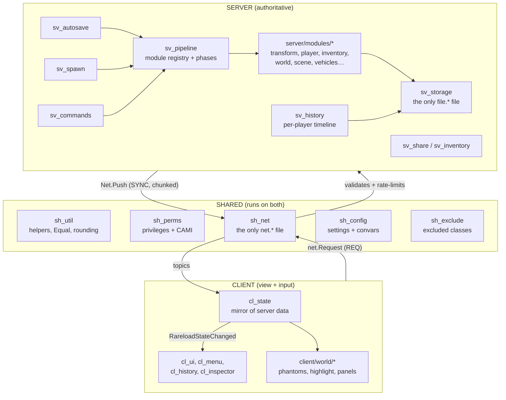
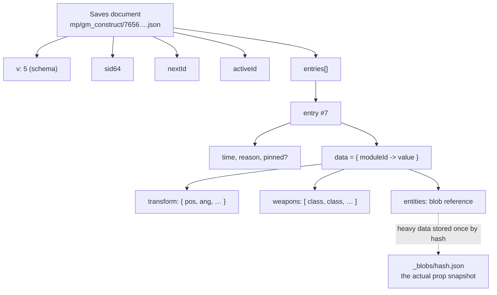
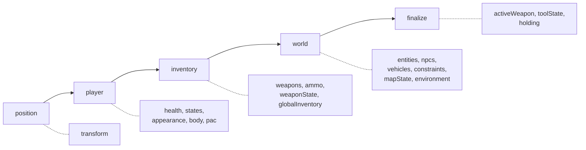
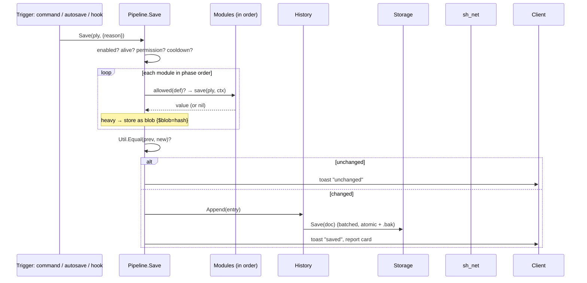
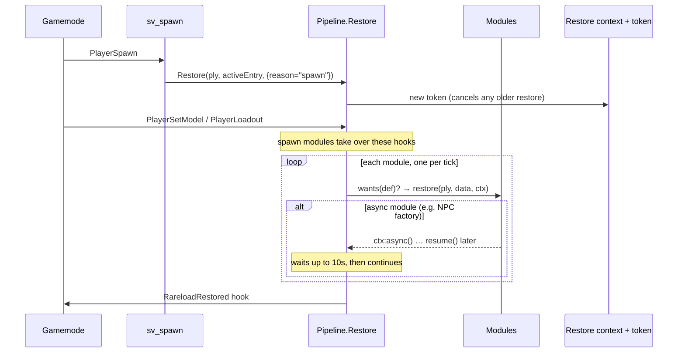
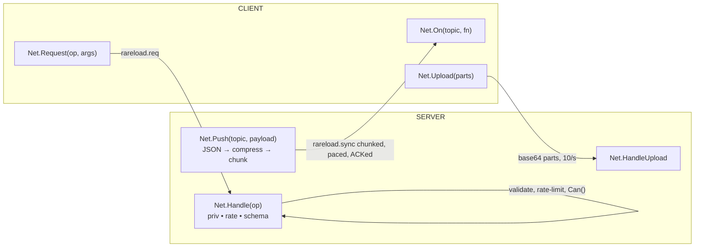
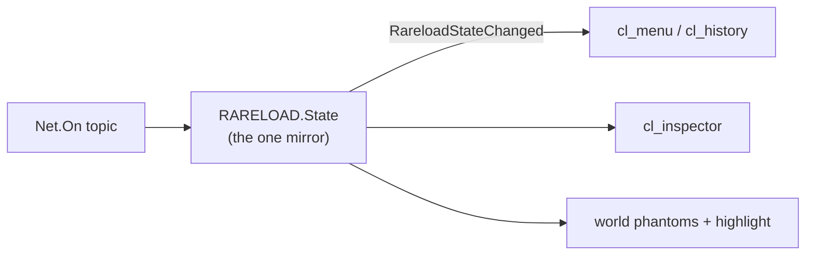
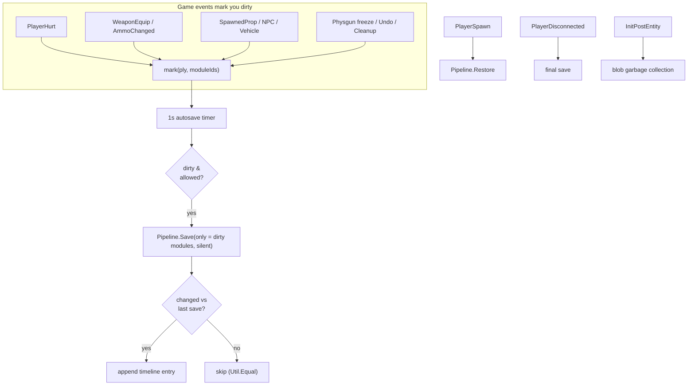

# Rareload — Position, Inventory, and World State for Garry's Mod

**Version 5.4**

Rareload remembers where you were, what you were carrying, and what you built — and
puts it all back when the map reloads. Close the game mid-build, come back
tomorrow, and spawn exactly where you left off, with your weapons, your props, your
NPCs and vehicles, even the time of day. It is a save-game system for Sandbox that
works per player, keeps a full timeline you can scrub through, and lets you export,
share and manage those saves.

---

## Table of contents

1. [What it does in game](#1-what-it-does-in-game)
2. [What it can capture](#2-what-it-can-capture)
3. [The big picture: client / server / shared](#3-the-big-picture-client--server--shared)
4. [The data schema](#4-the-data-schema-what-a-save-actually-is)
5. [The module pipeline](#5-the-module-pipeline-the-heart-of-rareload)
6. [Saving, step by step](#6-saving-step-by-step)
7. [Restoring, step by step](#7-restoring-step-by-step)
8. [The network layer](#8-the-network-layer-how-client-and-server-talk)
9. [Storage on disk](#9-storage-on-disk)
10. [What happens in the background](#10-what-happens-in-the-background)
11. [Settings and permissions](#11-settings-and-permissions)
12. [File map](#12-file-map)

---

## 1. What it does in game

- **Respawn where you left off.** When you die or the map reloads, you come back at
  your saved position, facing the saved direction, instead of at a map spawn point.
- **Keep your loadout.** Weapons, ammo, the active weapon, the selected tool and its
  settings, your health and armor.
- **Keep your build.** Props, ragdolls, NPCs, vehicles and the constraints between
  them are saved and spawned back for you — owned by you, welds and ropes intact.
- **A timeline, not a single slot.** Every save is an entry on a per-player timeline.
  Scrub back to any earlier state, pin the ones you want to keep, and restore the
  whole thing or just one part (just the position, just the inventory, …).
- **A world display.** With the Rareload tool out, you can see other players'
  respawn points and saved objects in the world, highlight them, and inspect them.
- **Move saves around.** Export a save to a file, import one, or offer a copy of your
  saves to another player on the server.
- **Admin control.** Server owners choose what may be saved, lock settings, block
  object classes, manage permissions, and (with the scene privilege) save and
  restore the map's own state — doors, time of day, weather, gravity.

Everything is gated: each capability is a **setting** (can I turn it off?) and a
**privilege** (am I allowed to do it?). A server can be as permissive or as locked
down as the owner wants.

---

## 2. What it can capture

Each row below is one **module**. A save holds whichever modules were allowed and
had something to record; the rest are simply absent.

| Area | Module(s) | What it holds |
|------|-----------|---------------|
| **Position** | `transform` | Position, angles, eye angle, duck/noclip movement |
| **Player** | `health`, `states`, `appearance`, `body`, `pac` | HP/armor; noclip, godmode, notarget, frozen, flashlight; model, skin, bodygroups, colors; speeds, jump, gravity, size, max HP/armor, FOV, suit power, fire; PAC3 outfit |
| **Inventory** | `weapons`, `ammo`, `activeWeapon`, `weaponState`, `globalInventory` | Carried weapons, ammo counts, the equipped weapon, weapon attachments (ARC9/ArcCW/TFA/MW), and an optional cross-map inventory |
| **Hands / tools** | `holding`, `toolState` | Object held with the use key; selected tool gun tool and its settings |
| **World** | `entities`, `npcs`, `vehicles`, `constraints` | Your props/ragdolls/ground weapons; NPCs with AI state, weapon, accuracy and relationships; vehicles with their networked values; welds, ropes and other links |
| **Scene** (admin) | `mapState`, `environment`, `worldSettings` | Map doors/buttons/breakables/movers; time of day, weather (StormFox2), sky, fog, sun; gravity, physics speed, AI switches |

> **Design rule:** new data is always a *new* module. Existing module shapes never
> change, so old saves keep loading and a server running an older Rareload simply
> ignores modules it doesn't understand. This is why the on-disk schema number has
> stayed at **5** across the whole 5.x line.

---

## 3. The big picture: client / server / shared

Rareload is split into three realms, loaded in a fixed order by
[`lua/autorun/rareload.lua`](lua/autorun/rareload.lua):



**Who owns what:**

- **The server is the single source of truth.** It runs the pipeline, owns the
  timeline, writes the files, and decides every permission. Nothing the client says
  is trusted — requests are validated against a schema, rate-limited and
  privilege-checked before they do anything.
- **The client is a view plus an input device.** It never reads files or saves
  anything itself. It holds one mirror of the server's data
  ([`cl_state.lua`](lua/rareload/client/cl_state.lua)) and the UI reads from that
  mirror, re-rendering when a `RareloadStateChanged` hook fires.
- **Shared code** is the contract both sides agree on: the list of settings and
  their types, the privilege names, the net opcodes and the validation schema. Both
  realms `include` the same five files so a setting or a permission means the same
  thing on both ends.

**The golden boundaries** (enforced by convention and reviewed):

| Concern | The *only* file allowed to touch it |
|---------|-------------------------------------|
| `net.*` (networking) | `sh_net.lua` |
| `file.*` (disk) | `sv_storage.lua` |
| Deciding what to save/restore and in what order | `sv_pipeline.lua` |
| Timers for deferred work | none — the pipeline's per-tick queue is used instead |

---

## 4. The data schema: what a save actually is

A player's saves on one map live in **one JSON document**, named by their SteamID64.
It is a timeline of **entries**; each entry is a bag of **module data**.



Key ideas:

- **`data` is keyed by module id.** A module that saved nothing is simply not a key.
  To restore, the pipeline walks its modules and hands each one `data[moduleId]`.
- **Heavy data is de-duplicated.** Big world snapshots aren't stored inline. They are
  hashed and written once as a *blob* (`_blobs/<hash>.json`); the entry just holds
  `{ "$blob" = "<hash>" }`. Ten saves of the same unchanged build share one blob
  file. A garbage collector removes blobs no entry references any more.
- **Stable values.** Floats are rounded and lists are sorted before comparison
  (`Util.Equal`), so an unchanged world compares equal — otherwise autosave would
  fire constantly and identical blobs would stop being shared.
- **A newer document is read-only.** If a file was written by a newer Rareload
  (`v` > 5), this version loads it but refuses to modify it.

The **network** shape is validated with a tiny schema language in `sh_net.lua`
(`Net.Validate`): each field is `"bool"`, `"number"`, `"uint"`, `"string"` or
`"string:<maxlen>"`, with a trailing `?` for optional. Unknown keys are dropped.
Every client request declares its schema; anything that doesn't match is rejected
before the handler runs.

---

## 5. The module pipeline: the heart of Rareload

Everything savable is a **module** registered with `RARELOAD.Module{…}`. The pipeline
([`sv_pipeline.lua`](lua/rareload/server/sv_pipeline.lua)) is the only place that
decides what runs and when. A module looks like this:

```lua
RARELOAD.Module({
    id          = "entities",
    phase       = "world",          -- one of: position, player, inventory, world, finalize
    heavy       = true,             -- store the result as a de-duplicated blob
    setting     = "keepEntities",   -- the player's on/off switch
    privSave    = "rareload_save_entities",
    privRestore = "rareload_restore_entities",

    save    = function(ply, ctx)        ... return data end,
    restore = function(ply, data, ctx)  ...            end,
    summary = function(data)            return "…" end,   -- one line for the report card
})
```

Modules run in a fixed **phase order**, and within a phase in dependency order
(`after`) then by id:



Why order matters: you must exist and have your body before you get weapons; props
must exist before the constraints that weld them; the active weapon is chosen last,
once every weapon is in hand.

Special module powers:

- **`replaces`** — the global inventory replaces the map's own weapons/ammo when it's
  in play, so they don't both apply.
- **`load`** — data that lives *outside* the per-map save (the global inventory in
  the player's PData). It restores even when there's no save on this map.
- **`empty`** — what an *exact* restore uses when the save has nothing for a world
  module: it removes those objects instead of leaving them.
- **`skipOnDeath`** — the scene (map/time/weather) is not re-applied on a respawn.
- **`spawn`** — a module that must run inside a gamemode spawn hook
  (`PlayerSetModel`, `PlayerLoadout`) instead of after it.

Third-party addons are never called directly. They go through **adapters**
(`matches` / `capture` / `apply`), each wrapped in `pcall`, so a renamed method in
ArcCW or StormFox can never break a save.

---

## 6. Saving, step by step

`Pipeline.Save(ply, opts)` is the single entry point. A manual save, an autosave, a
save-on-disconnect and a save-on-cleanup all go through it.



Guards before anything is captured: the gamemode must be supported, the player must
be enabled, alive, not spectating, have a SteamID, hold `rareload_save`, and not be
inside the 1-second manual cooldown. Any `RareloadCanSave` hook (PvP rules, server
policy) may also veto.

Each module's `save` runs under `xpcall`, timed, and its outcome becomes a line on
the **report card**. If a module errors, the last good value is kept (fail-soft).
Anything saved that the player won't be able to get back (a privileged state they
lack the restore permission for) is listed as *denied* and named in one toast.

---

## 7. Restoring, step by step

`Pipeline.Restore(ply, entry, opts)` walks the same modules and calls each one's
`restore`. The common case is a **respawn**: the gamemode's spawn hooks drive it.



What makes restore robust:

- **Tokens.** Every restore gets a token; starting a new one (or the player
  respawning again) invalidates the old one, so a slow async step from a stale
  restore can never apply to the current life.
- **Per-tick, never timers.** Deferred work goes on the pipeline's tick queue. Large
  builds are spread across ticks so a big restore doesn't hitch the server.
- **Async modules.** Things that finish later (NPC factories needing the map ready)
  call `ctx:async()` and resume when done; the pipeline waits, with a 10s timeout.
- **Modes.** `reset` puts still-present saved objects back the way they were; `exact`
  also removes objects the save doesn't contain (using each world module's `empty`);
  `only` restores a chosen subset (just position, just inventory).
- **The engine sometimes wins.** After a Source `loadgame` or a map transition the
  engine already rebuilt the world, so the first spawn skips the world modules.

---

## 8. The network layer: how client and server talk

All of it lives in [`sh_net.lua`](lua/rareload/shared/sh_net.lua) — two net strings,
`rareload.sync` (server → client) and `rareload.req` (client → server).



**Server → client (push).** The server compresses the JSON payload, splits it into
60 KB chunks, and sends at most one chunk-worth per client per tick, never exceeding
96 KB of unacknowledged data. The client ACKs each chunk; a newer push of the same
*key* (e.g. the latest timeline) replaces one still waiting in the queue; toasts jump
the queue as *urgent*. Clients announce `ready` on `InitPostEntity`, and nothing is
pushed before then.

**Client → server (request).** Every opcode is registered with `Net.Handle(op,
{priv, rate, args, fn})`. Incoming requests are rejected unless they pass the
privilege check, the per-op rate limit, and the argument schema. The client can't
make the server do anything it isn't allowed to.

**Uploads.** Payloads too big for one request (an exported save file) are sent as
compressed, base64-encoded parts, ten a second, one upload per player at a time,
with size caps.

**The client never parses the network directly.** Push handlers write into
[`cl_state.lua`](lua/rareload/client/cl_state.lua) and fire
`RareloadStateChanged(what, key)`. The UI listens to *that*, so rendering is
decoupled from transport.



---

## 9. Storage on disk

The only file that touches `file.*` is
[`sv_storage.lua`](lua/rareload/server/sv_storage.lua). Everything lives under
`garrysmod/data/rareload/`.

```text
data/rareload/
├─ mp/gm_construct/
│  ├─ 76561198....json        one document per player (their timeline)
│  ├─ 76561198....bak.json    atomic-write backup
│  └─ _blobs/
│     └─ <hash>.json          de-duplicated heavy snapshots
├─ sp/gm_flatgrass/           singleplayer saves (never mixed with mp)
├─ perms.json                 per-player privilege grants
└─ logs/
   └─ 2026-11-06.txt          one line per save/restore event
```

- **Atomic and batched.** Writes go to a `.tmp` file, the old file becomes `.bak`,
  then the temp is renamed into place — batched to at most one write every 0.5 s.
- **Self-healing.** A corrupt file is moved aside and the `.bak` copy is loaded
  instead.
- **SP and MP never mix.** Singleplayer and multiplayer saves are kept in separate
  folders.
- **Small per-player records** (reload-key mode, the global inventory) go in the
  engine's PData (`sv.db`), not loose files.

---

## 10. What happens in the background

Without you touching anything, Rareload is doing this:



1. **Autosave by dirtiness.** Game hooks (hurt, equip, spawn a prop, freeze, undo,
   cleanup…) mark only the *affected* modules dirty. A 1-second timer then does a
   **partial** save of just those modules — cheap, and it reuses the rest of the
   current entry.
2. **Unchanged saves are dropped.** If the new data equals the last entry it isn't
   appended, so your timeline doesn't fill with duplicates.
3. **Respawn restore.** On `PlayerSpawn` the active timeline entry is restored (unless
   you died and chose to skip restore on death).
4. **Save on leave.** A final save runs on disconnect and on map cleanup/shutdown so
   nothing is lost.
5. **Housekeeping.** On map load, blobs no entry references are garbage-collected;
   old log files are pruned.

The server also pushes state changes (new timeline rows, edited objects, other
players' respawn points) to the relevant clients so the menus and the world display
stay live without polling.

---

## 11. Settings and permissions

Two parallel systems, both declared in shared code so client and server agree.

- **Settings** (`RARELOAD.Setting`, [`sh_config.lua`](lua/rareload/shared/sh_config.lua))
  — *can I turn this off?* Each has a type, a category, a scope
  (`server` / `player` / `client`), a server default, and can be **locked** by the
  server so players can't override it. Player-scoped settings let each player pick
  their own value unless the key is locked.
- **Privileges** (`RARELOAD.Priv`, [`sh_perms.lua`](lua/rareload/shared/sh_perms.lua))
  — *am I allowed to?* Each has a tier (`user` / `admin` / `superadmin`). They
  register with **CAMI**, so ULX/ServerGuard/sam etc. manage them like any other
  permission. On servers with no admin mod, tiers and per-player grants are stored in
  `perms.json` and replicated convars. Anything that can grant power (godmode,
  scene changes, importing saves) defaults to `admin`.

Every module names both: a `setting` to switch it off and a `privSave`/`privRestore`
to gate it. The pipeline checks both before a module runs — a disabled module is
skipped silently, a forbidden one is reported.

---

## 12. File map

```text
lua/
├─ autorun/rareload.lua           loader: legacy-conflict check, include order
├─ rareload/
│  ├─ shared/
│  │  ├─ sh_util.lua              helpers, Util.Equal, rounding, PlayerKey
│  │  ├─ sh_perms.lua             privileges, tiers, CAMI, per-player grants
│  │  ├─ sh_net.lua              the only net.* file: push/request/upload
│  │  ├─ sh_config.lua            settings, convars, locks
│  │  └─ sh_exclude.lua           globally excluded classes
│  ├─ server/
│  │  ├─ sv_pipeline.lua          module registry, phases, save/restore engine
│  │  ├─ sv_storage.lua           the only file.* file: JSON docs + blobs
│  │  ├─ sv_history.lua           per-player timeline, entries, pinning
│  │  ├─ sv_snapshot.lua          prop/NPC/vehicle world snapshots
│  │  ├─ sv_autosave.lua          dirty-tracking autosave
│  │  ├─ sv_spawn.lua             respawn restore + save on leave
│  │  ├─ sv_commands.lua          the "rareload …" console commands
│  │  ├─ sv_share.lua / sv_inventory.lua   export, import, share, inventory mgmt
│  │  ├─ sv_antistuck.lua         unstick restored positions
│  │  ├─ sv_pvp.lua               PvP save rules and restore cooldown
│  │  └─ modules/                 one file per capture area
│  └─ client/
│     ├─ cl_state.lua             the one mirror of server data
│     ├─ cl_ui.lua / cl_menu.lua  the Rareload menu
│     ├─ cl_history.lua           the timeline UI
│     ├─ cl_inspector.lua         object inspector
│     ├─ cl_inventory.lua         inventory manager
│     └─ world/                   in-world phantoms, highlight, panels
└─ weapons/gmod_tool/stools/rareload_tool.lua   the Rareload tool gun
```

---

### A one-paragraph summary

Rareload is a per-player save system for Sandbox. The **server** is authoritative: a
**pipeline** of small **modules** (position, player, inventory, world, scene) captures
state in a fixed phase order into a JSON **timeline**, de-duplicating heavy snapshots
as content-hashed blobs, written atomically to disk. **Shared** code defines the
settings, privileges and network schema both sides trust. The **client** never
touches files or the raw network — it holds one mirror of the server's data and
renders from it, sending only validated, rate-limited, permission-checked requests.
In the background, game events mark modules dirty, a 1-second autosave records just
what changed, and respawns restore the active entry — so you always come back exactly
where, and as, you left off.
